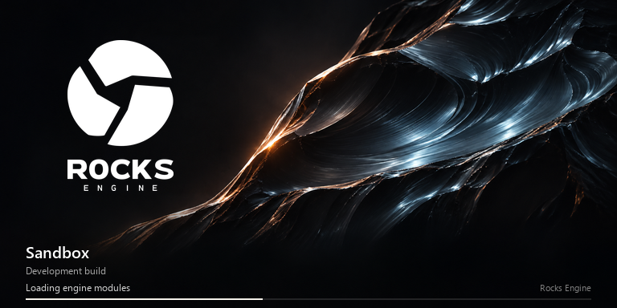
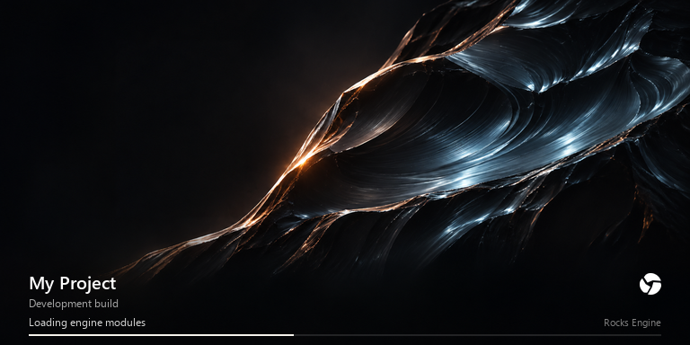

# 시작 화면(스플래시) — 12. 기본 이미지와 템플릿

[목차](README.ko.md)

## 12. 기본 이미지와 템플릿

| 파일 | 용도 | 그림 |
|---|---|---|
| `Engine/Content/Splash/StudioSplash.png`·`@2x` | Studio | 구릿빛 모서리가 있는 흑요석 배경, 왼쪽에 흰색 스택형 로고, 아래 96 px 띠는 비움 |
| `Engine/Content/Splash/Splash.png`·`@2x` | 자기 이미지가 없는 게임·엔진 창 프로그램(Sandbox) | Studio와 같은 그림(같은 파일 내용). 게임 이름은 엔진이 띠에 그린다 |
| `Templates/Game/Foundation/Content/Splash/Splash.png`·`@2x` | 새 프로젝트의 기본(바꿔 쓰라는 자리표시) | 같은 흑요석 배경, 띠 오른쪽 위에 작은 흰색 심볼("Rocks로 만듦"), 제목은 엔진이 프로젝트 이름으로 그림 |

엔진이 그릴 글자 칸(6.2절 기본 배치)을 얹은 모의 화면이다(1x, 생성기 `mockup.py` — 실제 엔진 출력이 아니다).

- 논리 크기 768×384(2:1), `@2x`는 1536×768이다. sRGB 8-bit RGB PNG, alpha 없음. 개정 3에서 16:9(768×432)를 높이가 길다는 사용자 의견으로 2:1로 낮췄다. 글자 칸은 이미지 아래 기준이라 코드는 그대로다.
- **배경 원본**은 `Assets/Branding/Splash/Obsidian.png`(1774×887, 로고 없는 그림)다. 개정 6에서 사용자가 준 생성형 AI(ChatGPT) 그림으로 바꿨다(이전: 생성기로 그린 지형 등고선·사암 계곡). 생성기는 이 원본을 1x·`@2x` 크기로 각각 줄인다(키우지 않는다).
- 브랜드 지침(`Assets/Branding/README.md`)을 지킨다: 로고는 SVG 마스터에서 뽑은 흰색 PNG(`Assets/Branding/PNG`)를 크기마다 한 번에 최종 크기로 줄여 얹고 형상·비율을 바꾸지 않는다. 스택형은 지침의 "Splash screen" 용도이고, 가로형 로고 최소 폭(240 px)보다 작은 자리(템플릿 띠)는 심볼만 쓴다. 로고에 그라데이션·그림자를 쓰지 않는다. 여백은 지침 5절의 x(= H/8) 이상이다 — 스택 로고(높이 188)는 가운데 (150, 144), 왼쪽 끝 약 84 px(사용자 의견 "좌측으로 좀더"로 200에서 옮김).
- 아래 96 px 글자 띠는 어둡다(평균 밝기 약 0.03 — 6.2절 이미지 약속). 템플릿 심볼(높이 24, 가운데 (724, 316))은 저작권 칸보다 위다.
- 생성기는 `Assets/Branding/Splash/`(`make_splash.py <저장소> <출력 폴더> studio|game|template`, `mockup.py`, Python 3 + Pillow)이다. 같은 원본으로 다시 돌리면 같은 결과가 나온다. 이미지를 바꿀 때 생성기·원본과 결과를 함께 커밋한다.
- 템플릿은 PNG를 그대로 복사한다(`replaceInExtensions`에 없는 확장자 — `NewProjectCommand`가 `File.Copy`).
