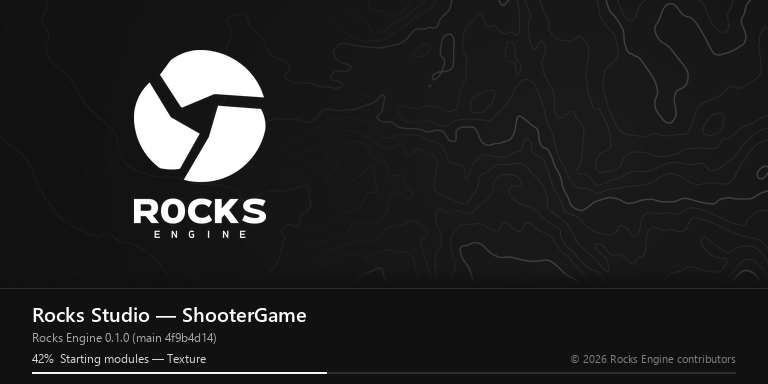

# 시작 화면(스플래시) — 12. 기본 이미지와 템플릿

[목차](README.ko.md)

## 12. 기본 이미지와 템플릿

| 파일 | 용도 | 그림 |
|---|---|---|
| `Engine/Content/Splash/StudioSplash.png`·`@2x` | Studio | Rocks Black 바탕, 왼쪽에 흰색 스택형 로고, 오른쪽으로 갈수록 드러나는 지형 등고선(암석 지층 모티프), 아래 96 px 띠는 비움 |
| `Engine/Content/Splash/Splash.png`·`@2x` | 자기 이미지가 없는 게임·엔진 창 프로그램(Sandbox) | 같은 등고선 바탕, 가운데 흰색 심볼, 게임 이름은 엔진이 띠에 그림 |
| `Templates/Game/Foundation/Content/Splash/Splash.png`·`@2x` | 새 프로젝트의 기본(바꿔 쓰라는 자리표시) | 해 질 녘 사암 뷰트·바위기둥 계곡 key art, 띠 오른쪽에 작은 흰색 심볼("Rocks로 만듦"), 제목은 엔진이 프로젝트 이름으로 그림 |

엔진이 그릴 글자 칸(6.2절 기본 배치)을 얹은 모의 화면이다(1x, 생성기 `mockup.py` — 실제 엔진 출력이 아니다).

- 논리 크기 768×384(2:1), `@2x`는 1536×768이다. sRGB 8-bit PNG, alpha 없음. 개정 3에서 16:9(768×432)를 높이가 길다는 사용자 의견으로 2:1로 낮췄다. 글자 칸은 이미지 아래 기준이라 코드는 그대로다. 템플릿 그림은 432 높이 구도로 그린 뒤 위쪽 하늘 48 px를 잘라 낸다.
- 브랜드 지침(`Assets/Branding/README.md`)을 지킨다: 로고는 SVG 마스터에서 뽑은 흰색 PNG를 한 번에 최종 크기로 줄여 얹었고 형상·비율을 바꾸지 않았다. 스택형은 지침의 "Splash screen" 용도이고, 가로형 로고 최소 폭(240 px)보다 작은 자리(템플릿 띠)는 심볼만 쓴다. 로고에 그라데이션·그림자를 쓰지 않는다(배경의 아주 약한 빛 웅덩이는 로고가 아니라 바탕이다). 여백은 지침 5절의 x(= H/8) 이상이다.
- 생성기는 `Assets/Branding/Splash/`(`make_splash.py`·`template_art.py`·`mockup.py`, Python 3 + numpy + Pillow)이다. 등고선과 지형은 고정 시드로 만들어 다시 돌려도 같은 그림이 나온다. 이미지를 바꿀 때 생성기와 결과를 함께 커밋한다.
- 템플릿은 PNG를 그대로 복사한다(`replaceInExtensions`에 없는 확장자 — `NewProjectCommand`가 `File.Copy`).
