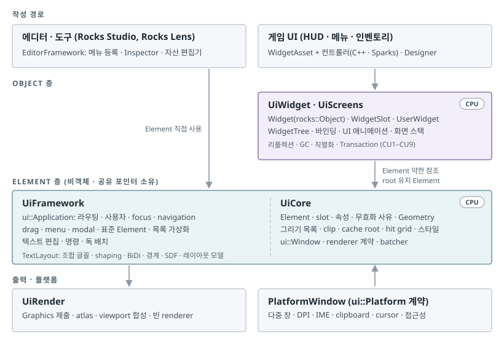
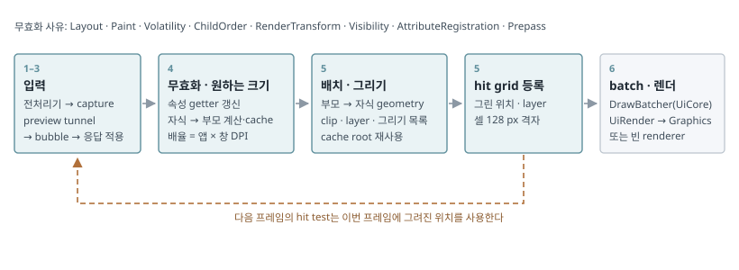

# UI 툴킷 — 게임 UI와 에디터의 단일 UI 체계

UE 5.8의 두 층 UI 구조(비객체 Element 층 + Object Widget 층)를 Rocks Core 위에 재구현

**설계 기준일 2026.11.22 · 초안 2.5 · 상태: 설계 제안 / 결정 UD1–UD12 확정, UD15는 `NotPlaceable`만 확정, UD13–UD17 권장안 · 미구현(UI 코드 없음, 스펙만 존재)**

Rocks의 게임 UI와 에디터(Rocks Studio)는 하나의 UI 툴킷을 사용한다. 구조는 UE 5.8의 UI 체계를 그대로 따른다. 하위 층은 Object가 아닌 경량 Element로 레이아웃·그리기·입력·focus·텍스트를 처리하고, 상위 층은 `rocks::Object`인 Widget이 Element를 감싸 에셋·리플렉션·GC·자체 언어 바인딩·Designer 편집을 제공한다. 에디터는 Element 층을 직접 사용하고, 게임 UI는 Widget 층으로 작성한다. 기본 스타일과 룩도 최초 구성에서는 UE 5.8의 기본값을 따른다(4.2절).

초안 1.0(2026.11.11)의 단일 층 설계는 검토 결과 기준 구조로 삼지 않기로 하였다. 변경 내역은 12절에 기록한다.

| 항목 | 내용 |
|---|---|
| 기준 문서 | [전체 구현 계획](EngineImplementationPlan.ko.md) 개정 1.9 · [Core·Object·Input 상세 구현 계획](CoreObjectInputDetailedPlan.ko.md) · [Clang 생성 Reflection](../Implementation/ReflectionMetadata.ko.md) · [리플렉션 B9](ReflectionExtensions.ko.md) · [Sparks 언어 설계](SparksLanguage/README.ko.md) |
| UE 기준 | 로컬 클론 `C:\github\UnrealEngine` 5.8.4-release(commit `f45729c0b6f0`). 이 문서의 UE 경로는 `Engine/Source/` 기준 상대 경로이며, 행 번호는 해당 클론의 값이다 |
| Rocks 상태 | UI·TextLayout·UiRender 코드 없음. Core·Object·리플렉션 구현 중. `PlatformWindow`은 Win64 단일 창(DPI·IME·clipboard·cursor 없음) |
| 이름 | Rocks 고유 이름을 사용한다(UD12). UI 계층 매크로는 `ROCKS_UI_` 접두. UE 이름(모듈·타입·매크로)은 대응표와 근거 열에만 적는다 |
| UE 원본 취급 | UE 소스는 구조·동작 확인을 위한 열람·대조에만 사용하고 코드를 옮기지 않는다. Epic 저작 자원(아이콘·이미지·`Engine/Content`)은 포함하지 않는다 |
| 식별자 | 단계 UT0–UT6, Core 선행 계약 CU1–CU9, Core·플랫폼 보강 CB1–CB4·PW1–PW8, 검증 UV1–UV9, 위험 UR1–UR8, 결정 UD1–UD17 |

## 요약

1. **구조:** UE 5.8과 같은 두 층이다. Element 층(UiCore·UiFramework·TextLayout)은 공유 포인터로 소유되는 비객체 트리이고, Widget 층(UiWidget)은 Element를 감싸는 Object다. 배치 속성은 부모·자식 관계인 slot에 둔다(UD1·UD2 확정).
2. **프레임:** 입력 라우팅 → 원하는 크기 계산(자식 → 부모) → 배치(부모 → 자식)와 그리기 목록 기록 → 그리기 중 hit grid 갱신 → batch → Render lane 제출 순서다(3.4절). UE와 같이 기본은 매 프레임 전체를 다시 계산하는 경로이며, 무효화 사유 플래그는 cache root 안에서 작업을 줄인다.
3. **에디터:** 독·명령·메뉴 기반·Inspector·Transaction·viewport를 UE 에디터와 같은 분담으로 구성한다(6절). 독·명령은 런타임 층(UiFramework), Object 모델에 닿는 Inspector·Transaction·자산 편집기·메뉴 등록은 에디터 전용(EditorFramework)이다.
4. **기본 룩:** 최초 구성의 색·글꼴·크기·여백·모서리 규칙은 UE 5.8 기본 스타일 값과 같게 맞춘다. 글꼴은 UE와 같은 공개 글꼴을 원 배포처에서 받고, 아이콘은 Epic 자원을 쓰지 않는다(UD10).
5. **현 단계:** Core 작업 중 Widget 층과 에디터가 의존하는 리플렉션 계약 CU1–CU9를 확정한다(7절). UiCore·UiFramework는 창·GPU 없이 시험할 수 있으므로 Foundation Gate 직후 RHI와 병행 착수한다(9절). 검증은 UE 5.8 소스 근거를 단 고정 기준값으로 수행한다(8절).

## 1. 방향과 원칙

### 1.1 형태 결정

| 안 | 내용 | 판단 |
|---|---|---|
| A · 단일 층(초안 1.0) | widget = Object 한 층, 테마 상속·자식 widget 배치 속성 | 검토 결과 기준 구조로 삼지 않음(2026.11.16) |
| B · UE 두 층 구조 재구현 | 비객체 Element 층 + Object Widget 층. 레이아웃·입력·무효화·텍스트·스타일·에디터 분담을 UE 5.8과 같게 구성 | **채택** |
| C · 웹 에디터 + 별도 게임 UI | 개정 1.3 이전 계획 | 제외(개정 1.4) |

B를 채택하는 근거는 다음과 같다.

- **에디터 규모의 비용:** 에디터는 Element 수가 많고 대부분 영속 데이터가 아니다. 비객체 층이면 GC mark·리플렉션 등록 비용 없이 레이아웃·그리기를 처리한다. UE 에디터 전체가 이 층으로 작성되어 있어 규모 검증이 끝난 구조다.
- **게임 UI의 편집성:** 게임 UI는 에셋 저장·Designer 편집·자체 언어 바인딩·Undo가 필요하다. 이 요구는 Object 층이 리플렉션·직렬화·Transaction으로 해결하며, 비용은 게임 UI 규모에서만 발생한다.
- **검증 가능한 기준:** 동작 계약(무효화 사유·배치 규칙·라우팅 순서·focus 이동·텍스트 경계)을 UE 5.8 소스의 행 단위 근거로 고정할 수 있다(8절).

### 1.2 원칙

- **구조는 UE, 이름은 Rocks:** UE의 층 구성·생명 주기·처리 순서는 그대로 따른다. 모듈·타입·매크로 이름은 Rocks 관례로 짓는다(UD12).
- **Rocks Core 관례 우선:** 소유는 Core `SharedPtr`·`SharedRef`·`WeakPtr`, 콜백은 Core `Delegate`, 할당 실패는 `Result`로 전달한다. 전역 singleton 대신 세션 범위 객체(`ui::Application`)가 스타일 등록부·사용자·창을 소유하고 주입한다(전체 계획 1절).
- **UE와 다르게 하는 부분은 근거와 함께 표시:** Blueprint 의존 기능(Widget Blueprint 그래프·변환 함수 그래프·CDO 공유 자료), 실행 중 해석하는 문자열 조건, 폴링 바인딩, 중첩 tick modal은 Rocks에서 대체한다. 대체 지점은 각 절의 「UE와 다른 점」에 적는다.
- **UE 원본 취급:** UE 소스 코드는 저장소에 포함하거나 옮기지 않는다([플랫폼 계층](PlatformLayer.ko.md)의 UE 대조 방식과 같다). 수치 기본값(색·크기·여백)은 대조하여 같은 값으로 설정하되 코드는 새로 작성한다.
- **한도 값:** UE 동작에서 가져온 한도(FillContent 반복 5회, hit grid 셀 128 px, 테마 사용자 색 16개 등)는 구현에서 이름 있는 상수로 둔다.

## 2. 계층 구조와 모듈

그림 1. 에디터는 Element 층을 직접 사용하고 게임 UI는 Widget 층을 사용한다. 두 경로가 같은 레이아웃·그리기·입력 처리를 공유한다. UiCore·UiFramework·UiWidget까지 CPU만으로 시험할 수 있다는 점이 9절의 착수 순서를 결정한다.

| Rocks 모듈 | UE 5.8 대응 | 위치 | 직접 의존 | 책임·금지 |
|---|---|---|---|---|
| UiCore | `Runtime/SlateCore` | `Engine/Source/Runtime/UiCore` | Core·Task·TextLayout(글꼴 계약) | Element·slot·자식 목록·속성·무효화·Geometry·그리기 목록·clip·cache root·hit grid·스타일·`ui::Window`·renderer 계약·batcher. Object·Graphics·PlatformWindow 의존 금지 |
| UiFramework | `Runtime/Slate` | `Engine/Source/Runtime/UiFramework` | UiCore·TextLayout·Input(이벤트 형식) | `ui::Application`(입력 라우팅·사용자·focus·navigation·drag/drop·tooltip·menu·modal), 표준 Element(패널·텍스트·편집·목록 가상화·스크롤·메뉴·`RetainedPanel`), 명령·단축키, 독 배치와 저장. Object·UiRender 의존 금지 |
| TextLayout | `SlateCore/Fonts` + `Slate/Framework/Text` + Core ICU | `Engine/Source/Runtime/TextLayout` | Core·Localization(없는 동안 culture 주입). FreeType·HarfBuzz·ICU·msdfgen은 ClientOnly `TextLayoutBackend`가 쓰고 backend 표로 연결한다([글꼴 설계](Font/03-Modules.ko.md) 3장 — 서버 타깃 제외, BD25) | 글꼴·조합 글꼴·shaping·BiDi·줄/grapheme 경계·글리프 캐시·SDF·텍스트 레이아웃 모델. library 타입 비공개 |
| UiRender | `Runtime/SlateRHIRenderer` · `SlateNullRenderer` | `Engine/Source/Runtime/UiRender` | UiCore renderer 계약·Graphics(RHI)·Task | batch 데이터의 Render lane 제출·atlas texture·render target·viewport 합성·SVG 래스터 결과 업로드. 빈 renderer(headless) 포함. Element 순회 금지 |
| UiWidget | `Runtime/UMG` + `Runtime/FieldNotification` + MVVM 플러그인 | `Engine/Source/Runtime/UiWidget` | ObjectRuntime·MetaSchema·UiFramework | Widget·slot 객체·UserWidget·WidgetTree·WidgetAsset·Widget 풀·바인딩·UI 애니메이션·화면 layer 등록 interface. World·LocalPlayer 의존 금지 |
| UiScreens | CommonUI · CommonInput 플러그인 | `Engine/Source/Runtime/UiScreens` | UiWidget·Input(action) | 화면 스택·입력 라우터·입력 모드·뒤로 가기·focus 복원·입력 장치 종류 전환·플랫폼별 버튼 아이콘. UE에서 플러그인인 만큼 선택 모듈이며, 게임이 쓰지 않으면 링크하지 않는다 |
| PlatformWindow | `Runtime/ApplicationCore` | 기존 모듈 확장 | Core·PlatformBase·window SDK | 다중 창·DPI·IME·clipboard·cursor·OS drag/drop·접근성 provider(PW1–PW8) |
| EditorFramework | `Editor/UnrealEd` 일부 · `PropertyEditor` · `EditorStyle` · `Developer/ToolMenus` | `Engine/Source/Editor/Framework` | UiFramework·UiWidget·EditorBackend | 셸·자산 편집기 host·메뉴 등록·Inspector·Transaction 연결·에디터 스타일·EditorViewport·곡선/타임라인 Element. 그래프 편집 화면은 GraphView 모듈이다. Shipping 링크 금지 |
| GraphView | `Editor/GraphEditor` | `Engine/Source/Editor/GraphView` | UiFramework·EditorFramework·NodeGraph·NodeGraphTools·SpatialIndex(2D 격자) | 노드 그래프 편집 화면: 캔버스·노드·핀 시각·연결선·노드 메뉴·주석·diff 화면([노드 그래프](NodeGraph/11-ModulesAndView.ko.md) 11절). 그래프 데이터·변경·undo·복사는 `NodeGraph`(Runtime)·`NodeGraphTools`(Developer) 소유이고, 도메인 schema·노드 서술은 각 도구 소유다. 도메인 모듈 의존 금지, Shipping 링크 금지 |
| WorldIntegration | `UWidgetComponent` · `UGameViewportSubsystem` · `SGameLayerManager` | 기존 계획 | World·UiWidget | game viewport의 화면 layer와 LocalPlayer별 layer, World 정리 연동, 월드 공간 Widget·가상 사용자 상호작용, 기본 입력 모드 |

모듈 의존 방향은 전체 계획 3.1절을 따른다. UiCore·UiFramework는 Object·Graphics·World·PlatformWindow에 직접 의존하지 않는다. OS 창·clipboard·cursor·IME는 `ui::Platform` 계약(UE `GenericApplication` 대응)으로 주입받으며 CPU 시험에서는 가짜 구현을 주입한다. UE에서는 독·명령·layout 저장이 런타임 `Slate` 모듈에 있고 Rocks도 같은 위치(UiFramework)에 둔다. 도구 프로그램(Rocks Lens 등)이 에디터 없이 독을 사용하기 때문이다. Shipping 게임은 독·명령 코드를 참조하지 않으므로 링크에서 제외된다.

## 3. Element 층

### 3.1 객체 모델과 소유

| Rocks | UE 5.8 대응 | 계약 |
|---|---|---|
| `ui::Element` | `SWidget`(`SlateCore/Public/Widgets/SWidget.h:167`) | 원하는 크기 계산(layout 배율 인자)·자식 배치·그리기의 세 가상 함수와 자식 목록 조회. 공통 속성: tooltip·cursor·visibility·enabled·clip·pixel snapping·흐름 방향 선호·render transform·render opacity·접근성·tag |
| `ui::LeafElement` · `CompoundElement` · `PanelElement` | `SLeafWidget` · `SCompoundWidget` · `SPanel` | 자식 없음 · 자식 slot 1개 · 다수 slot. 패널은 자식을 같은 layer에서 그리고 최대 layer를 반환한다(`SlateCore/Private/Widgets/SPanel.cpp:18-43`) |
| `ui::NullElement` | `SNullWidget::NullWidget` | 빈 slot을 채우는 공유 Element. 부모를 가질 수 없다 |
| `ui::ElementSlot` · slot 기능 조합 | `FSlotBase`(`SlateCore/Public/SlotBase.h`) · `TSlotBase` · `Layout/BasicLayoutWidgetSlot.h`의 정렬·여백·크기 mixin | slot이 자식을 강하게 소유한다. 정렬·여백·크기 규칙은 조합 가능한 slot 기능으로 제공 |
| `ui::ElementChildren` 계열 | `FChildren` · `TPanelChildren` · `TSingleWidgetChildrenWithBasicLayoutSlot` 등 | 자식 없음·단일·다수·slot 없는 목록·약한 자식의 변형 |

- **소유:** 부모는 slot 안의 `SharedRef<Element>`로 자식을 강하게 소유하고, 자식은 부모를 `WeakPtr`로 가리킨다(UE `SlotBase.h:115`, `SWidget.h:2012`). 명시적 파괴 함수는 없으며 마지막 강한 참조가 해제될 때 파괴된다. slot 제거 시 부모 연결을 끊고 부모에 `ChildOrder` 무효화를 보낸다(`SWidget.cpp:761-788`).
- **파괴 시 정리:** 활성 timer 해제, 접근성 통지, cache root에서 제거, 캐시된 그리기 목록 제거(`SWidget.cpp:278-337`).
- **active timer:** Element가 등록하는 주기 콜백이며, 그리기 단계에서 Tick보다 먼저 실행된다(`SWidget.cpp:1497`). 입력이 없는 프레임에 UI 갱신을 계속할지 판정(UE의 sleep 판정)하는 근거가 된다.
- **할당 실패:** Core `SharedPtr::TryMake`는 실패 가능한 할당이다. 선언적 생성 중 실패는 트리 전체의 `Result`로 전파한다(UD9).

### 3.2 선언적 생성

UE는 `SNew`/`SAssignNew`, 인자 구조체 매크로(`SLATE_BEGIN_ARGS`·`SLATE_ATTRIBUTE`·`SLATE_ARGUMENT`·`SLATE_EVENT`·`SLATE_NAMED_SLOT`·`SLATE_SLOT_ARGUMENT`), slot 연산자 체인(`+ Slot() [ ... ]`)으로 트리를 선언하고, 속성의 무효화 사유는 클래스별 등록 함수에 따로 적는다(`SlateCore/Public/Widgets/DeclarativeSyntaxSupport.h:37-45, 63-460`, `SlateControlledConstruction.h:19-44`). 생성 순서는 공통 인자 적용 → 사용자 `Construct` → 속성 초기 갱신(선택, 기본 꺼짐) → volatility 계산 → 생성 완료 표시다(같은 파일 668, 981–991행).

Rocks는 같은 생성 순서와 표현력(값·바인딩 인자, slot이 배치 속성을 소유, 속성별 무효화 사유)을 유지하되 매크로·연산자 체인·등록 함수·코드 생성 없이 C++23 문법으로 선언한다(UD5 확정).

~~~cpp
class LabeledButton : public ui::CompoundElement {
public:
    using Super = ui::CompoundElement;   // RTTI 없는 형식 판정(CB2)에 쓴다.

    // 인자: 매크로 없는 일반 구조체. 필드 순서는 내용 → 모양 → 동작 → 이벤트로 고정한다.
    struct Args {
        ui::Bindable<Text> label;                   // 값 또는 바인딩
        const ui::ButtonStyle* style = nullptr;     // nullptr이면 활성 스타일의 기본값
        ui::ClickedDelegate onClicked;
    };

    // 실패하면 트리 전체의 생성 결과가 오류가 된다(UD9).
    Result<void> Construct(const Args& args) noexcept;

private:
    // 무효화 사유는 형식에 둔다. 등록 표·매크로·코드 생성이 필요 없다.
    ui::ElementAttribute<Text, ui::Invalidate::Layout> label_;
};

// 사용: 트리 모양이 그대로 보이고 연산자 오버로딩이 없다.
Result<SharedRef<ui::VerticalStack>> panel = ui::Build<ui::VerticalStack>({
    .slots = {
        { .size = ui::Auto, .padding = 4,
          .content = ui::Make<ui::TextLabel>({ .text = title }) },
        { .size = ui::Fill(1.0f),
          .content = ui::Make<ui::ListView<ItemRef>>({
              .items = &items,
              .onGenerateRow = ui::Bind(this, &InventoryPanel::MakeRow) }) },
    },
});
~~~

| 요소 | 규칙 | UE 5.8 대응 |
|---|---|---|
| 인자 구조체 `T::Args` | 일반 aggregate 구조체. 값·바인딩 인자는 `ui::Bindable<T>`, 이벤트는 Core `Delegate`, 스타일은 항목 포인터. 필드 순서는 내용 → 모양 → 동작 → 이벤트 | `SLATE_BEGIN_ARGS` 계열 매크로 |
| `ui::Make<T>(const typename T::Args&)` | 인자 형식을 추론하지 않는 매개변수라 중괄호 오류가 구조체 초기화 오류(예: `Args`에 없는 멤버)로 짧게 보고된다. 즉시 할당하여 「Element 또는 오류」를 담은 값을 돌려준다. 이 값은 참조 계수 복사이므로 중괄호 목록에 넣을 수 있다 | `SNew` · `SAssignNew` |
| `ui::Build<T>(...)` | 트리에서 첫 오류를 찾아 전체를 `Result` 하나로 반환하고, 실패 시 만든 부분 트리를 모두 해제한다(UD9) | — |
| slot 인자 | 패널마다 slot 인자 구조체(`.size`·`.padding`·`.align`·`.content` 등). 패널 인자의 `.slots` 목록 | `SLATE_SLOT_ARGUMENT` · `+ Slot()[...]` |
| `ui::ElementAttribute<T, 사유[, 변경 후 처리]>` | 사유는 형식 인자, 변경 후 처리는 선택적 멤버 함수 형식 인자. 바인딩된 getter만 바인딩 시점에 Element별 목록에 등록하고, 갱신 순서는 멤버 선언 순서(객체 안 위치)다 | `TSlateAttribute` + `SLATE_ADD_MEMBER_ATTRIBUTE_DEFINITION` |
| `using Super` | 부모 형식 선언. Element 형식 정보와 정적 형 변환에 쓴다 | `SLATE_DECLARE_WIDGET` |

남는 제약은 designated initializer의 필드 선언 순서 하나다. Rocks 빌드는 MSVC `/WX`와 clang `-Wpedantic -Werror`를 쓰므로 순서가 틀리면 컴파일 오류가 된다(`Programs/Rocks.Build/ActionGraph.cs:397, 438`). 필드 순서 규칙과 IDE 자동완성(선언 순서 표시)으로 부담을 줄인다. UI 계층에 매크로가 필요해지면 이름은 `ROCKS_UI_` 접두로 짓는다(UD12).

### 3.3 속성과 무효화

UE 5는 `TAttribute`(값 또는 매 호출 getter)와 Element 멤버 속성 `TSlateAttribute`(클래스별 등록, 무효화 사유 포함)를 구분한다. `TSlateAttribute`의 getter는 보이는 Element에 한해 원하는 크기 계산 단계에서 프레임당 한 번 호출되고, 비교 결과 값이 바뀐 경우에만 등록된 사유로 무효화된다(`SlateCore/Public/Types/SlateAttribute.h:23-161`, `Types/Attributes/SlateAttributeBase.inl:257-364`). 바인딩된 getter만 Element별 목록에 등록된다(`Types/SlateAttributeMetaData.h:102`). Rocks는 같은 두 형태를 둔다.

| Rocks | UE 5.8 대응 | 계약 |
|---|---|---|
| `ui::Bindable<T>` | `TAttribute<T>` | 값 또는 getter delegate. 인자 전달용이며 Element 멤버로 오래 보관하지 않는다 |
| `ui::ElementAttribute<T>` | `TSlateAttribute<T>` · `TSlateManagedAttribute` · `TSlateAttributeRef` | Element 멤버. `Set`은 getter를 해제하고 값이 다르면 무효화, `Assign(Bindable)`은 바인딩이면 등록·값이면 설정. 등록 순서대로 갱신하고 선행 관계를 지정할 수 있다 |
| 속성 등록 | `SLATE_DECLARE_WIDGET` · `FSlateAttributeDescriptor` · `SLATE_ADD_MEMBER_ATTRIBUTE_DEFINITION` | 사유·변경 후 처리를 멤버 형식에 둔다(3.2절). 별도 등록 함수가 없다 |

무효화 사유(UE `EInvalidateWidgetReason`, `SlateCore/Public/Widgets/InvalidateWidgetReason.h:13-69`)와 처리 규칙. 정규화는 `SWidget::Invalidate`(`SWidget.cpp:1306-1368`), 사전 처리와 부모 전파는 cache root(`SlateInvalidationRoot.cpp:1055-1066`, `FastUpdate/WidgetProxy.cpp:114-184`)를 따른다.

| Rocks `InvalidateReason` | 의미 | 처리 규칙 |
|---|---|---|
| `Layout` | 원하는 크기가 바뀜 | 다시 계산한 크기가 실제로 바뀐 경우에만 부모로 `Layout` 전파 |
| `Paint` | 다시 그리기만 | — |
| `Volatility` | volatility 재계산 | `Paint` 추가 |
| `ChildOrder` | 자식 추가·제거 | `Prepass`·`Layout` 추가 |
| `RenderTransform` | render transform 변경 | 원하는 크기 변화와 무관하게 부모 `Layout` |
| `Visibility` | 보이기 변경 | 사전 단계에서 가시성 상태를 갱신한 뒤 `RenderTransform`으로 처리 |
| `AttributeRegistration` | 속성 바인딩 등록·해제 | 사전 단계에서 처리 |
| `Prepass` | 하위 원하는 크기를 다시 계산 | `Layout` 추가 |

layout 배율이 아직 정해지지 않은 Element의 무효화는 `Prepass`·`Layout`으로 강제된다(`SWidget.cpp:1329`). 예를 들어 텍스트 Element의 `SetText`는 `Layout`으로 등록된 속성에 값을 대입하는 한 줄이며, 값이 같으면 아무 일도 일어나지 않는다(`Slate/Private/Widgets/Text/STextBlock.cpp:245-251, 47-48`).

**기본 경로:** UE 기본 설정(창 전체 cache 꺼짐)에서는 창마다 매 프레임 전체 원하는 크기 계산·그리기·hit grid 재구성을 수행한다(`SWindow.cpp:1118`, `SlateInvalidationRoot.cpp:391-399`, `SWidget.cpp:684`). 무효화 사유가 작업을 줄이는 곳은 cache root(3.6절) 안이다. Rocks도 같은 기본값에서 출발한다(UD11).

**UE와 다른 점:** Element 층은 UE와 같다. Widget 층의 폴링 바인딩(UE의 속성 delegate 바인딩)은 도입하지 않고 5.5절의 변경 통지 바인딩으로 대체한다. Element 층의 바인딩 getter는 에디터 코드 작성에 필요하므로 UE와 같이 유지한다.

### 3.4 프레임 처리 순서와 lane

그림 2. 입력은 지난 프레임에 그려진 hit grid를 기준으로 라우팅된다. 원하는 크기는 자식에서 부모 방향, 배치·그리기는 부모에서 자식 방향으로 진행한다.

**엔진 프레임 안의 위치:** UE 엔진 루프는 OS 메시지 수집·보관 → World tick → UI 입력 라우팅(`Tick(PlatformAndInput)`) → UI 그리기(`Tick(TimeAndWidgets)`) 순이다(`Runtime/Launch/Private/LaunchEngineLoop.cpp:5784, 5859, 5921, 5991`). 따라서 viewport를 거쳐 전달된 gameplay 입력은 다음 World tick에서 소비된다. Rocks는 전체 계획 8.2절의 프레임 순서에서 같은 위치를 정하고 이 1프레임 지연을 계약으로 명시한다.

**UI 단계 안의 순서:**

1. **플랫폼 입력:** OS 메시지를 모아 두었다가 UI 입력 단계에 전달한다(UE `FWindowsApplication::ProcessMessage`·`ProcessDeferredMessage`, `ApplicationCore/Private/Windows/WindowsApplication.cpp:2214, 3184`). Rocks는 Input 모듈의 bounded `InputQueue`를 창별 이벤트로 확장하여 사용한다(PW5).
2. **입력 라우팅:** 3.8절. 그 전후로 접근성 작업 처리, 사용자별 cursor·tooltip 갱신, 커서가 멈춰 있어도 hover를 갱신하는 합성 cursor move를 실행한다(`SlateApplication.cpp:1689-1744`).
3. **갱신 여부 판정:** active timer·입력·애니메이션이 없으면 그리기를 생략할 수 있다(UE `AllowSlateToSleep`, `SlateApplication.cpp:1746-1830`).
4. **무효화 처리와 원하는 크기:** 창별로 무효화를 처리한 뒤 `앱 배율 × 창 DPI`를 layout 배율로 원하는 크기 계산을 실행한다(`SlateApplication.cpp:1345-1362`). 각 Element는 속성 getter 갱신 → 자식 재귀(collapsed 자식은 dirty 표시만, 자식별 상대 layout 배율 적용) → 자기 원하는 크기 계산·캐시 순으로 처리한다(`SWidget.cpp:679-714, 1804-1894`).
5. **배치와 그리기:** 창 Element부터 그리기를 시작한다. 각 Element는 culling·clip 계산 → opacity 합성 → 상태 저장 → hit grid 등록 → clip push → pixel snapping·흐름 방향 적용 → active timer → Tick → 자기 그리기 → clip pop → 지연 그리기 처리 → cache 갱신 순으로 처리한다(`SWidget.cpp:1473-1781`). Tick이 필요한 Element만 Tick을 받으며 기본값은 Tick 없음으로 한다. **UE와 다른 점:** UE는 하위 호환을 위해 기본값이 Tick이다(`SWidget.cpp:245-246`).
6. **batch·제출:** 그리기 목록을 batch로 합쳐 draw buffer에 기록하고 renderer에 넘긴다(3.7절).

**지연 그리기:** overlay 메뉴·팝업처럼 부모의 clip·layer와 무관하게 최상위에 그려야 하는 Element는 그리기를 지연 목록에 넣고 창 그리기 끝에 그린다(UE `QueueDeferredPainting`, `SlateCore/Public/Rendering/DrawElements.h:349`).

**흐름 방향:** 오른쪽에서 왼쪽으로 쓰는 언어에서는 패널 배치가 좌우 반전된다. Element의 흐름 방향 선호와 현재 culture가 그리기 중 흐름 방향을 정하고, stack·canvas 배치 함수가 이를 받는다(`SWidget.cpp:1590`, `SlateCore/Public/Layout/LayoutUtils.h:798`).

**좌표와 배율:** Element는 DPI 독립 단위로 계산한다. `Geometry`는 로컬 크기, 누적 layout 변환(균일 배율 + 이동), 누적 render 변환(2×2 행렬 + 이동)을 가진다(`SlateCore/Public/Layout/Geometry.h:39`, `SlateLayoutTransform.h:19`). layout 변환은 배치·hit 계산에, render 변환은 표시에만 쓴다. 원하는 크기 계산은 layout 배율을 인자로 받으므로 텍스트는 최종 배율로 측정된다. 창 루트 변환은 `앱 배율 × 창 DPI`다(`SWindow.cpp:823-831`).

**lane:** Element·Widget 처리는 UE의 game thread와 같이 Game lane 하나에서 실행한다. 그리기 목록과 batch는 순환 draw buffer에 기록하여 Render owner lane에 넘기며, Render lane은 Element·Widget을 읽지 않는다(UE `FSlateRHIRenderer`는 game thread에서 batch한 뒤 render thread에 명령을 보낸다, `SlateRHIRenderer.cpp:1634, 1749`). buffer 반환은 GPU fence 완료 이벤트로 판정한다. OS 창 메시지는 PlatformWindow가 OS UI thread에서 받아 queue로 넘긴다(전체 계획 2.5절). Core `SharedPtr`는 항상 원자 참조 계수지만 Element 트리 자체는 Game lane 밖에서 접근하지 않는다.

### 3.5 레이아웃 Element

| Rocks | UE 5.8 대응 | 배치 규칙 요점 |
|---|---|---|
| `SizeBox` | `SBox` | 너비·높이 override, 최소·최대 원하는 크기, 종횡비 범위, 여백·정렬 |
| `Frame` | `SBorder` | 배경 brush·전경색·여백·내용 배율 |
| `HorizontalStack` · `VerticalStack` | `SHorizontalBox` · `SVerticalBox` | slot 크기 규칙 Auto·Fill(계수)·FillContent(증가·감소 계수)와 최소·최대, 축소 허용 여부, 흐름 방향. 여백과 Auto 자식을 먼저 뺀다. 남은 공간은 Fill 계수와 FillContent 증가 계수의 합을 분모로 Fill에 나누며, Fill은 최소·최대로 한 번만 제한하고 재분배하지 않는다. FillContent는 원하는 크기에서 증가 계수 비율로 늘이고, 축소는 `감소 계수 × 기준 크기` 비중으로 줄이며, 한도에 닿은 항목을 고정하며 최대 5회 반복한다(`LayoutUtils.h:798-1030`) |
| `Overlay` | `SOverlay` | z 순서 slot. 자식마다 layer를 올리며 증가 폭은 직전 자식이 사용한 layer 수에 따른다(`SOverlay.cpp:194-223`) |
| `Grid` · `UniformGrid` | `SGridPanel` · `SUniformGridPanel` | 행·열·span·layer, 행·열 채움 계수 / 균일 칸·칸 여백·최소 칸 크기 |
| `WrapStack` | `SWrapBox` | 선호 너비 또는 할당 크기, 줄 바꿈 강제, 빈 공간 채우기 |
| `ScrollView` | `SScrollBox` | 방향·overscroll·navigation 목적지 |
| `Splitter` | `SSplitter` | 내용 크기 또는 부모 비율, 크기 조정 모드 |
| `AnchorCanvas` | `SConstraintCanvas` | slot: offset(여백)·anchor(최소·최대)·정렬(기본 0.5, 0.5)·자동 크기·z 순서. anchor가 같은 축은 `anchor + offset.left − 정렬 × 크기` 위치와 offset 크기, 다른 축은 offset을 anchor 선으로부터의 여백으로 해석(`SConstraintCanvas.cpp:238-284`) |
| `FitBox` | `SScaleBox` | 늘이기 방식(없음·채움·맞춤·X/Y 맞춤·덮기 등)과 방향(양쪽·축소만·확대만) |
| `SafeArea` | `SSafeZone` | 플랫폼 안전 영역 여백, 변마다 적용 여부 지정 |
| `Switcher` | `SWidgetSwitcher` | 활성 index 하나만 배치 |
| `ScaleLayer` | `SDPIScaler` | 하위 상대 layout 배율(`SDPIScaler.cpp:79`). 변경 시 `Prepass` 무효화 |
| `ListView` · `TileView` · `TreeView` | `SListView` · `STileView` · `STreeView`(`STableViewBase`) | 보이는 항목만 행을 생성하고 쓰지 않는 행을 재사용한다(`STableViewBase.h:410`, `SListView.h:978-1072`). 트리는 자식 조회 delegate로 선형화한다 |

표준 컨트롤(텍스트·이미지·버튼·체크 상자·슬라이더·진행 표시·텍스트 입력·콤보·숫자 입력·색 선택·메뉴·tooltip)은 UiFramework에 같은 방식으로 둔다. 이름 목록은 UT3 착수 시 UE 5.8 `Runtime/Slate/Public/Widgets`의 목록과 1:1 대응표로 확정한다.

### 3.6 무효화 캐시

| Rocks | UE 5.8 대응 | 계약 |
|---|---|---|
| `CacheRoot` | `FSlateInvalidationRoot`(`SlateCore/Public/FastUpdate/SlateInvalidationRoot.h:76`) | 하위 트리를 평탄화한 proxy 배열과 사유별 처리 heap 3개(사전·원하는 크기·사후)를 유지한다. 느린 경로는 재귀 그리기로 cache를 다시 채우고, 빠른 경로는 갱신 목록의 Element만 다시 그리고 나머지는 캐시된 그리기 목록을 재사용한다(`SlateInvalidationRoot.cpp:358-439, 879-1280`) |
| `CachePanel` | `SInvalidationPanel` | 지역 cache root. 창 전체 cache가 켜지면 cache하지 않는다(`SInvalidationPanel.cpp:179`) |
| `RetainedPanel` | `SRetainerWidget`(UE는 UMG 모듈) | 하위 트리를 render target에 그리고 effect material로 합성, 단계 분할 갱신. render target은 UiCore `UiRenderer` 계약으로 요청하므로 UiFramework는 UiRender에 의존하지 않는다 |
| volatile | `IsVolatile`·`ForceVolatile` | volatile Element는 캐시하지 않고 매 프레임 다시 그린다 |
| 창 전체 cache | `Slate.EnableGlobalInvalidation`(기본 false, `SlateCoreClasses.cpp:52-55`) | UE와 같이 기본 꺼짐(UD11). 전환은 UV2·전체 계획 21.5절 예산 측정 후 판단 |

### 3.7 그리기 목록과 renderer 경계

- **그리기 목록(`PaintList`, UE `FSlateWindowElementList`):** 종류별 배열(box·text·shaped text·spline·line·gradient·viewport·border·custom·custom vertices·post process·rounded box·debug quad)로 기록한다(`Rendering/DrawElementCoreTypes.h:34-57, 155-172`). 명령 목록을 덤프할 수 있어 CPU 시험의 기준이 된다(UV6).
- **layer:** Element는 받은 layer 이상에 그리고 사용한 최대 layer를 반환한다.
- **clip:** clip 방식은 상속·경계 clip·교차 없는 경계 clip·항상·필요 시(원하는 크기가 할당보다 클 때)의 5종이다(`SlateCore/Public/Layout/Clipping.h:19-54`). clip 상태는 축 정렬이면 scissor, 회전이면 stencil 사각형이다.
- **batcher(`DrawBatcher`):** renderer와 독립이며 UiCore에 둔다(UE `FSlateElementBatcher`도 SlateCore, `ElementBatcher.h:245`). batch 결합 조건은 shader resource·draw flag·shader 종류·primitive·효과·parameter·instance·custom drawer·clip 상태이며 layer별로 묶는다(`SlateRenderBatch.h:145-161`).
- **renderer 계약(`UiRenderer`, UE `FSlateRenderer`):** draw buffer 획득·반환, 창 그리기, viewport 생성·크기 변경, brush resource 조회, 갱신 가능 texture, render target. UiRender가 Graphics로 구현하고, 빈 renderer는 headless 실행에 쓴다(`SlateNullRenderer.cpp:19-84`).
- **atlas:** 텍스처 atlas와 글리프 atlas(회색조·컬러·SDF)는 GPU fence 후 회수한다(전체 계획 21절).

### 3.8 입력 라우팅

UE `FSlateApplication`의 라우팅 정책 4종(직접·최하위·tunnel(루트 → 말단)·bubble(말단 → 루트))을 그대로 둔다(`SlateApplication.cpp:244-512`). 경로 위 각 Element가 반환한 `EventReply`는 다음 Element로 넘어가기 전에 즉시 적용된다.

**마우스 버튼 누름**(`SlateApplication.cpp:5292-5534`):

1. 입력 전처리기(우선순위 구간 순서)
2. pointer capture가 있으면 capture 경로의 최하위 Element에 preview → 본 이벤트
3. 없으면 커서 아래 창 → 팝업 바깥 클릭 통지 → hit grid의 bubble 경로에 preview를 tunnel, 본 이벤트를 bubble
4. 처리 중 focus 변경이 없으면 경로에서 focus를 받을 수 있는 가장 깊은 Element에 마우스 원인으로 focus

**키 누름**(`SlateApplication.cpp:4961-5076`): 전처리기 → Escape면 drag 취소 → 사용자 focus 경로에 preview tunnel → 본 이벤트 bubble → 처리되지 않으면 미처리 키 처리기. 문자 입력과 키 뗌은 bubble만 한다.

**`EventReply`**(UE `FReply`, `SlateCore/Public/Input/Reply.h`): 처리 여부와 함께 capture·focus 설정·해제, navigation 요청, 커서 고정·해제, 고정밀 마우스, 마우스 위치 설정, drag 감지·시작·종료, throttling 방지를 담는다. 적용 순서는 UE `ProcessReply`(`SlateApplication.cpp:3387-3726`)와 같다.

**hit grid**(UE `FHittestGrid`, `SlateCore/Private/Input/HittestGrid.cpp`): 창 영역을 128×128 px 셀로 나눈 격자이며(109, 275행) **그리기 중에** 채운다. 등록 키는 batch 우선순위와 layer이며, 경로는 셀의 최전면 Element에서 그리기 부모를 따라 창까지 올라간 뒤 뒤집는다. 비활성 Element에서 경로를 자르고, 3D 내 Element는 사용자 정의 hit 경로로 이어 붙인다(189–265, 859–930행). 즉 hit test는 지난 프레임의 그려진 위치와 layer를 따른다.

**보이기(`Visibility`, UE `EVisibility`):** 공개 값은 보임·접힘(공간 없음)·숨김(공간 유지)·전체 hit 불가(자신과 자식)·자신만 hit 불가의 5종이며, 내부는 보임·hit 가능 여부 비트의 조합이다(`SlateCore/Public/Layout/Visibility.h:13-107`).

**입력 전처리기(`InputPreprocessor`, UE `IInputProcessor`):** 키·아날로그·마우스·휠·동작 이벤트를 Element 라우팅과 capture보다 먼저 받는다. UE 5.5부터 등록 구간을 오버레이·엔진 전·엔진·에디터 전·에디터·게임 전·게임 순서로 나눈다(`Slate/Public/Framework/Application/SlateApplication.h:186-205`). IME 조합 중이거나 텍스트 편집 Element가 focus를 가지면 게임 구간 전처리기는 문자 입력을 소비하지 않는다.

**Rocks 입력 체계와의 연결:** 상세안 22.1절의 전달 자격 순서(text/IME·modal UI → 일반 UI → viewport → gameplay)는 위 순서로 실현된다. gameplay 입력은 game viewport Element(3.11절)가 bubble 경로에서 받아 World 입력으로 넘기며, 화면 입력 라우터(5.8절)와 기본 입력 모드가 viewport 전달 여부를 정한다.

### 3.9 사용자·focus·navigation

- **사용자(`ui::User`, UE `FSlateUser`, `Slate/Public/Framework/Application/SlateUser.h:40-359`):** 사용자 index, cursor, focus 경로(약한 경로와 지연 생성 강한 경로), focus 원인·표시 여부·version, pointer별 위치·capture·drag 감지·drag 내용·커서 고정, tooltip 상태, 사용자별 navigation 설정. cursor가 없는 사용자는 가상 사용자이며 월드 공간 Widget 상호작용에 쓴다(`SlateApplication.cpp:4509-4533`). 상세안의 LocalPlayer별 focus는 `ui::User`와 1:1이다.
- **focus 설정**(`SlateApplication.cpp:2984-3133`): 활성 modal 밖 창 거부 → 경로에서 focus 가능한 가장 깊은 Element 선택 → version 증가 → 변경 예고 통지(중간에 version이 바뀌면 중단) → focus 표시 여부 결정 → 경로 설정 → 잃음 통지(접근성 이벤트 포함) → 받음 통지. 원인은 마우스·navigation·직접·해제·다른 Element focus 상실·창 활성화다(`SlateCore/Public/Input/Events.h:24-43`).
- **navigation 발생:** bubble 경로에서 focus 가능한 Element의 기본 키·아날로그 처리가 navigation 키를 navigation 응답으로 바꾼다(`SWidget.cpp:415-448`). 이 Element가 키를 처리한 것으로 간주되므로 조상은 그 키를 받지 않는다.
- **navigation 해석:** 방향은 좌·우·상·하·다음·이전, 규칙은 경계 탈출·명시·순환·정지·사용자 정의·사용자 정의 경계다(`SlateCore/Public/Types/SlateEnums.h:98-136`, `Input/NavigationReply.h:14-33`). 다음·이전은 tab 순서, 상하좌우는 hit grid의 기하 탐색이다(`HittestGrid.cpp:319, 575`, `SlateApplication.cpp:6498-6597`). UE 5.8은 탐색 방식을 Element 메타데이터로 교체하는 확장점(`HittestGrid.cpp:1179`)과 실험적 탐색(681행)을 두며, Rocks도 탐색 방식을 교체 가능한 계약으로 둔다.
- **navigation 설정(`NavigationConfig`, UE `FNavigationConfig`):** tab·키·아날로그 navigation 사용 여부, 키 → 방향 규칙, 확인·뒤로 동작 키, 아날로그 임계값과 반복 속도. 사용자별로 교체할 수 있다(`NavigationConfig.h:60-163`).

### 3.10 drag/drop·tooltip·menu·modal

| 기능 | Rocks | UE 5.8 근거 | 계약 |
|---|---|---|---|
| drag 감지 | `EventReply::DetectDrag` | `SlateUser.cpp:1220-1237`, `SlateApplication.cpp:994-1002` | pointer별 감지 상태. 기본 거리는 1 mm 환산이며 최소값은 데스크톱 5 px, 그 외 10 px. 초과 시 drag 감지 이벤트 |
| drag/drop | `DragOperation` | `SlateCore/Public/Input/DragAndDrop.h:19-120` | drop·drag 중·cursor 질의, 장식 창 또는 창 없는 장식, 형식 ID |
| tooltip | `ui::User` tooltip 상태 | `SlateUser.cpp:52-61, 1315-1455` | 소환 지연 0.15초, 등장 0.1초(UE 기본값). 대화형 tooltip 지원 |
| menu | `MenuStack` | `MenuStack.h:72`, `PopupMethodReply.h:8-14` | 새 OS 창 또는 현재 창 overlay 중 방식을 bubble 질의로 결정(UD4), 바깥 클릭·focus 상실·창 활성화 시 닫기 |
| modal 창 | `ui::Application::AddModalWindow` | `SlateApplication.cpp:2124-2265` | modal stack, 대상 외 창 입력 차단, capture 해제 |

**UE와 다른 점:** UE의 modal 창은 중첩 tick 루프로 호출자를 막는다. 이 방식은 Rocks Task 체계와 프레임 순서를 깨므로 modal 창은 비동기 결과(완료 delegate)로 제공한다. 에디터의 닫기·저장 확인 흐름도 비동기 결과로 설계하며, 열린 Transaction 중 modal 결과를 기다리는 것을 금지한다.

**시간 동작:** tooltip 지연·더블 클릭·키 반복·아날로그 반복은 `ui::Application`에 주입한 시계로 진행한다. 시험은 시계를 명시적으로 전진시키며 실제 시간 대기에 의존하지 않는다.

### 3.11 창·DPI·viewport

- **창(`ui::Window`, UE `SWindow`, `SlateCore/Public/Widgets/SWindow.h`):** 창 종류(일반·메뉴·tooltip·알림·커서 장식), OS 테두리 사용 또는 자체 제목 표시줄, 최상위, 처음 표시 시 focus, 종횡비 유지. 창마다 native 창과 hit grid를 가진다. 가상 창(`VirtualWindow`, UE `SVirtualWindow`)은 render target에 그리는 창이며 OS capture 경로를 건너뛴다.
- **DPI:** 모니터별 DPI(Windows는 per-monitor aware, `GetDpiForMonitor` 유효 DPI, `WM_DPICHANGED`)와 앱 전체 배율을 곱한다(`ApplicationCore/Private/Windows/WindowsPlatformApplicationMisc.cpp:306-410`). 초기 창 크기·위치를 DPI로 조정한다.
- **viewport Element(`ViewportElement` + `ViewportSource`, UE `SViewport` + `ISlateViewport`):** 3D 화면을 Element 트리 안에 배치한다. 에디터와 Tryout은 별도 render target에 그린 뒤 viewport 그리기 요소로 합성하고, standalone game은 창 back buffer에 직접 그린다(UE `SViewport.cpp:165-169`, `SceneViewport.cpp:76`, `GameEngine.cpp:215-222`). UE 5.8의 그리기 범위 객체(`ISlateViewport::Paint`, 자식 그리기 후 소멸, `RenderingCommon.h:476-508`) 형태를 따른다. 입력은 viewport Element가 bubble 경로에서 받아 source에 전달한다.
- **에디터 배치:** 독 창은 OS 창, 게임의 팝업은 현재 창 overlay가 기본이다(UD4).

### 3.12 텍스트

글꼴 에셋(FontFace·Font)·임포트·쿠킹·로딩 방식과 아래 표의 글꼴 정보·조합 글꼴·글리프 cache·shaping·SDF 행의 상세(face·metric·조합 탐색·래스터·거리장·cache)는 [글꼴 설계](Font/README.ko.md)가 정한다. 이 절의 레이아웃 모델·BiDi·Element·IME·지역화 행은 이 문서 소유다.

| 영역 | Rocks(TextLayout) | UE 5.8 대응 | 계약 |
|---|---|---|---|
| 글꼴 정보 | `FontInfo` | `FSlateFontInfo` | 글꼴·typeface 이름·크기·자간·기울임·fallback 수준·외곽선 |
| 조합 글꼴 | `CompositeFont` | `FCompositeSubFont`·`FCompositeFont`(`SlateCore/Public/Fonts/CompositeFont.h:402-469`) | 기본 typeface(이름 있는 face 목록)·fallback typeface·문자 범위와 culture를 가진 보조 typeface. 현재 culture 우선 탐색, culture 변경 시 cache 재구성 |
| 글리프 cache·shaping | `FontCache` · `TextShaper` | `FSlateFontCache`(`FontCache.h:756`) · `FSlateTextShaper` | BiDi run 분할 후 shaping. 방식은 자동(LTR은 kerning만, RTL은 전체 shaping)·kerning만·전체 shaping(`FontCache.h:51-72`). 회색조·컬러·SDF atlas |
| SDF 글꼴 | 래스터 모드 | `EFontRasterizationMode`(Bitmap·Msdf·Sdf·SdfApproximation) | msdfgen 계열 생성기를 Task로 실행 |
| BiDi·경계 | `TextBoundary` | ICU `ubidi`·`BreakIterator`(문자·단어·줄·camel case) | ICU adapter(UD3 확정). UE와 같이 문자(grapheme)·단어·줄·camel case 경계와 BiDi run을 제공 |
| 레이아웃 모델 | `TextLayoutModel` · run · 블록 · marshaller | `FTextLayout`(`Slate/Public/Framework/Text/TextLayout.h:211`)·`FSlateTextLayout`·`ISlateRun`·`ITextLayoutMarshaller` | 원본 줄(run 목록)과 표시 줄(줄바꿈된 블록), 정렬·흐름 방향. marshaller는 일반·서식·구문 강조 |
| Element | `TextLabel` · `RichTextLabel` · `TextInput` · `TextArea` | `STextBlock` · `SRichTextBlock` · `SEditableText` · `SMultiLineEditableText` | 숫자 전용 단순 모드, 서식 태그 parser와 decorator, 편집 커서는 grapheme 단위 이동(`SlateEditableTextLayout.cpp:3075-3084`) |
| IME | `TextInputContext` · `TextInputSystem` | `ITextInputMethodContext` · `ITextInputMethodSystem`(`ApplicationCore/Public/GenericPlatform/ITextInputMethodSystem.h`) | 편집 Element가 focus 시 context 등록·활성화, blur 시 비활성화. 위치 공간은 UTF-16 ACP이며 줄 끝은 `\n` 한 글자(한국어 IME 줄바꿈 뒤 입력 문제의 UE 수정, `SlateEditableTextLayout.cpp:21-28`). Windows는 TSF(`ITextStoreACP`)와 IMM, macOS는 `NSTextInputClient` |
| 표시 문자열 | Localization `Text` | `FText` | 표시 API는 `Text`, 레이아웃 내부는 문자열. 편집 결과는 `Text`로 확정 |
| 지역화 | `Text` 수집·culture 변경 | `FText` 수집·`FTextLocalizationManager` | WidgetAsset의 `Text` 속성은 안정 키로 수집 대상이 되고, culture 변경 시 텍스트 Element는 `Layout` 무효화와 조합 글꼴 cache 재구성을 받는다. Designer는 미리보기 culture를 바꿀 수 있다. 수집·키 규칙은 Localization 설계와 UE 대조 후 확정한다 |

### 3.13 접근성

UE는 `WITH_ACCESSIBILITY` 아래 플랫폼 중립 접근성 interface(`ApplicationCore/Public/GenericPlatform/Accessibility/GenericAccessibleInterfaces.h`: 동작·종류·이벤트·사용자·창·widget, 활성화·속성·텍스트·표 기능)와 UI 측 처리기(`FSlateAccessibleMessageHandler`, OS 스레드 질의를 UI 스레드로 전달)를 두고, Windows UIA·macOS·iOS provider를 직접 구현한다(`ApplicationCore/Public/Windows/Accessibility`, `Mac/Accessibility/MacAccessibilityElement.h`). Rocks는 같은 구조로 `PlatformWindow`에 Windows UIA·macOS NSAccessibility provider를 직접 구현하고 Element마다 접근성 동작·텍스트·요약을 노출한다(PW8).

## 4. 스타일과 기본 룩

### 4.1 스타일 체계

| Rocks | UE 5.8 대응 | 계약 |
|---|---|---|
| `StyleSet` · `StyleRegistry` | `ISlateStyle` · `FSlateStyleSet` · `FSlateStyleRegistry` | 이름(+지정자)으로 Element 스타일·brush·색·실수·여백·글꼴을 조회하는 형식별 표. 부모 style 이름, content root. 등록부는 전역이 아니라 `ui::Application`이 소유한다 |
| 활성 앱 스타일 | `FAppStyle` | 앱 스타일 집합 이름을 바꿔 끼우는 간접 참조. 에디터는 에디터 스타일로 교체 |
| `Brush` | `FSlateBrush`(`SlateCore/Public/Styling/SlateBrush.h:235`) | 그리기 방식(없음·9분할 box·border·image·rounded box), UV 여백, 이미지 크기, tint, 반복, 반전, 이미지 종류(full color·linear·vector), 외곽선(모서리 반경 4개·색·두께·반경 방식) |
| `ColorRef` | `FSlateColor`(`SlateColor.h:17-126`) | 지정 색·테마 색 slot·상속 전경색·약한 전경색·스타일 색 |
| 테마 색 slot · `ThemeColors` | `EStyleColor` · `USlateThemeManager`(`StyleColors.h:31-358`) | 의미 slot(배경·패널·주색·전경 등 + 사용자 16개). UE의 테마 관리자는 UObject이므로 Rocks는 비객체 설정 객체와 JSON 테마 파일(엔진·프로젝트·사용자 3단계)로 구현한다 |
| Element 스타일 구조체 | `FSlateWidgetStyle` 파생(`SlateTypes.h`: 버튼·체크·텍스트·편집·스크롤·진행·슬라이더·콤보·표·독 탭·창 등) | `ButtonStyle` 등. `ROCKS_STRUCT`로 선언하여 Widget 층에서 속성으로 편집·저장 |
| SVG brush | `FSlateVectorImageBrush` · nanosvg 래스터 | 요청 크기·배율로 래스터화하여 cache |

### 4.2 기본 룩: UE 5.8 기본값

최초 구성의 기본 스타일과 룩은 UE 5.8과 같게 맞춘다. UE는 용도별로 기본 스타일을 나누며 Rocks도 같은 세 집합을 둔다.

| Rocks 집합 | UE 5.8 위치 | 용도 |
|---|---|---|
| 게임 Widget 기본 스타일 | `Runtime/SlateCore/Private/Styling/UMGCoreStyle.cpp` | 게임 UI Widget의 기본값(UE `DefaultStyleCache.cpp:25-75`가 버튼·텍스트 등 runtime 기본값을 여기서 가져간다) |
| 핵심 스타일 | `Runtime/SlateCore/Private/Styling/StarshipCoreStyle.cpp` | 독립 UI 앱(도구 프로그램)의 앱 스타일(`SlateApplication.cpp:7688`). 글꼴 크기: 본문 10, 소 8, 대 14, 제목 BoldCondensed 33·21·15(34–44행) |
| 에디터 스타일 | `Editor/EditorStyle/Private/StarshipStyle.cpp` | 에디터 앱 스타일(`EditorStyleModule.cpp:30`). 앱 배율(에디터 설정)도 같은 기본값 |

- **테마 색:** 기본값은 `Runtime/SlateCore/Private/Styling/StyleColors.cpp:82-114`에 있다(예: 배경 `#151515`, 패널 `#242424`, 주색 `#0070E0`, 전경 `#C0C0C0`). 값 표는 sRGB hex로 기록하고, UE와 같이 linear로 변환하여 사용한다(`StyleColors.h:25`). 엔진 기본 테마 파일(UE `Engine/Content/Slate/Themes/Dark.json`)에 해당하는 Rocks 기본 테마 파일을 둔다.
- **글꼴:** UE 기본 조합 글꼴은 Roboto 계열(Regular·Italic·Bold·BoldItalic·BoldCondensed·BoldCondensedItalic·Black·BlackItalic·Medium·Light, VeryLight는 Light 파일), Mono는 DroidSansMono, fallback은 DroidSansFallback이다. 보조 typeface는 박스 그리기 등 문자 범위에 DroidSansFallback, 아랍어에 NotoNaskhArabicUI를 둔다(`SlateCore/Private/Fonts/LegacySlateFontInfoCache.cpp:111-148`). 에디터에서만 일본어(GenEiGothicPro, `ja`), 중국어 간체(DroidSansFallback, `zh-Hans`), 한국어(NanumGothic 계열, `ko`), Devanagari·Gurmukhi(Noto) 보조 typeface를 더한다(152–260행). 즉 UE 게임 runtime의 한글은 fallback인 DroidSansFallback이 그린다. 모두 공개 라이선스 글꼴이므로 원 배포처에서 받아 같은 구성으로 둔다. Rocks 게임 runtime에 한국어 보조 typeface를 둘지는 이 기본값 구현 후 별도로 정한다.
- **아이콘:** Epic 저작 자원이므로 포함하지 않는다. 클론에는 `Engine/Content`가 없어, 원본을 확인하려면 의존성을 내려받아야 한다. 공개 라이선스 아이콘 세트로 시작하고(UD10), style 키 이름과 크기 격자(16·20 px 등)는 UE 구성과 1:1로 맞춘다.
- **검증:** 기본 값 표의 Rocks 값과 UE 출처 행을 시험으로 대조한다(UV8). 같은 구성 화면을 UE와 나란히 놓은 비교 캡처를 기록한다.

이후 Rocks 고유 룩으로의 변경은 이 기본값이 구현·검증된 뒤 별도 개정으로 다룬다.

## 5. Widget 층

### 5.1 Widget과 Element의 관계

| Rocks | UE 5.8 대응 | 계약 |
|---|---|---|
| `Widget` : `rocks::Object` | `UVisual` · `UWidget`(`UMG/Public/Components/Widget.h`) | 기반은 Element를 **약하게** 참조한다(`Widget.h:1195-1201`). 파생 Widget은 자기 형식의 Element를 강한 포인터로 보관하고 해제 함수에서 끊는다(UE `TextBlock.h:306`, `TextBlock.cpp:46-51`) |
| Element 생성 | `TakeWidget` · `RebuildWidget` · `SynchronizeProperties` · `OnWidgetRebuilt` | Element가 없을 때만 생성하고, 새로 생성한 경우 저장된 속성 전체를 Element에 반영한 뒤 재구성 통지(`Widget.cpp:962-1099`). 반영 함수의 부모 호출 누락은 검사한다 |
| Element 해제 | `ReleaseSlateResources`(`Visual.cpp:20-26`) | Object 파괴 시작 시에는 자기 Element만, root 해제 시에는 하위까지 끊는다 |
| root 유지 Element | `SObjectWidget`(`UMG/Public/Slate/SObjectWidget.h:30`) | UserWidget의 Element 루트를 감싸며 UserWidget에 대한 GC root(Rocks `RootRef`)를 가진다. Element 트리가 살아 있는 동안 UserWidget이 살아 있고, 이 Element 파괴 시 해체 통지 → 하위 Element 해제를 GC 밖에서 실행한다(`SObjectWidget.cpp:42-106`) |

이 관계로 UserWidget의 구성(construct)·해체(destruct) 통지는 Object 수명이 아니라 Element 트리의 존재를 따른다(UE와 같다). 일반 Widget은 WidgetTree → slot → 내용 Widget의 속성 참조로 유지된다.

### 5.2 slot 객체

배치 속성(여백·크기 규칙·정렬·anchor·offset·z 순서)은 부모·자식 관계의 속성이므로 slot 객체에 둔다(UD2 확정). `PanelWidget`은 `WidgetSlot` 배열을 소유하고 패널마다 slot 형식을 선언한다(`PanelWidget.h:22, 167-190`). slot 객체는 Element 패널의 slot을 비소유 포인터로 보관하고, setter가 Element slot에 값을 바로 반영한다(`HorizontalBoxSlot.cpp:30-58`). 같은 자식을 다른 부모로 옮기면 slot 객체가 교체되어 부모별 속성만 Inspector에 표시된다. Designer 이동·drag 미리보기 hook과 템플릿 동기화도 slot이 제공한다(`PanelSlot.h:51-61`).

### 5.3 속성 정의

UE 5.1부터 UMG Widget 속성은 접근자 지정(`Setter`·`Getter` 속성 지정자)과 직접 접근 사용 중단 표시를 두어 리플렉션 경로(Inspector·애니메이션·바인딩)도 C++ 접근자를 거친다(`TextBlock.h:28-31`). setter는 필드 갱신 → Element가 있으면 반영 → 값이 바뀐 경우 변경 통지 순서이고, getter는 Element가 있으면 Element의 현재 값을 읽는다(`Widget.cpp:406-441`). Rocks는 같은 의미를 리플렉션 지정자와 생성 접근자로 구현한다(UD7).

~~~cpp
// Rocks 제안. 지정자 이름은 확정 전이다.
ROCKS_CLASS()
class TextLabelWidget : public Widget {
    ROCKS_GENERATED_BODY()

private:
    // 생성 setter: 동등 비교 → 필드 대입 → Element 반영(ApplyText) → 변경 통지(CU5)
    ROCKS_PROPERTY(Category = "Content", Multiline, Apply = ApplyText, Notify)
    Text text;

    ROCKS_PROPERTY(Category = "Appearance", Apply = ApplyStyle)
    TextStyle style;

    SharedPtr<ui::TextLabel> label_;   // 해제 함수에서 끊는다(5.1절)

    void ApplyText();   // label_이 있으면 SetText
    void ApplyStyle();

protected:
    // Element 생성과 전체 속성 반영(5.1절)
    Result<SharedRef<ui::Element>> BuildElement() override;
    void ApplyAllProperties() override;
    void ReleaseElements(bool releaseChildren) override;
};
~~~

- **실행 스키마:** 접근자 지정(`Apply`·`Notify`)은 편집 메타데이터가 아니라 실행 스키마이며 Shipping에 포함된다(UE의 `Setter`·`Getter`도 실행 중 속성 정보에 남는다). 범주·표시 이름 같은 편집 정보만 CU1에 속한다.
- **변경 통지 비용:** UE는 Widget에 구독 여부 비트 배열만 두고 delegate 저장소는 소유 UserWidget의 확장 객체에 지연 생성하여, 구독자가 없으면 통지 비용이 비트 검사 하나다(`Widget.h:1216`, `Widget.cpp:1902-2055`). Rocks도 같은 구조로 CU5를 구현한다.
- **UE와 다른 점:** UE의 폴링 바인딩(속성 옆 getter delegate, `Widget.h:108-170`)은 도입하지 않는다. 바인딩은 5.5절의 변경 통지 기반만 제공한다.

### 5.4 UserWidget·WidgetTree·WidgetAsset

| Rocks | UE 5.8 대응 | 계약 |
|---|---|---|
| `UserWidget` | `UUserWidget`(`UMG/Public/Blueprint/UserWidget.h:280`) | WidgetTree 소유, 이름 있는 slot 제공, 실행 확장 객체 목록. 초기화 → Element 생성 → 사전 구성(Designer에서도 실행 가능)·구성 → 해체. 소유 LocalPlayer 문맥 전파 |
| `WidgetTree` | `UWidgetTree`(`WidgetTree.h:106-158`) | 루트 Widget과 이름 있는 slot 내용, Widget 생성 함수 |
| `NamedSlot` | `UNamedSlot` · `INamedSlotInterface` | 파생 에셋·인스턴스가 내용을 채우는 자리 |
| `WidgetAsset` | `UWidgetBlueprint` + `UWidgetBlueprintGeneratedClass` | **UE와 다른 점:** Blueprint·생성 클래스 대신 에셋이 템플릿 WidgetTree, 컨트롤러 클래스, 결합 표, 애니메이션, 바인딩, 이름 있는 slot 선언, 부모 에셋 참조, 에셋 확장 자료(ViewModel 정의 등)를 저장한다. 인스턴스 생성은 템플릿 기반 subobject 인스턴싱이다(UE `DuplicateAndInitializeFromWidgetTree`, `UserWidget.cpp:228-337`). 파생 에셋은 부모 트리를 쓰고 이름 있는 slot 내용만 병합한다(UE `WidgetBlueprintGeneratedClass.cpp:210-226`) |
| 컨트롤러 | C++ `UserWidget` 파생(UE의 C++ 부모 클래스와 같다) 또는 Sparks `WidgetController` | Sparks의 `Widget.이름` 경로는 컴파일 시 결합 표의 stable ID로 해석하며 이름은 작성·표시용이다. 구성·해체 통지는 WidgetController의 수명 hook으로 전달한다([Sparks 언어 설계](SparksLanguage/README.ko.md)) |
| 결합 표 | `meta=(BindWidget)` · `BindWidgetOptional` · `BindWidgetAnim` | **UE와 다른 점:** UE는 인스턴싱 후 같은 이름의 모든 속성에 대입하고 명시 navigation 대상도 이름으로 해석한다(`WidgetBlueprintGeneratedClass.cpp:238-283`, `Widget.cpp:788`). Rocks 에셋은 (컨트롤러 FieldId → Widget stable ID) 표를 저장한다. 표는 Designer가 이름 일치나 명시 지정으로 만들고, 실행 스키마로 Shipping에 포함된다. 명시 navigation 대상·애니메이션 대상·이름 있는 slot도 같은 ID 체계를 쓰며, 파생 에셋 사슬 전체에서 ID 유일성을 보장한다 |
| Widget navigation 규칙 | `UWidget::SetNavigationRule*` · `FNavigationMethod`(`Widget.cpp:788-893`) | 방향별 규칙(경계 탈출·명시·순환·정지·사용자 정의)과 명시 대상 ID를 Widget 속성으로 저장하여 Element navigation(3.9절)에 반영 |
| 확장 | `UWidgetBlueprintGeneratedClassExtension` · `UUserWidgetExtension` | 에셋 확장 자료(예: ViewModel 정의)와 인스턴스 확장 객체(예: 바인딩 실행 view, 변경 통지 저장소) |
| 검증 | `FWidgetBlueprintCompilerContext`(`UMGEditor/Private/WidgetBlueprintCompiler.cpp:502-600, 1257-1412`) | `rocks validate --ui`와 cook에서 필수 결합 누락·형식 불일치·애니메이션 대상 누락·이름 있는 slot 충돌·ID 중복을 진단 코드로 거부한다. 진단 코드 구간은 [컴파일러 진단](CompilerDiagnostics.ko.md) 체계에 등록한다 |
| 화면 추가 | `AddToViewport` · `AddToPlayerScreen` · `UGameViewportSubsystem`(`GameViewportSubsystem.cpp:150-193, 301-333`) | 전체 화면 추가(viewport overlay)와 LocalPlayer별 추가를 구분한다. UiWidget은 화면 layer 등록 interface만 두고, game viewport·LocalPlayer layer·World 제거 시 자동 제거(slot 옵션, 기본 켬)는 WorldIntegration이 구현한다. 소유는 Element 쪽(viewport → canvas → root 유지 Element → UserWidget)이다 |

### 5.5 ViewModel 바인딩

UE MVVM 플러그인의 구조를 따른다(`Engine/Plugins/Runtime/ModelViewViewModel`).

- **ViewModel:** 변경 통지(CU5)를 구현한 Object. 값 설정 helper는 비교 → 대입 → 통지다(`MVVMViewModelBase.h:16-110`). Widget도 변경 통지 원천이 될 수 있다.
- **보관:** UE는 ViewModel 인스턴스를 생성 클래스에 추가한 변수로 둔다(`MVVMViewBlueprintCompiler.cpp:493`). Rocks 에셋은 컨트롤러 클래스에 필드를 추가할 수 없으므로, ViewModel 원천은 UserWidget의 바인딩 실행 확장 객체에 에셋 정의 ID로 보관하고 조회 API를 둔다.
- **생성 방식:** 수동·인스턴스 생성·전역 모음·속성 경로·해석기·문맥(`MVVMBlueprintViewModelContext.h:19-33`).
- **방향:** 한 번(→ 대상)·단방향(→ 대상)·양방향·단방향(→ 원천)(`Types/MVVMBindingMode.h:10-17`). 양방향 바인딩에는 변환 함수를 허용하지 않는다(UE 컴파일 오류, `MVVMViewBlueprintCompiler.cpp:797-799`).
- **실행 시점:** 즉시·프레임 끝 지연(그리기 전)·매 프레임·자동(여러 필드에서 촉발되면 지연, 아니면 즉시)(`Types/MVVMExecutionMode.h`).
- **저장:** 원천·대상 필드 경로(CU4)와 변환 함수 참조를 에셋에 저장하고 cook에서 해석·검증한다. 통지가 없는 원천은 경고한다(UE "will only trigger ONCE").
- **UE와 다른 점:** 변환 함수는 Blueprint 그래프 대신 C++ 또는 Sparks의 리플렉션된 함수(CU2)다. 컨트롤러 멤버는 순수·const, 라이브러리 함수는 정적·순수여야 하며(UE `MVVMBlueprintViewConversionFunction.cpp:31-61`), 다중 인자는 인자별 원천 경로를 가진다. 프로젝트 허용 목록으로 사용 가능한 함수를 제한한다. CU2는 순수·const 표지를 제공해야 한다.

### 5.6 UI 애니메이션

UE `UWidgetAnimation`은 MovieScene 시퀀스이며 이름(Widget 이름·slot Widget 이름)으로 대상에 결합하고 공유 entity system linker에서 일괄 평가한다. 5.6부터 재생 상태를 UObject 플레이어(`UUMGSequencePlayer`) 대신 비객체 `FWidgetAnimationState`·handle로 둔다(`UMG/Public/Animation/WidgetAnimation.h`, `WidgetAnimationState.h:47`, `UMGSequenceTickManager.cpp:56-60`). Rocks는 전체 계획 21.3절에 따라 공유 curve/평가기를 사용하고, 재생 상태는 비객체 handle로 둔다. 대상은 stable ID와 속성 경로(CU4)로 결합한다. 트랙은 render transform·여백·색·opacity·Widget material parameter·이벤트를 포함한다. 시계(gameplay·실시간·컷씬)는 전체 계획 21.3절을 따른다.

### 5.7 Widget 풀과 엔트리 목록

| Rocks | UE 5.8 대응 | 계약 |
|---|---|---|
| `WidgetPool` | `FUserWidgetPool`(`UMG/Public/Blueprint/UserWidgetPool.h:14-158`) | 활성·비활성 목록. 비활성 항목은 Element를 cache하여 구성·해체 통지를 생략할 수 있고, 전체 해제 시 모두 해체한다 |
| 엔트리 목록 Widget | `UListViewBase` · `IUserObjectListEntry` | 항목 객체마다 엔트리 Widget을 풀에서 받아 Element 가상화 목록(3.5절)에 표시 |
| 동적 엔트리 상자 | `UDynamicEntryBoxBase` | 가상화 없이 엔트리 Widget을 동적으로 추가·제거. 풀 사용 |

### 5.8 화면 스택과 입력 모드(UiScreens)

| Rocks | UE 5.8 대응(CommonUI·CommonInput) | 계약 |
|---|---|---|
| `Screen` | `UCommonActivatableWidget`(`CommonActivatableWidget.h:43-290`) | 활성화·비활성화, 뒤로 가기 처리, 입력 차단 root(modal) 여부, 자동 활성화, focus 복원, 원하는 입력 설정, 원하는 focus 대상, 화면별 입력 mapping context와 우선순위. 입력 차단 root는 3.10절의 modal 창과 다르다 |
| `ScreenStack` · `ScreenQueue` | `UCommonActivatableWidgetStack` · `Queue` | 스택은 맨 위 전환, 큐는 다음 순서. Widget 풀로 재사용하며 맨 위 비활성 시 아래로 전환하고 위 화면을 반환한다(`CommonActivatableWidgetContainer.cpp:33, 193-396`) |
| 화면 입력 라우터 | `UCommonUIActionRouterBase`(`ULocalPlayerSubsystem`, `CommonUIActionRouterBase.h:66-299`) | LocalPlayer마다 하나. 활성 화면 트리를 유지하고, game viewport 입력보다 먼저 화면 동작 바인딩을 처리한다(UE 진입점 `CommonGameViewportClient.cpp:130-205`). action domain 표, 입력 모드(메뉴·게임·모두), 마우스 capture·cursor·이동/시점 입력 무시를 가장 깊은 활성 화면의 설정으로 적용한다(`CommonUIActionRouterBase.cpp:1888-1911`) |
| 입력 장치 추적 | `UCommonInputSubsystem` · `FCommonInputPreprocessor` | 마우스·키보드 / 게임패드 / 터치를 입력 전처리기에서 판별하고 변경을 통지 |
| 버튼 아이콘 자료 | `UCommonInputBaseControllerData` · `UCommonInputPlatformSettings` | 플랫폼·게임패드 종류별 key → brush 표 |
| 동작 표시줄 | `UCommonBoundActionBar` | 현재 바인딩된 동작의 버튼 목록 |
| 기본 입력 모드 | `APlayerController::SetInputMode`(`FInputModeUIOnly`·`GameAndUI`·`GameOnly`, `PlayerController.h:126-212`) | UiScreens를 쓰지 않는 게임의 기본 입력 모드 API. WorldIntegration이 LocalPlayer 단위로 제공 |

**UE와 다른 점:** CommonUI는 버튼·텍스트 스타일과 컨트롤러 자료를 클래스 기본 객체(CDO)로 공유한다(`CommonButtonBase.cpp:71-77`, `CommonInputBaseTypes.h:290`). Rocks는 Blueprint 클래스가 없으므로 데이터 에셋으로 공유하고, 클래스 상속은 부모 에셋 + 재정의로 대체한다. 입력 동작은 Rocks Input의 action 체계(전체 계획 Enhanced Input 계열 행)를 사용한다.

### 5.9 월드 공간 Widget

UE `UWidgetComponent`는 화면 공간(매 프레임 투영한 game layer)과 월드 공간(가상 창을 render target에 그려 mesh에 표시) 두 방식을 두고, 월드 공간 입력은 viewport의 사용자 정의 hit 경로 또는 상호작용 component의 가상 사용자로 주입한다(`UMG/Public/Components/WidgetComponent.h:25-95`, `WidgetComponent.cpp:153-191, 1206, 1478`, `WidgetInteractionComponent.cpp:77-535`). UE의 viewport hit 경로는 첫 번째 플레이어만 사용한다(`WidgetComponent.cpp:171`). Rocks는 WorldIntegration에 같은 구조로 두되 LocalPlayer마다 hit 경로를 둔다. 전체 계획 21.4절의 depth·velocity·업스케일 정책을 적용한다.

## 6. 에디터 프레임워크

| 영역 | Rocks | UE 5.8 대응 | 계약 |
|---|---|---|---|
| 독 배치 | `DockManager` · `DockTab` · 배치 트리(영역·분할·탭 묶음) | `FTabManager` · `FGlobalTabmanager` · `SDockTab` · `FLayout`/`FArea`/`FStack`(`Slate/Public/Framework/Docking/TabManager.h:241-1797`) | UiFramework 소속. 탭 생성기 등록(표시 이름·그룹·메뉴 표시), 배치 복원·저장, 탭 역할(주·패널·전역·문서). 배치는 이름에 버전을 붙여 저장하며 이름을 올리면 저장된 사용자 배치를 무시한다(`LayoutService.h:19-35`) |
| 자산 편집기 | `AssetEditor` · 모드형 자산 편집기 | `FAssetEditorToolkit` · `FWorkflowCentricApplication`(`Editor/UnrealEd/Public/Toolkits/AssetEditorToolkit.h:115-548`) | 탭 생성기 등록·해제, 기본 배치, 명령 결합, 도구 모음 확장. 모드마다 배치와 허용 탭 집합 |
| 명령 | `CommandSet` · `CommandInfo` · `CommandList` · `KeyChord` · `BindingManager` | `TCommands` · `FUICommandInfo` · `FUICommandList` · `FInputChord` · `FInputBindingManager`(`Slate/Public/Framework/Commands`) | UiFramework 소속. 1차·2차 단축키, 실행·실행 가능·체크 상태·표시 여부 delegate, 사용자 재지정 저장. 단축키는 Element bubble에서 각 Element가 명령 목록을 먼저 조회하고(`UICommandList.h:170-188`), 처리되지 않은 키는 전역 명령 목록으로 넘긴다(UE `SetUnhandledKeyDownEventHandler`, `Editor/MainFrame/Private/Frame/MainFrameActions.cpp:97, 275-290`) |
| 메뉴 | `MenuRegistry` · 메뉴 · section · 항목 | `UToolMenus`(5.8 현행, `Developer/ToolMenus/Public/ToolMenus.h:100-531`). `FMenuBuilder`/`FExtender`는 UToolMenus가 내부에서 사용하며 공개 런타임 API로도 남음 | EditorFramework 소속. 점으로 구분한 계층 이름, 부모 메뉴 상속, 확장 지점, 동적 section·항목, 삽입 위치, 소유자 단위 해제, 명령 목록·문맥 객체 전달. 에디터 밖 도구는 UiFramework의 메뉴 구성 Element와 `CommandList`로 메뉴를 만든다 |
| Inspector | `Inspector` · 클래스별 배치 사용자 정의 · 형식별 편집기 · `FieldHandle` | `IDetailsView` · `IDetailCustomization` · `IPropertyTypeCustomization` · `IPropertyHandle`(`Editor/PropertyEditor/Public`) | 다중 객체 편집(다른 값 표시), 범주·고급 표시, 행 생성기(헤드리스), 단일 속성 view, 구조체 view. 편집 메타데이터(CU1)를 소비 |
| 변경·Undo | Transaction · 변경 전후 통지 · 변경 종류 | `FScopedTransaction` · `PreEditChange`·`PostEditChangeChainProperty` · `EPropertyChangeType`(`CoreUObject/Public/UObject/UnrealType.h:6944-6975`) | 변경 종류는 비트 플래그다: 미지정·배열 추가·제거·비우기·값 설정·복제·대화형(drag 중)·이름 변경 후 재지정·편집 가능 전환·배열 이동·기본값 복원. slider drag는 시작 시 Transaction 시작 → drag 중 대화형·비기록 설정 → 끝에 값 설정 후 Transaction 종료로 Undo 1개(`SPropertyEditorNumeric.h:492-596`) |
| viewport | `EditorViewport` · viewport client | `SEditorViewport` · `FEditorViewportClient` · `FSceneViewport` | 에디터 viewport는 별도 render target 합성, Tryout은 viewport 교체 또는 새 창. 마우스 capture 모드(없음·영구·누름 중 등)와 capture 해제 명령(UE 기본 Shift+F1) |
| 에디터 스타일 | 에디터 `StyleSet` · 테마 · 앱 배율 | `FStarshipEditorStyle` · `USlateThemeManager` · `UEditorStyleSettings::ApplicationScale` | 4.2절 기본값 |
| 자산 선택 | asset picker · path picker | `IContentBrowserSingleton::CreateAssetPicker` | 필터·선택 모드 |
| 그래프 편집 | `GraphView` 모듈(Editor 계층, EditorFramework와 별도) · 도메인 시각 등록 · overlay | `SGraphEditor` · `SGraphPanel` · `SGraphNode` · `UEdGraph`/`UEdGraphSchema` | [노드 그래프](NodeGraph/11-ModulesAndView.ko.md) 11절. 머티리얼(전체 계획 14.5절)·오디오·애니메이션 등 그래프 편집기가 함께 쓰는 화면이다. 데이터 모델·변경·undo는 `NodeGraph`, 도메인은 schema·노드 서술과 시각 등록·overlay만 넣는다. 화면은 노드 시각을 `NodeId`로 찾고 통지 단위로 증분 갱신한다 |
| 곡선·타임라인 | 곡선 편집기 · 컷씬 타임라인 | `FCurveEditor` · `FCurveModel` · `SCurveEditorPanel` · `ISequencer` | 곡선 편집기를 타임라인이 재사용(UE와 같다) |
| 로그·검사 | 로그 패널 · UI 트리 검사기 | `OutputLog` · `SlateReflector` | UI 트리 검사기는 Element 트리·geometry·무효화 사유를 표시하며 개발 빌드 전용 |

**모듈 경계:** UE는 독·명령·배치 저장·메뉴 기반·스타일·viewport 합성을 런타임 Slate/SlateCore에 두고, Object 모델에 닿는 Inspector·Transaction·자산 편집기를 Editor 전용으로 둔다. Rocks도 같은 경계로 UiFramework와 EditorFramework를 나눈다. 메뉴 등록(`UToolMenus`)은 UE에서 Object에 의존하는 Developer 모듈이므로 Rocks는 EditorFramework에 둔다.

**Designer:** UE는 미리보기 인스턴스를 편집한 뒤 템플릿으로 속성 사슬을 옮긴다(`UMGEditor/Private/Details/SWidgetDetailsView.cpp:664-700`). Rocks는 다음 규칙으로 템플릿을 Transaction으로 편집한다.

- drag 중 대화형 값은 미리보기에만 적용하고, 끝에 템플릿에 Transaction 1개를 기록한다(UE도 대화형 변경은 옮기지 않는다).
- 애니메이션 기록 모드에서는 편집을 키로 기록한다.
- 구조 변경과 재생성 표지(UE `DesignerRebuild`)가 있는 속성은 미리보기를 다시 만든다. 그 밖의 속성은 같은 속성 경로(CU4)를 미리보기 인스턴스에 적용한다.
- 사전 구성(Designer 실행)이 덮어쓴 값은 Inspector에서 템플릿 값과 구분하여 표시한다.

**UE와 다른 점:** UE의 편집 조건(`EditCondition`)은 에디터가 실행 중 해석하는 문자열 식이다(`EditConditionParser.cpp`). Rocks는 메타 컴파일러가 빌드 시 검증하는 제한된 식으로 한다(UD8).

## 7. Core 선행 계약

현재 리플렉션은 `ROCKS_CLASS`·`ROCKS_PROPERTY`·enum·struct·배열·Soft 참조를 지원하고(A0-B), 리플렉션 B9가 Name·Text·Optional·Map·Set·클래스 참조·정적 배열·경로의 map key 단계를 더한다([리플렉션 B9](ReflectionExtensions.ko.md)). 함수 리플렉션·이벤트·편집 메타데이터·변경 통지·동적 속성은 아직 없다. Widget 층·에디터·Sparks는 아래 항목에 의존하므로 Foundation Gate 전에 계약을 확정한다. ID는 초안 1.0과 같으며 다른 문서가 같은 ID로 참조한다.

| ID | 항목 | UE 5.8 대응 | 계약 내용 · 사용처 |
|---|---|---|---|
| CU1 | 편집 메타데이터 어휘 | `UPROPERTY(meta=…)`(`CoreUObject/Public/UObject/ObjectMacros.h:1242-1655`: ClampMin·Delta·EditCondition·EditConditionHides·InlineEditConditionToggle·MetaClass·MultiLine·UIMin·Units·GetOptions 등)와 편집용 속성 지정자(Category·AdvancedDisplay·EditDefaultsOnly·EditInstanceOnly 등, 1086–1218행) · 타입 메타데이터(DisplayName·Category) · 문서 주석 ToolTip · 에디터 전용 저장(`WITH_METADATA`) | 범위(편집 범위와 강제 범위 구분)·단계·단위·enum 표시·비트 플래그·여러 줄·허용 클래스·편집 조건(UD8)·조건 불만족 시 숨김·인라인 토글·후보 목록 함수·고급·숨김·재생성 표지, 편집 위치(UD13)·설명(UD14)·타입 표시 메타(UD15)·분류 계층(UD16) — 7.3절. 버전 있는 manifest로 등록하고 메타 컴파일러가 검증한다. 에디터 전용 값은 Shipping 스키마에서 제외한다. 접근자 지정·결합 표는 실행 스키마이므로 CU1에 속하지 않는다(5.3·5.4절). 사용처: Inspector·Designer·프로젝트 설정 |
| CU2 | 함수 리플렉션 | `UFUNCTION` | `ROCKS_FUNCTION`(설계 [함수 리플렉션](FunctionReflection.ko.md) — FR1–FR4). 인자·반환 스키마, 순수·const 표지, 호출 thunk. 사용처: 이벤트 대상·바인딩 변환 함수·Sparks 바인딩·Inspector 버튼·에디터 명령·치트 함수(`CheatSet`의 `Cheat`·`Authority` 지정자 — [CVar·치트 명령 설계](CVarSystem.ko.md) 14.3절). 스크립트 재정의 표지 `ScriptOverridable`과 dispatch, 함수 `DisplayName`·`Category`·`Help`는 7.3절 (b)·(c)·(f) |
| CU3 | 리플렉션된 이벤트 | dynamic multicast delegate | ObjectRuntime `Event<Args...>` 필드(안쪽이 Core `MulticastDelegate`) + `ROCKS_PROPERTY(Params = ...)`, `FieldKind::Event`. 약한 Object 바인딩, 대상 파괴 시 자동 해제, 연결을 WidgetAsset에 저장(템플릿 바인딩 표), 에디터 이벤트 목록 — 설계 [이벤트 리플렉션](EventReflection.ko.md) |
| CU4 | 속성 경로 | `FPropertyPath` · `FEditPropertyChain` · `FCachedPropertyPath` | (객체 stable ID, FieldId 체인, 배열 index·map key) 한 형식을 Transaction·Inspector·UI 애니메이션 트랙·바인딩에서 공용. map key 단계는 리플렉션 B9 B9f3 |
| CU5 | 변경 통지 | `PreEditChange`·`PostEditChangeChainProperty`·`EPropertyChangeType` + `INotifyFieldValueChanged`·`FFieldId`(`Runtime/FieldNotification`) | (a) 편집 통지: 변경 전·후와 종류(대화형·값 설정·배열 연산·기본값 복원 등), Transaction 병합의 기반. (b) 실행 중 필드 변경 통지: 클래스별 필드 번호, 구독 비트 검사 후 통지(5.3절). 생성 setter에 포함(UD7). Sparks 필드 `Changed` 이벤트로 노출 |
| CU6 | 동적 속성 | `IDetailCustomization` 계열의 사용자 정의 행 · 스크립트 정의 속성 | 형태가 데이터로 정해지는 속성(스크립트 정의 속성·머티리얼 parameter)을 객체가 추가 노출. 저장 형식·Transaction 경로는 정적 속성과 동일 |
| CU7 | 텍스트 위치 변환 | `FString`(UTF-16)·ICU · TSF ACP | UTF-8 byte ↔ UTF-16 ↔ code point 위치 변환은 Core, grapheme·줄 경계는 TextLayout의 ICU adapter(UD3). IME와 편집 Element가 사용 |
| CU8 | 필드 형식 확장 | `FEnumProperty`·`FStructProperty`·`FArrayProperty`·`FTextProperty` 계열 | enum(플래그 포함)·값 구조체(Vector2·Color·여백·anchor·brush·Element 스타일)·Text·에셋 참조·배열. enum·구조체도 `.rocksids.json` 안정 ID 체계에 포함. A0-B와 B9(Text는 B9l)로 대부분 충족 |
| CU9 | 스크립트 구현 interface 표 | `UINTERFACE` | [Sparks 언어 설계](SparksLanguage/10-EngineBinding.ko.md) 10.3절에서 정의. `NativeOnly` 표지와 C++ interface 조회 offset은 7.3절 (f) |

선행 관계: CU1·CU4는 enum·구조체·배열을 대상으로 하므로 CU8 이후, CU3은 CU2 이후, CU5는 UD7 이후, CU6은 CU4·CU5 이후다. CU7은 독립이다. Sparks는 CU2·CU3·CU5·CU8을 언어 L1의 선행 조건으로 사용한다.

### 7.1 Core 기반 보강

리플렉션 밖에서 Element 층과 Widget 층이 필요로 하는 Core 기능이다.

| ID | 항목 | 사용 층 | 현재 | 필요 계약 |
|---|---|---|---|---|
| CB1 | Object 약한 바인딩 delegate | Widget | Core `Delegate`는 static·lambda·raw·`SharedPtr` 약한 바인딩만 지원(FoundationStatus) | Element 이벤트가 Widget(Object)을 약하게 가리키는 바인딩(UE `CreateUObject` 계열). 대상 파괴 시 호출하지 않는다 |
| CB2 | 공유 포인터 형 변환 | Element | `SharedPtr`에 static·dynamic cast helper 없음 | Element 형식 질의와 정적 변환(UE `StaticCastSharedRef`). RTTI 없이 Element 클래스 정보로 판정 |
| CB3 | 외부 GC root 보관 | Widget | `RootRef` 있음 | 비객체(Element)가 Object를 GC root로 붙드는 수명 규약과 GC 중 해제 금지 검사(5.1절 root 유지 Element) |
| CB4 | 유니코드 경계 | Element(텍스트) | Core 유니코드는 정규화·대소문자 접기만 | grapheme·단어·줄 경계와 BiDi를 TextLayout의 ICU adapter로 제공(UD3). Core 유니코드 표와 기능이 겹치는 부분(정규화 등)은 Core를 그대로 쓴다 |

### 7.2 플랫폼 보강(PlatformWindow)

| ID | 항목 | UE 5.8 대응 |
|---|---|---|
| PW1 | 다중 창(생성·소유 관계·종류·최상위·테두리 유무·활성화) | `GenericApplication::MakeWindow` · `FGenericWindowDefinition` |
| PW2 | 모니터별 DPI와 변경 통지 | `GetDPIScaleFactorAtPoint` · `HandleDPIScaleChanged` |
| PW3 | IME(TSF·IMM, `NSTextInputClient`) | `FWindowsTextInputMethodSystem` · `FTextStoreACP` · `FCocoaTextView` |
| PW4 | clipboard · cursor 모양 · 커서 아래 창 | `ClipboardCopy`/`Paste` · `ICursor` · `GetWindowUnderCursor` |
| PW5 | 창별 입력 이벤트·modifier 상태·고정밀 마우스·capture | `FGenericApplicationMessageHandler` · `SetHighPrecisionMouseMode` · `SetCapture` |
| PW6 | OS drag/drop | `OnDragEnter`·`OnDragDrop` 계열 |
| PW7 | 자체 제목 표시줄 영역 판정 | `GetWindowZoneForPoint` |
| PW8 | 접근성 provider(UIA·NSAccessibility) | `FWindowsUIAManager` · `MacAccessibilityElement` 계열 |

### 7.3 CU1·CU2·CU9 보강: 편집 위치·도움말·타입 표시·분류 계층·스크립트 재정의

UE 5.8 `Templates`의 C++ 템플릿(헤더 119개, `.cpp` 119개)과 대조해 CU1·CU2·CU9 계약에서 빠진 것을 더한다(초안 2.1). 템플릿 사용 수는 `UPROPERTY` 461회(그중 `EditDefaultsOnly`·`EditInstanceOnly`·`VisibleDefaultsOnly` 13회, `VisibleAnywhere` 78회), `/** */` 문서 주석 1374개, `USTRUCT(meta=(DisplayName, Category))` 14회, `|` 계층 Category 97회, `BlueprintImplementableEvent` 38회, 엔진 `BlueprintNativeEvent`의 `_Implementation` 재정의 11회, `UINTERFACE(NotBlueprintable)` 4회다. 교차 검증(12절 초안 2.1 기록)으로 타입 단위 편집 메타와 남은 공백 목록(g)까지 넓혔다.

**공통 규칙.** CU1과 같이 버전 있는 manifest에 등록하고 메타 컴파일러가 검증한다.
- **저장 위치:** 이 절의 편집 값은 **편집 메타데이터 블록**에 둔다. `FieldSchema`·`TypeSchema`는 블록 포인터 하나를 가지며, `ROCKS_WITH_EDITOR_DATA=0` 빌드([빌드 타깃](BuildTargets/README.ko.md) 3.2·3.4절)에서는 생성 코드가 블록을 만들지 않아 null이다. UE `WITH_METADATA`(= `WITH_EDITORONLY_DATA`, `Runtime/Core/Public/Misc/CoreMiscDefines.h:31`)와 같은 타깃 축이며, CU1 표의 "Shipping 스키마에서 제외"도 이 뜻으로 읽는다.
- **실행 스키마에 남는 것:** 기존 `FieldSchema`의 `displayName`은 게임 빌드의 콘솔 설정 도움말이 쓰므로(`Core/Source/Runtime/Config/Private/ConsoleSettings.cpp:665-667`) 실행 스키마로 남긴다. `category`는 실행 중 소비처가 없으므로 편집 메타데이터 블록으로 옮긴다.
- **값 문자열:** 이 절에서 새로 받는 표시 문자열(`Help`, 타입·함수 `DisplayName`·`Category`)은 NUL·제어 문자 없는 유효 UTF-8이고 이름 붙은 길이 한도를 따른다(각 항). 기존 필드 `DisplayName`·`Category`는 지금 중간 NUL을 허용하고 한도가 없다([ReflectionMetadata](../Implementation/ReflectionMetadata.ko.md) 182행). CU1 구현 때 같은 규칙으로 좁힌다(하위 호환은 두지 않는다).
- **언어:** 엔진 저장소(Core·Engine·엔진 플러그인)의 `Help`·`DisplayName`·`Category`는 영어다. 실행 중 사용자에게 보이는 문구이기 때문이며 [AppInfo·CommandLine](AppInfoCommandLine/README.ko.md) D18(도움말은 영어)과 같다. 정책 검사로 막는다. 게임 프로젝트와 시험 fixture(모듈 `Tests/`·시험 전용 fixture 모듈)는 제한하지 않는다. 지금 이스케이프 시험용 fixture(`ReflectionTestFixtures/ReflectionFixture.h` 60·79·82행)의 NUL·제어 문자 값은 새 문자열 규칙에 맞게 바꾸고(이스케이프 시험은 따옴표·역슬래시·비ASCII로), 문자 규칙 위반은 음성 시험으로 옮긴다.
- **지역화:** 원문 문자열을 Localization 수집 대상으로 두고, 키는 (TypeId, FieldId·FunctionId·enum 값, 항목 종류)로 만든다. UE는 `UObjectDisplayNames`·`UObjectToolTips` 네임스페이스에 전체 경로 키를 쓴다(`Runtime/CoreUObject/Private/UObject/Class.cpp:303-316, 346-359`). Rocks는 경로 대신 안정 ID를 쓴다. 수집·번역 도구는 Localization 단계 일이다.

**(a) Inspector 노출과 편집 위치(UD13).**

| Rocks `ROCKS_PROPERTY` | UE 5.8 지정자 | UE 플래그(`EpicGames.UHT/Specifiers/UhtPropertyMemberSpecifiers.cs:21-91`) |
|---|---|---|
| (없음) | (편집 지정자 없음) | `CPF_Edit` 없음 — Inspector에 나오지 않는다 |
| `Edit` | `EditAnywhere` | `CPF_Edit` |
| `Edit, EditScope = "Archetype"` | `EditDefaultsOnly` | `CPF_Edit \| CPF_DisableEditOnInstance` |
| `Edit, EditScope = "Instance"` | `EditInstanceOnly` | `CPF_Edit \| CPF_DisableEditOnTemplate` |
| `DisplayOnly` | `VisibleAnywhere` | `CPF_Edit \| CPF_EditConst` |
| `DisplayOnly, EditScope = "Archetype"` | `VisibleDefaultsOnly` | `CPF_Edit \| CPF_EditConst \| CPF_DisableEditOnInstance` |
| `DisplayOnly, EditScope = "Instance"` | `VisibleInstanceOnly` | `CPF_Edit \| CPF_EditConst \| CPF_DisableEditOnTemplate` |

- **노출은 명시한다.** UE와 같이 `Edit`·`DisplayOnly`가 없는 리플렉션 필드는 Inspector에 나오지 않는다. [Sparks](SparksLanguage/10-EngineBinding.ko.md) 10.1절 예시의 `ROCKS_PROPERTY(Edit, …)`가 이 지정자다. `Edit`과 `DisplayOnly`를 함께 쓰거나, 둘 다 없이 `EditScope`를 쓰면 메타 컴파일러 오류다(UE도 편집·보이기 지정자를 둘 이상 쓰면 오류 — 같은 파일 24–27행).
- **`EditScope`는 값 하나다**(`"Archetype"`·`"Instance"`). 배타적인 두 지정자를 두지 않아 함께 쓰는 경우가 생기지 않고, `EditorOnly`·`WorldOnly`·`DevelopmentOnly` 같은 "존재 범위"의 `…Only` 이름과 헷갈리지 않는다.
- **`DisplayOnly`와 `ReadOnly`는 다르다.** `DisplayOnly`는 Inspector 표시 전용(UE `CPF_EditConst`)이고 코드·스크립트·바인딩·애니메이션 트랙의 쓰기를 막지 않는다. `ReadOnly`는 경로·리플렉션 쓰기를 거부하는 실행 의미다([리플렉션 기반](ReflectionFoundations.ko.md) 954행, staged 쓰기만 허용). Inspector 규칙: `Edit`이고 `ReadOnly`인 필드는 생성 setter(5.3절 `Apply`, UD7)가 있으면 setter를 거쳐 편집하고(예: 장부를 거쳐야 하는 `relativeTransform`), 없으면 표시 전용으로 보인다.
- **`EditScope`를 붙일 수 있는 곳:** 원형과 인스턴스가 나뉘는 타입, 곧 `WorldOnly` 클래스(Actor·Component — prefab 노드)와 UI Widget 클래스(UiWidget이 기반 클래스를 등록)의 필드, 그리고 struct 멤버다. 그 밖의 클래스(자산 전용 등)의 필드에 붙이면 메타 컴파일러 오류다. struct 멤버의 `EditScope`는 그 struct가 자산 객체 안에서 쓰일 때는 문맥이 없으므로 무시한다(두 위치 모두 편집할 수 있다).
- **중첩 전파:** 실효 위치는 객체에서 그 필드까지 경로에 있는 `EditScope`의 교집합이다(UE도 중첩 노드마다 자기 플래그로 다시 판정한다 — `Editor/PropertyEditor/Private/PropertyEditorHelpers.cpp:407-423`). 정적으로 알 수 있는 모순 조합(바깥 `"Archetype"` 필드의 struct 형식 안에 `"Instance"` 멤버, 그 반대)은 메타 컴파일러 오류다. Atomic struct 멤버에는 `EditScope`를 붙일 수 없다(통째 단위라 멤버만 따로 막을 수 없다). 통째 단위 override(Array·StaticArray·Optional·InstancedStruct — [Prefab](Prefab.ko.md) 3.5절)의 데이터 검사는 바깥 필드의 실효 위치로만 판정하고, 원소 struct 멤버의 `EditScope`는 Inspector 표시에만 쓴다.

**편집 문맥.** UE는 Details 뷰 설정과 객체의 `IsTemplate()`을 함께 쓴다. 레벨 편집기 Actor Details는 기본값 전용을 숨기고(`Editor/LevelEditor/Private/SActorDetails.cpp:455` `DefaultsOnlyVisibility = Hide`), Blueprint 편집기는 선택 객체가 모두 템플릿(클래스 기본값·SCS 컴포넌트 템플릿)이면 인스턴스 전용을 숨긴다(`Editor/Kismet/Private/SKismetInspector.cpp:845-922`). UMG Designer는 트리의 자식 Widget을 인스턴스로, 편집 중인 루트 UserWidget을 원형으로 다룬다(`Editor/UMGEditor/Private/Details/SWidgetDetailsView.cpp:386-401`). 그 밖의 자산 편집기는 기본값 `Show`(`Editor/PropertyEditor/Public/DetailsViewArgs.h:158`)로 둘 다 보여 주고, `Automatic` 모드는 클래스 기본값 객체일 때만 기본값 전용을 보인다(같은 파일 20–27행). Rocks는 **값이 저장되는 곳으로 문맥을 정한다.**

| 문맥 | 대상(저장 위치) | `"Archetype"` | `"Instance"` |
|---|---|---|---|
| 원형 | `PrefabAsset`에 저장되는 모든 것: prefab·variant 편집 World의 노드, variant `overrides`, 바깥 prefab이 중첩 노드에 둔 override([Prefab](Prefab.ko.md) 3.6·3.8절). WidgetAsset Designer의 루트 UserWidget | 편집 | 숨김 |
| 배치 인스턴스 | 레벨에 저장되는 것: `PrefabPlacement.overrides`, 레벨에 직접 배치한 객체의 Record. WidgetAsset Designer 트리의 자식 Widget·중첩 UserWidget(그 WidgetAsset 안의 배치 값) | 숨김 | 편집 |
| 클래스 기본값 보기 | 클래스 레코드·subobject 기본값 레코드 | 표시 전용. 이 값은 C++ 생성자·Sparks 필드 초기값에서만 나오고 Inspector 편집 경로가 없다([Prefab](Prefab.ko.md) 3.1·3.2절, RCM 76행) | 숨김 |

독립 자산 객체는 위 문맥에 속하지 않는다. 그 클래스 필드에는 `EditScope`를 붙일 수 없고, 그 안에 쓰인 struct 멤버의 `EditScope`는 무시한다.

**강제 위치.** UE는 Inspector 말고도 편집기 쓰기 경로에서 막는다. 편집기 스크립팅 `SetEditorProperty`는 `CanSetPropertyValue`로 `CannotEditInstance`·`CannotEditTemplate`를 거부하고(`Runtime/CoreUObject/Private/UObject/PropertyAccessUtil.cpp:723-751`, `Runtime/Engine/Private/KismetSystemLibrary.cpp:3507`), SpawnActorFromClass 노드의 기반은 `DisableEditOnInstance` 필드를 spawn 핀으로 내지 않으며(`Editor/BlueprintGraph/Private/K2Node_ConstructObjectFromClass.cpp:134-139`), UHT는 `ExposeOnSpawn`과 함께 쓰면 경고한다(`EpicGames.UHT/Types/UhtProperty.cs:2411-2416`). Rocks는 세 곳에서 막는다.
1. **편집기 쓰기 경로:** Inspector `FieldHandle`과 편집기 Transaction은 문맥을 받고, 문맥 밖 필드 쓰기를 `PrefabOverridePathInvalid`(InvalidArgument)로 거부한다. [Prefab](Prefab.ko.md) 3.11절 이 진단의 원인에 "편집 위치 위반"을 더한다. 편집기 스크립트(Sparks `@editorButton` 등)도 이 경로를 쓴다.
2. **저장 검증(방어선):** 외부 편집·병합·스키마 변경으로 들어온 위반을 잡는다. 원형 문맥 저장물에 `"Instance"` 필드가 클래스 레코드와 다른 값으로 있거나, 배치 인스턴스 문맥 저장물에 `"Archetype"` 필드가 원형과 다른 값으로 있으면 진단 `PrefabEditScopeViolation`이다. 처리는 Prefab 3.7절 충돌과 같다(편집기: 진단만 하고 값은 적용, cooked: InvalidArgument). 이미 override가 있는 필드가 나중에 `EditScope`를 얻은 경우도 같은 규칙이라 값을 잃지 않고 편집기에서 지우거나 원형으로 옮기게 한다.
3. **spawn 인자:** `"Archetype"` 필드는 spawn 인자(Sparks 생성 인자, Prefab 3.1절 적용 순서의 마지막 층)로 쓸 수 없다. Sparks 컴파일러와 C++ spawn 인자 검증이 오류로 낸다.

실행 중 게임 코드·스크립트의 일반 쓰기는 막지 않는다(UE와 같다).

**원형 적용과 variant 만들기.** "원형에 적용"(Prefab 3.7절 Apply to source)과 "variant 만들기"(3.13절)는 `"Instance"` 필드 override를 옮기지 않으며, 옮기지 않은 항목은 인스턴스 집합에 그대로 남는다. UE는 인스턴스 변경을 Blueprint에 적용할 때(`ApplyInstanceChangesToBlueprint`, `Editor/UnrealEd/Private/Kismet2/Kismet2.cpp:2177`, 플래그 2210행), Actor에서 Blueprint를 만들 때(`CreateBlueprintFromActor`, 같은 파일 1553행), 컴포넌트 속성을 옮길 때(`Editor/UnrealEd/Private/Editor.cpp:1910`) `SkipInstanceOnlyProperties`로 뺀다.

Sparks `@edit` 필드의 대응 표기(`@edit(Scope: Archetype)` 등)는 [Sparks 언어 설계](SparksLanguage/README.ko.md)가 정한다.

**(b) 도움말(UD14).** 설명은 `Help = "…"`로 PROPERTY·CLASS·STRUCT·ENUM·ENUMERATOR·FUNCTION(CU2, 인자 포함)에 둔다. 명령줄 바인더의 `ROCKS_PROPERTY(Help=…)`([AppInfo·CommandLine](AppInfoCommandLine/README.ko.md) 13.2절), 계획된 `ROCKS_FUNCTION(…, Help=…)`([CVar](CVarSystem.ko.md) 14.3절), CVar `.Help()`와 같은 키로 하나로 통일한다. Inspector tooltip, Designer palette, 자산·클래스 선택 목록, Sparks 언어 서버 hover(native API 설명)가 쓴다.
- 길이 한도는 `MaxHelpBytes`(1024 — CVar `MaxVarHelpBytes`와 같은 값)다.
- `Help`가 없으면 tooltip은 표시 이름을 쓴다(UE도 같다 — `Runtime/CoreUObject/Private/UObject/Class.cpp:323-363`). 선택 목록처럼 짧은 설명이 필요한 곳은 `Help`의 첫 줄(첫 줄바꿈 앞)을 쓴다. UE `ShortToolTip` 같은 별도 키는 두지 않는다.
- 설정 struct 필드([설정 시스템](ConfigSystem.ko.md) 7절)와 명령줄 바인더의 `Help`, 치트 함수(`ROCKS_FUNCTION(Cheat, …)` — [함수 리플렉션](FunctionReflection.ko.md) FD12)의 `Help`는 게임 빌드의 콘솔·명령줄 도움말이 쓰므로 실행 스키마에도 남는다. 그 밖의 `Help`는 편집 메타데이터 블록에만 있다.
- **C++ 문서 주석은 가져가지 않는다.** UE UHT는 선언 앞 주석(`/** */`와 `//` 모두)을 `Comment`·`ToolTip` 메타데이터로 자동 추출하고 명시 `ToolTip`이 있으면 건너뛴다(`EpicGames.UHT/Parsers/UhtParsingScope.cs:172-220`). 함수 주석의 `@param`은 편집기가 핀 tooltip으로 쓴다(`Editor/BlueprintGraph/Private/K2Node_CallFunction.cpp:1681` `GeneratePinTooltipFromFunction`). Rocks C++는 명시한 `Help`만 쓴다. 근거: (1) 저장소 규칙상 손으로 쓴 소스 주석은 한국어이고 표시 문구는 영어다(D18과 같은 이유). (2) 공개 API 주석은 프로그래머용(목적·사용 예·인자·오류·수명)이라 편집자용 tooltip과 독자·분량이 다르다. (3) 주석 수정이 생성 메타데이터를 바꿔 재빌드와 스키마 차이를 만든다. C++ 문서 주석은 프로그래머용 hover(C++ 언어 서버)가 그대로 쓴다.
- **Sparks는 다르다.** Sparks는 `///` 문서 주석이 편집기 tooltip이다([Sparks](SparksLanguage/10-EngineBinding.ko.md) 10.1절 표). Sparks 문서 주석은 언어가 정한 단일 형식이고 스크립트 작성자가 편집자에게 보이는 설명으로 쓰는 것이 언어 설계의 전제이므로 이 차이는 의도한 것이다. Sparks 컴파일러는 그 주석을 같은 `Help` 메타데이터로 기록한다.

**(c) 타입·함수 표시 메타(UD15).** `DisplayName`·`Category`·`Help`를 CLASS·STRUCT·ENUM과 FUNCTION(CU2 — Inspector 버튼·에디터 명령 목록)에도 둔다. 타입 선택 UI(클래스 선택, palette, 노드 목록)가 쓴다. 예를 들어 StateTree 노드 선택 목록은 struct 메타데이터 `Category`를 `|`로 나눠 분류한다(`Plugins/Runtime/StateTree/Source/StateTreeEditorModule/Private/Customizations/Widgets/SStateTreeNodeTypePicker.cpp:176`).
- `DisplayName`이 없으면 필드 `DisplayName`이 없을 때와 같은 기본 표시 규칙을 타입 도구 이름(enum은 C++ 이름)에 적용한다. UE는 메타데이터가 없으면 이름을 표시 문자열로 바꾼다(`Runtime/CoreUObject/Private/UObject/Class.cpp:303-313`, `FName::NameToDisplayString`). Rocks 기본 표시 규칙은 CU1 구현에서 하나로 정해 필드·타입·함수가 같이 쓴다.
- CLASS·STRUCT의 `Name`(타입 도구 이름, [리플렉션 B9](ReflectionExtensions.ko.md) 5.2절)과 ENUM의 `ToolPrefix`는 저장·조회용 식별자이고 `DisplayName`은 표시용이다. 둘은 독립이다.
- `Category`·`DisplayName`·`Help`는 파생 타입으로 상속하지 않는다(UE와 같다). Sparks 타입의 대응 표기(attribute 인자)는 Sparks 문서가 정한다.

**(d) 분류 계층(UD16).** 필드·타입·함수 `Category`의 `|`는 계층 구분자다(`"Input|Touch Controls"`). UE PropertyEditor의 구분자와 같다(`Editor/PropertyEditor/Private/PropertyNode.h:97` `CategoryDelimiterChar = '|'`). 메타 컴파일러 검사:
- 빈 마디(`"A||B"`, 앞뒤 `|`)와 마디 앞뒤 공백은 오류다(UE StateTree 선택 목록은 공백을 정리하지만 Rocks는 원문을 정규형으로 강제한다).
- 한도: 마디 수 `MaxCategoryDepth`(8), 마디 `MaxCategorySegmentBytes`(64), 전체 `MaxCategoryBytes`(256).
- 대소문자만 다른 범주 경로는 오류다. 범위는 한 클래스의 필드 전체(다른 모듈에서 import한 기반 클래스 필드 포함)다. UE는 FName이라 합치지만 Rocks는 더 엄격하게 거부한다.
- 타입 `Category`의 모듈 사이 충돌은 메타 컴파일러가 볼 수 없으므로, 편집기가 대소문자를 무시하고 합쳐 먼저 등록된 철자로 표시하고 진단을 남긴다.
- 표시 순서는 기반 클래스부터 선언 순서로 처음 나온 순서다. Rocks 고유 규칙이다. UE는 필드 반복이 파생 클래스부터 돌고 Blueprint에 보이는 범주를 앞쪽에 끼워 넣는다(`Editor/PropertyEditor/Private/ObjectPropertyNode.cpp:524-571`, 특히 562–570행). Rocks는 Blueprint 구분이 없고, 기반 클래스 범주가 먼저 오는 편이 파생마다 순서가 흔들리지 않는다. 앞으로 올릴 범주는 (e)의 `PrioritizeCategories`로 정한다.

**(e) 타입 단위 편집 메타(UD15).** UE `UCLASS` 지정자 중 Inspector·선택 목록 동작을 정하는 것이다. UHT의 부모 목록 처리는 지정자마다 다르다(`EpicGames.UHT/Types/UhtClass.cs:919-941, 1349-1380`). Rocks도 같은 규칙을 쓴다.

| UE 5.8 | Rocks CLASS 지정자 | 의미 |
|---|---|---|
| `ClassGroup` | 타입 `Category`로 대체 | 선택 목록 분류 |
| `HideCategories`·`ShowCategories` | 같은 이름(값은 `\|`가 아닌 `;`로 나열한 범주 경로 목록 — `\|`는 경로 안 구분자다) | 상속 범주 숨김·다시 보임, 부모 목록과 병합 |
| `AutoExpandCategories`·`AutoCollapseCategories` | 같은 이름, 같은 값 형식 | Inspector 초기 펼침·접힘. 부모 목록과 병합하되, 자식의 펼침 목록에 있는 범주는 상속한 접힘 목록에서 빼고 그 반대도 같다(`UhtClass.cs:1361-1380`) |
| `PrioritizeCategories` | 같은 이름, 같은 값 형식 | 범주 표시 순서를 앞으로 올린다. 병합하지 않고, 자식 목록이 비었을 때만 부모 목록을 물려받는다(`UhtClass.cs:924-927`) |
| `HideDropdown` | `HiddenInPicker` | 클래스 선택 목록에서 뺀다(`Abstract`는 이미 빠진다) |
| `NotPlaceable` | `NotPlaceable` | 레벨 배치 목록에서 뺀다. `WorldOnly` 클래스에만 쓰며 파생에 상속한다(UE와 같다). 레벨 스크립트 `LevelScript`가 쓴다([레벨 스크립트](LevelScript.ko.md) LD3 — Outliner에서 "레벨 스크립트" 항목으로만 보이는 것은 새 지정자가 아니라 편집기 규칙이다). 실행 중 spawn은 막지 않는다 |
| `AdvancedClassDisplay` | 두지 않는다 | 기반 클래스 필드 전체를 고급 표시로 보내는 거친 수단이다. 필드 단위 고급 표지(CU1)로 충분하다 |

**(f) 스크립트 재정의 함수와 interface 구현 표지(CU2·CU9 보강, UD17).** UE는 C++ 함수를 Blueprint가 재정의하게 하는 두 지정자를 둔다(`EpicGames.UHT/Specifiers/UhtFunctionSpecifiers.cs:60, 88`).
- `BlueprintImplementableEvent`: C++ 본문 없이 스크립트만 구현한다.
- `BlueprintNativeEvent`: C++ 기본 구현(`_Implementation`)이 있고 스크립트가 재정의한다.
- 생성 thunk는 `ProcessEvent`로 스크립트 재정의를 찾고, 없으면 `_Implementation`을 부른다(`EpicGames.UHT/Exporters/CodeGen/UhtHeaderCodeGeneratorCppFile.cs:2429` 이후, `_Implementation` 호출은 2480행).

Sparks는 엔진 기반 타입의 재정의 가능 함수를 `override fn`으로 재정의한다고만 정했다(Sparks 3.2절·SD27). C++ 쪽 표시와 dispatch 계약은 비어 있었다. 다음과 같이 정한다.

- **표시:** `ScriptExtensible` 클래스의 `virtual` 멤버 함수에 `ROCKS_FUNCTION(ScriptOverridable)`을 붙인다.
  - 함수는 `final`이 아니어야 하고, 인자·반환이 Sparks 바인딩 가능한 형식이어야 한다(메타 컴파일러 검사).
  - 본문이 있으면 UE NativeEvent, 순수 가상(`= 0`)이면 UE ImplementableEvent에 해당한다.
  - 순수 가상은 `Abstract` 클래스에만 허용하고, 반환 형식은 `void`나 `Result<T>`여야 한다. 그 클래스를 상속하는 구체 Sparks 클래스가 재정의하지 않으면 Sparks 컴파일 오류다.
  - UE `_Implementation` 같은 이름 규칙은 두지 않는다. C++ 기본 구현은 그 가상 함수 자체다.
  - `ScriptExtensible` 클래스는 `final`일 수 없다(메타 컴파일러 오류).
- **dispatch — 스크립트 파생 대리 클래스:** 메타 컴파일러는 `ScriptOverridable` 함수가 있는(상속받은 것 포함) `ScriptExtensible` 클래스 X마다 생성 C++ 클래스 `ScriptProxy<X>`를 만든다.
  - 대리 클래스는 X를 상속하고 `using X::X`로 생성자를 그대로 받는다. 각 `ScriptOverridable` 함수를 재정의해, 인스턴스의 Sparks 타입에 `override fn`이 있으면 VM을 부르고 없으면 `X::`의 구현을 부른다.
  - **대리 클래스는 등록하지 않는 구현 세부다.** TypeId·필드·생성 메타데이터가 없고, 필드를 더하지 않으며, `sizeof`·정렬이 X와 같다(생성 `static_assert`). 그래서 native 파생 클래스의 저장 금지 규칙(`completeFieldLayout=false` — `Core/Source/Runtime/ObjectRuntime/Public/Object/NativeClass.h:22-24`, [Prefab](Prefab.ko.md) 3.11절 `PrefabUnsaveableNode`)과 무관하다.
  - 인스턴스의 TypeId는 Sparks 타입이다(Sparks 12절 두 번째 발급자). 저장·로드는 Sparks 타입 규칙을 따른다.
  - 레지스트리가 Sparks 타입의 인스턴스를 만들 때는 X의 생성 함수 대신 대리의 생성 함수를 쓴다. 할당 크기는 X와 같다. 생성자 인자(Allocator 등)와 생성 문맥(`ConstructionContext`)은 X와 같다.
  - 클래스 기본값 레코드는 지금처럼 X의 생성자로 만든다. 대리는 vtable만 다르므로 레코드가 같다.
  - X를 상속한 C++ 클래스 Y가 `ScriptExtensible`이면 Y도 자기 대리 `ScriptProxy<Y>`를 가진다. Y를 기반으로 한 Sparks 타입은 그것을 쓴다.
  - C++ 호출자는 보통 가상 호출을 쓰고, C++ 파생 클래스의 재정의도 그대로 동작한다.
- **호출 문맥:** VM 진입은 Game lane에서만 허용한다(Sparks 10.1절 규칙). 다른 lane에서 스크립트 재정의가 있는 함수를 부르면 계약 위반 진단이다.
  - 본문이 있는 함수는 기반 구현으로 대체한다.
  - 순수 가상 함수는 `void`면 아무것도 하지 않고, `Result<T>`면 계약 위반 오류를 돌려준다.
  - 스크립트 실행 오류도 같은 규칙으로 대체하고 진단한다(Sparks native 경계 규칙).
- **interface 구현 표지:** C++ interface(`ROCKS_INTERFACE`, CU9)는 기본으로 Sparks 클래스가 구현할 수 있다. `ROCKS_INTERFACE(NativeOnly)`(UE `UINTERFACE(NotBlueprintable)`)이면 Sparks 구현이 컴파일 오류다.
- **C++ interface 상속과 조회:**
  - UE는 C++ 다중 상속으로 interface를 구현하고, 클래스의 interface 표에 포인터 offset을 둔다(`Runtime/CoreUObject/Public/UObject/Class.h:3788` `FImplementedInterface`). `Cast<IFoo>(UObject*)`가 이것으로 조회한다(`Runtime/CoreUObject/Public/Templates/Casts.h:146`).
  - 지금 메타 컴파일러는 리플렉션 클래스에 public 비가상 기반을 정확히 하나만 허용한다(`Programs/Rocks.MetaCompiler/ClangAstParser.cs:786-789`, NativeClass도 단일 상속). 이 제약을 다음과 같이 넓힌다(CU9 구현): 리플렉션 데이터 기반은 지금처럼 하나이고, 그 밖에 `ROCKS_INTERFACE` 타입을 public 비가상 기반으로 여러 개 둘 수 있다.
  - `ROCKS_INTERFACE` 타입은 데이터 멤버가 없고(가상 함수와 비가상 inline 함수만), 리플렉션 데이터 기반이 될 수 없다.
  - 생성 코드는 등록 때 각 interface 기반의 `this` 조정 offset(`static_cast<IFoo*>`의 주소 차이)을 계산해 CU9 `InterfaceImpl`에 넣는다.
  - 새 API `ObjectCast<IFoo>(object)`(CU9와 같이 신설)는 RTTI 없이 이 표로 interface 포인터를 돌려준다.
  - Sparks 클래스가 구현한 interface는 C++ 하위 객체가 없으므로 `ObjectCast`가 null을 돌려준다. 이런 객체에는 slot 표(FunctionId) 기반 호출(`ROCKS_FUNCTION` 메서드만)을 쓴다.
  - interface의 리플렉션하지 않는 C++ 메서드(raw 포인터 인자 등)는 slot 표에 들어가지 않고 C++ 호출(`ObjectCast`)로만 쓴다.

**(g) 대조에서 나온 남은 공백.** 이 절에서 결정하지 않고 주인 문서·단계로 넘기는 항목이다. 놓치지 않도록 여기 기록한다.

| UE 요소(템플릿 사용) | 판단 | 주인 |
|---|---|---|
| 클래스 단위 config 속성 `UCLASS(config=Game)` + `UPROPERTY(Config)`(10개 클래스, 모두 `bForceTouchControls`) | **채택하지 않는다.** 설정 값은 설정 struct(`Settings(Branch, Section)`)로 읽는다. 클래스 레코드가 설정 파일에 따라 달라지면 원형 차이 저장의 기준이 흔들린다(RCM 74행이 CDO config 로드를 두지 않은 것과 같은 이유) | [설정 시스템](ConfigSystem.ko.md) 7절 |
| 엔진 태그 사전(GameplayTags, `Config/Tags/*.ini`) | Sparks `Tag`·`TagSet`과 저장 형식은 있다(RX 1417행). 사전의 정의 원천(설정 파일·C++ 선언), 계층 매칭, 등록 API의 스펙이 없다. 별도 설계가 필요하다 | 전체 계획 후속(태그 사전 설계 신설) |
| 동작이 있는 다형 struct(StateTree 노드 struct 17개의 virtual, `FTableRowBase` virtual) | 리플렉션 struct의 virtual은 RMC2301로 금지이고 다형성은 InstancedStruct(데이터)다. 동작 dispatch의 대체 경로는 StateTree 설계 때 정한다(후보: 노드를 Object로, 또는 InstancedStruct + 함수 표) | StateTree 설계(전체 계획 P2) |
| Category로 바인딩 역할을 정하는 용도(StateTree `Context`·`Input`·`Output`·`Parameter` — `Plugins/Runtime/StateTree/Source/StateTreeModule/Private/StateTreePropertyBindings.cpp:35-49`) | Rocks `Category`는 표시 전용이다. 역할은 별도 지정자로 정한다 | StateTree 설계 |
| `FDataTableRowHandle`(테이블 + 행 이름) | Rocks `Row<T>`는 행 이름만 저장한다(RX 1417행). 같은 행 타입의 테이블이 여럿일 때 테이블을 지정하는 형식을 정해야 한다 | DataTable 설계(전체 계획 2101행 부근) |
| C++ 지역화 리터럴 `LOCTEXT`와 소스 수집 | `Text`·`Catalog`·Sparks `Loc()`는 있다. C++ 리터럴 매크로와 수집 도구는 없다 | Localization 단계 |
| `AllowPrivateAccess`(69회) | 두지 않는다. Rocks의 스크립트·편집 노출은 지정자(`Edit`·`ScriptWritable` 등)로 정하고, C++ 접근 수준과 무관하다(생성 코드가 private 멤버에 닿는다) | — |
| `MinimalAPI`·`*_API` export 매크로 | Editor 타깃은 UE와 같이 모듈식으로 링크한다(BD17). 모듈 API 매크로는 `ROCKS_<MODULE>_API`이고, 리플렉션 타입 정보는 생성 코드가 항상 export하므로 `MinimalAPI` 지정자는 두지 않는다 | [빌드 타깃](BuildTargets/03-Design/03.08-LinkType.ko.md) 3.8절 BD27·BD28 |

**선행·단계.** (a)–(e)는 CU1과 같이 UT0에서 구현한다. (a)의 편집기 쓰기 경로 거부·저장 검증·원형 적용 제외는 Prefab 구현 단계(PF)와 Inspector(UT4)에서 넣는다. (b)·(c)의 함수 항목과 (f)는 CU2·CU9와 같이 넣는다.

## 8. 검증

동작 계약은 UE 5.8 소스의 행 단위 근거를 단 고정 기준값으로 검증한다. 기준값 파일에는 장면 정의, 기대값, 근거(UE 경로·행)를 함께 기록한다. UV6 픽셀 비교와 UV8 비교 캡처를 제외한 시험은 창·GPU 없이 CPU에서 결정적으로 실행한다. 시간 동작은 주입한 시계를 명시적으로 전진시켜 시험하며 실제 시간 대기에 의존하지 않는다(3.10절).

| ID | 대상 | 기록 값 | 장면 구성 |
|---|---|---|---|
| UV1 | 레이아웃 | Element별 geometry(로컬 크기·layout 변환) | 가로·세로 stack의 Auto·Fill·FillContent·최소·최대·축소 조합, 흐름 방향 반전, AnchorCanvas anchor·offset·정렬·자동 크기, Grid span, WrapStack, FitBox 방식, ScaleLayer, DPI·앱 배율 변화 |
| UV2 | 무효화 | 사유별 처리 횟수, 원하는 크기 재계산 횟수, 다시 그린 Element 수 | 같은 값 설정(0회), 사유 정규화와 RenderTransform·Visibility의 부모 Layout, 크기 불변 Layout(부모 미전파), cache root 빠른 경로 재사용, volatile, 기본 경로(창 전체 cache 꺼짐) |
| UV3 | 입력 라우팅 | 수신 Element·순서·처리 여부·응답 적용 순서 | 전처리기 구간, capture, preview tunnel·bubble, 보이기 5종, 겹친 layer, 비활성 Element 경로 자름, 팝업 바깥 클릭, modal 창, IME 조합 중 게임 전처리기 |
| UV4 | focus·navigation | 입력 후 사용자별 focus Element·원인 | tab 순서, bubble 중 navigation 변환, 기하 navigation, 규칙 6종, 사용자 2명, 비활성·접힘 Element 포함 |
| UV5 | 텍스트 | 줄바꿈 위치·glyph advance·BiDi 순서·grapheme 커서 위치·IME 조합 범위 | 고정 글꼴 파일, 한국어·영문·아랍어 혼합, culture별 보조 글꼴, 한국어 IME 조합 중 줄바꿈, culture 변경 무효화 |
| UV6 | 그리기 | 그리기 목록 덤프·batch 수·clip 상태 | clip 5종, 회전 render transform, Overlay layer, 지연 그리기, 같은 장면의 offscreen 픽셀 비교(GPU job) |
| UV7 | Widget 층 | 수명 사건 순서·GC 결과·통지 횟수·진단 코드 | Element 해제 ↔ 해체 통지, root 유지와 GC, slot 속성 반영, 구독 없는 통지 비용, Widget 풀 재사용, 결합 표·ID 검증 오류, Designer 미리보기와 런타임 결과 동일 |
| UV8 | 기본 룩 | 테마 색·글꼴 구성·글꼴 크기·여백·brush 값 | 세 기본 스타일 집합의 Rocks 값과 UE 출처 행 대조, UE 에디터와 같은 구성 화면 비교 캡처 |
| UV9 | 화면·도구 | 화면 스택 전환·입력 모드·focus 복원, 독 배치 저장·복원, 명령 단축키 처리 순서 | 스택·큐 push/pop, 뒤로 가기, 입력 차단 root, 입력 장치 전환, 배치 버전 올림, 미처리 키의 전역 명령 |

UV1·UV3·UV4는 소스 근거 기준값에 더해 UE 5.8로 빌드한 독립 덤프 프로그램을 실행한 결과를 1회 기준값으로 채택한다(UD6). 저장소에는 UE 코드가 아닌 덤프 결과만 기준값으로 넣는다.

## 9. 단계 계획

UiCore·UiFramework는 창·GPU 없이 시험할 수 있으므로 에디터 일정의 임계 경로에 있는 툴킷을 Foundation Gate 직후 RHI와 병행 착수한다. 일정 열은 전체 계획 30.1절의 M 단계 표기다.

| 단계 | 범위 | 선행 | 완료 판정 | 일정 |
|---|---|---|---|---|
| UT0 | Core 계약 CU1–CU9, Core 보강 CB1–CB3 | 현재 Core 작업 | 리플렉션 하네스에서 사용 예제·음성 대조·직렬화 왕복 통과 | M1–M2 |
| UT1 | UiCore·UiFramework 기반: Element·slot·자식 목록·속성·무효화·Geometry·레이아웃 Element·그리기 목록·clip·cache root·hit grid·`ui::Application` 라우팅·사용자·focus·navigation·drag·menu stack·주입 시계·스타일 체계·batcher·빈 renderer·가짜 `ui::Platform` | CB2 | UV1–UV4, UV6의 CPU 부분 통과 | Foundation Gate 직후 |
| UT2 | 출력: PW1–PW7, TextLayout(FreeType·HarfBuzz·ICU·msdfgen adapter, CB4·CU7 — 글꼴 부분은 [글꼴 설계](Font/10-Stages.ko.md) FT2·FT6, 서드파티 도입 FT1은 먼저 할 수 있다), UiRender(Render lane 제출·atlas·render target·viewport 합성), SVG, 기본 핵심·게임 스타일(4.2절) | UT1, RHI 기본 | UV5, UV6 픽셀 비교, UV8 핵심·게임 스타일, 한국어 IME 조합 | M3 |
| UT3 | 표준 Element: 텍스트 편집·목록/트리 가상화·스크롤·콤보·숫자 입력·색 선택·메뉴·tooltip·알림·viewport Element·독 배치와 저장·명령 | UT2 | 에디터 규모 Element 수에서 레이아웃·그리기 예산 측정(UR3), UV9 독·명령 부분 | M3 |
| UT4 | EditorFramework: 셸·자산 편집기 host·메뉴 등록·Inspector(CU1·CU6)·Transaction 연결·에디터 스타일·EditorViewport. 전체 계획 22.2절의 M3 기능(Outliner·Inspector·Asset Browser·viewport·gizmo·log) | UT3, UT0 | M3 gate 「import→edit→save→cook→run」을 Windows·macOS에서 통과, UV8 에디터 스타일 | M3 |
| UT5 | UiWidget·UiScreens: Widget·slot 객체·UserWidget·WidgetTree·WidgetAsset·결합 표·검증·Widget 풀·화면 layer(WorldIntegration 연동)·화면 스택·입력 라우터·입력 장치 전환, Designer 기초(palette·hierarchy·canvas·Inspector 재사용) | UT4, CB1·CB3 | UV7, UV9 화면 부분, 전체 계획 21.5절 HUD·menu·설정 sample | M3 착수 · M4 완료 |
| UT6 | 완성: ViewModel 바인딩·UI 애니메이션·서식 텍스트·Widget 층 엔트리 목록·월드 공간 Widget·cache/retained panel 활용·곡선·타임라인 Element·코드 편집 Element·접근성(PW8)·전문 Designer | UT5 | 전체 계획 21.5절 필수 sample 5종·14.9절 MAT 시험·B12 | M5–M6 |

그래프 편집 화면은 [노드 그래프](NodeGraph/14-Stages.ko.md) 단계 NG5–NG7이다. NG5는 UT3과 EditorBackend Transaction(UT4의 headless 부분, 노드 그래프 NG4) 뒤에, NG6은 공용 2D 격자([공간 색인](SpatialIndex.ko.md) 5.3절) 뒤에 착수한다.

## 10. 위험과 대응

| ID | 위험 | 대응 |
|---|---|---|
| UR1 | 에디터 일정의 임계 경로에 UI 툴킷이 포함된다. | UT1을 CPU-only로 구성하여 RHI와 병행 착수한다. UT3 Element는 22.2절 M3 기능에 필요한 순서로 구현한다(전체 계획 31절 R08). |
| UR2 | 텍스트 편집·IME·접근성을 직접 구현한다. | UE와 같은 분담(외부 shaping·경계 library + 자체 레이아웃 모델 + 플랫폼 IME·접근성 provider 직접 구현)을 따르고 상세안 19.2절의 TSF·NSTextInputClient 계약을 사용한다. 코드 편집 Element는 UT6으로 순연한다. |
| UR3 | 두 층 구조의 이중 작성 비용 | Widget 래퍼는 게임 UI와 Designer palette에 필요한 Element에만 만든다. 에디터 화면은 Element로 직접 작성한다(UE와 같다). |
| UR4 | UE와의 세부 동작 차이(반올림·경계 조건·순서) | UV 기준값에 UE 근거 행을 기록하고, 의도적 차이는 사유와 함께 차이 목록에 등재한다. 필요 시 UD6의 실행 대조로 보강한다. |
| UR5 | `SharedPtr`와 GC 경계의 누수·순환(Element의 root 유지, delegate 캡처) | 수명 규약(CB1·CB3)과 UV7의 누수 시험, World 종료 시 UI root 잔존 검사(전체 계획 21.2절). |
| UR6 | 실패 가능한 할당과 선언적 생성의 결합 | UD9의 트리 단위 `Result` 전파 규칙에 대해 할당 실패 주입 시험을 둔다. |
| UR7 | UE 코드·Epic 자원의 저작권 | 코드 복사 금지, Epic 아이콘·이미지 미포함, 수치 기본값만 대조. 리뷰에서 UE 원문 유사 코드 여부를 점검한다. |
| UR8 | 지정자 어휘 확장에 따른 메타 컴파일러 복잡도, 생성 접근자 디버깅 | 어휘를 버전 있는 manifest로 고정하고 지정자마다 양성·음성 회귀 시험을 둔다. 생성 접근자는 생성 헤더에 있어 디버거로 단계 실행할 수 있다. |

## 11. 결정 항목

| ID | 사안 | 결정 | 대안 | 근거 |
|---|---|---|---|---|
| UD1 | 층 구조 | **확정(2026.11.16):** 비객체 Element 층 + Object Widget 층 | 한 층(초안 1.0) | 1.1절 |
| UD2 | 배치 속성 위치 | **확정(2026.11.16):** slot 객체 | 자식 Widget 속성(초안 1.0) | 5.2절, UE와 같다 |
| UD3 | 텍스트 library 구성 | **확정(2026.11.16):** UE와 같은 구성. FreeType(글리프 래스터)·HarfBuzz(shaping)·ICU(BiDi·문자·단어·줄 경계)·msdfgen(SDF)·nanosvg(SVG 래스터) | ICU 대신 Core 유니코드 표(UCD 18)를 확장하여 UAX #29·#14·#9 직접 구현 | UE와 줄바꿈·BiDi·shaping 결과를 맞추고 사전 기반 줄바꿈(태국어 등)을 지원한다. library 타입은 공개 API에 노출하지 않고 TextLayout·UiCore adapter로 격리한다. 버전은 UE 5.8 `Source/ThirdParty`의 구성을 대조해 정하고 Core `ThirdParty` 규칙(원본 보존·SHA-256 확인)으로 들인다. 구체 판·빌드 구성은 [글꼴 설계](Font/08-ThirdParty.ko.md) 8장이 정한다. 판은 그 FD14(사용자 결정 2026-11-24)로 UE가 고른 판이 아니라 도입 시점 최신 안정판(하한은 UE 트리 최신판)이다. 판 차이로 UE와 shaping·줄바꿈 결과가 다른 사례는 글꼴 설계 10.3절의 차이 목록으로 남긴다 |
| UD4 | 팝업 방식 | **확정(2026.11.16):** OS 창과 현재 창 overlay 모두 지원(UE `EPopupMethod`) | OS 창만 | 게임(전체 화면·콘솔)은 overlay, 에디터는 OS 창 |
| UD5 | 선언적 생성 문법 | **확정(2026.11.16):** 일반 인자 구조체 + designated initializer 트리 + 형식에 사유를 둔 속성(3.2절). 매크로·연산자 체인·등록 함수·코드 생성 없음 | UE와 같은 형태(인자 매크로 + slot 연산자 체인 + 클래스별 속성 등록 함수) | UE 형태는 매크로와 연산자 오버로딩으로 읽기 어렵고 속성을 두 곳에 적는다. 확정안의 대가는 필드 선언 순서 제약 하나다 |
| UD6 | UE 실행 대조 | **확정(2026.11.16):** 소스 근거 기준값을 기본으로 하고, UV1·UV3·UV4에 한해 UE 5.8로 빌드한 독립 덤프 프로그램의 결과를 1회 기준값으로 채택 | 소스 근거 기준값만 | 실행 대조는 경계 조건 누락을 줄이나 UE 빌드 환경이 필요하다. 저장소에는 덤프 결과만 넣는다 |
| UD7 | 접근자 생성 방식 | **확정(2026.11.16):** 생성 본문 주입(`ROCKS_GENERATED_BODY`를 파일·줄 단위 매크로로 확장하여 `SetX`·`GetX` 선언), 의미는 UE `Setter`/`Getter`와 같다 | 수기 한 줄 setter + 생성 helper | 단순 속성의 수기 코드가 0줄. 생성 헤더 포함 순서 규약이 추가된다 |
| UD8 | 편집 조건 형식 | **확정(2026.11.16):** 제한된 식(필드·enum·리터럴 비교, `&&`·`\|\|`·`!`)을 빌드 시 검증 | UE와 같은 실행 중 해석 문자열 | 빌드 시 의존 필드를 추출하여 Inspector 재평가가 자동이며 오탈자를 빌드에서 거부한다 |
| UD9 | Element 생성 실패 처리 | **확정(2026.11.16):** 선언 트리 전체를 하나의 `Result`로 반환(`ui::Build`), 실패 시 만든 부분 트리를 모두 해제 | Element 할당 실패를 치명 오류로 처리 | Core의 실패 가능한 할당 관례와 일치. 프레임 중 동적 생성(목록 행)도 같은 규칙 |
| UD10 | 기본 아이콘 | **확정(2026.11.16):** 공개 라이선스 아이콘 세트로 시작하고 style 키·크기 격자는 UE와 1:1 | UE 아이콘 배치를 참고한 자체 제작 SVG | Epic 아이콘은 포함할 수 없다. 자체 제작은 룩 일치도가 높으나 제작량이 크다 |
| UD11 | 창 전체 무효화 cache 기본값 | **확정(2026.11.16):** UE와 같이 꺼 둠(창은 느린 경로, 지역 `CachePanel`로 cache) | 기본 켬 | UE 기본값과 동작을 맞춘 뒤 UV2·21.5절 예산 측정으로 전환을 판단 |
| UD12 | 이름 규칙 | **확정(2026.11.16):** (1) 업계 일반 명사(Widget·Geometry·Visibility·Overlay·Splitter·ListView·CompositeFont 등)는 UE 접두만 떼고 그대로 쓴다. (2) UE 고유 합성어·상표성 이름(Slate·UMG·CommonUI·Hittest·Reply·Constraint Canvas·Invalidation Panel·Retainer 등)은 서술형으로 바꾼다. (3) Element 층은 `rocks::ui` 이름공간에서 접두·접미 없이(`ui::Button`·`ui::Window`), Widget 층은 같은 이름의 Element를 감싸는 경우 `Widget` 접미(`ButtonWidget`), 그 밖의 Widget 층 고유 타입은 서술형 이름(`UserWidget`·`NamedSlot`·`Screen`), 에디터는 `rocks::editor`. (4) UI 계층의 매크로는 `ROCKS_UI_` 접두(예: `ROCKS_UI_ELEMENT_DECLARE`)로 UI 소속을 이름에 드러낸다(사용자 지정, 2026.11.16). 일반 리플렉션 매크로(`ROCKS_CLASS`·`ROCKS_PROPERTY`)는 그대로 쓴다 | 두 층 모두 접미로 구분(`ButtonElement`·`ButtonWidget`) | UE의 `S`·`U`·`F` 접두 대신 이름공간과 접미로 구분한다. 게임 UI 작성자는 Widget 이름만 본다 |
| UD13 | Inspector 노출과 편집 위치 | **권장안(2026.11.19):** 노출은 `Edit`·`DisplayOnly`로 명시(없으면 숨김, UE와 같다). 편집 위치는 값 하나 `EditScope = "Archetype"\|"Instance"`. 문맥은 저장 위치로 정한다(원형·배치 인스턴스·클래스 기본값 보기). 편집기 쓰기 경로에서 거부하고, 저장 검증 `PrefabEditScopeViolation`을 방어선으로 두며, `"Archetype"` 필드는 spawn 인자로 쓸 수 없다. 원형 적용·variant 만들기는 `"Instance"` override를 옮기지 않는다 | 배타 지정자 두 개(`ArchetypeOnly`·`InstanceOnly`), Inspector에서만 막고 저장 검증을 두지 않음 | 7.3절 (a). `DisplayOnly`(표시 전용)와 `ReadOnly`(실행 쓰기 거부)를 분리한다 |
| UD14 | 도움말 | **권장안(2026.11.19):** 키는 기존 `Help` 하나(명령줄·CVar·`ROCKS_FUNCTION`과 같다). C++는 명시 `Help`만 쓰고 문서 주석은 가져가지 않는다. Sparks는 `///` 문서 주석이 `Help`가 된다. 한도 `MaxHelpBytes`(1024), 엔진 저장소 문구는 영어 | 새 키 `Description`, UE와 같이 C++ 선언 앞 주석 자동 추출 | 7.3절 (b). 소스 주석은 한국어·표시 문구는 영어(D18)이고, 프로그래머용 주석과 편집자용 tooltip은 독자가 다르다 |
| UD15 | 타입·함수 표시 메타와 타입 단위 편집 메타 | **`NotPlaceable`만 확정(2026.11.20 — [레벨 스크립트](LevelScript.ko.md) LD3가 쓴다), 나머지는 권장안(2026.11.19):** CLASS·STRUCT·ENUM·FUNCTION에 `DisplayName`·`Category`·`Help`(상속 안 함). CLASS에 `HideCategories`·`ShowCategories`·`AutoExpandCategories`·`AutoCollapseCategories`·`PrioritizeCategories`(부모와 병합)·`HiddenInPicker`·`NotPlaceable`, `ClassGroup`은 `Category`로 대체, `AdvancedClassDisplay`는 두지 않는다 | 타입 도구 이름만 표시 | 7.3절 (c)·(e) |
| UD16 | 분류 계층 | **권장안(2026.11.19):** `Category`의 `\|`를 계층 구분자로 하고 빈 마디·앞뒤 공백·한도(`MaxCategoryDepth` 8, `MaxCategorySegmentBytes` 64, `MaxCategoryBytes` 256) 초과·대소문자만 다른 경로를 빌드에서 거부, 표시 순서는 첫 등장 순서 | 평문 문자열 | 7.3절 (d). UE 구분자와 같다 |
| UD17 | 스크립트 재정의 함수 | **권장안(2026.11.19):** `ScriptExtensible` 클래스의 `virtual` 함수에 `ROCKS_FUNCTION(ScriptOverridable)`, 순수 가상은 `Abstract` 클래스에서만(UE ImplementableEvent). 메타 컴파일러가 생성하는 등록하지 않는 스크립트 파생 대리 클래스(`ScriptProxy<X>`, X와 크기·배치 동일)가 dispatch한다. `ROCKS_INTERFACE(NativeOnly)`. 리플렉션 클래스는 데이터 기반 하나 + 데이터 없는 `ROCKS_INTERFACE` 기반 여러 개를 허용하고, `InterfaceImpl`의 `this` 조정 offset과 새 `ObjectCast`로 RTTI 없이 조회 | UE와 같이 `_Implementation` 이름 규칙 + thunk에서 스크립트 탐색 | 7.3절 (f). C++ 호출자는 보통 가상 호출을 쓰고 C++ 파생 재정의도 그대로 동작한다 |

## 12. 개정 기록과 기존 스펙의 개정 위치

**초안 2.5(2026.11.24):** [글꼴 설계](Font/README.ko.md) 개정 1에 맞춰 2절 TextLayout 행의 라이브러리 의존을 ClientOnly `TextLayoutBackend`로 옮기고(서버 타깃 제외 — 빌드 타깃 BD25), 3.12절에 글꼴 상세의 소유 문서를 적고, UT2 행과 UD3에 글꼴 설계 단계·버전 결정(FD14, 사용자 결정 2026-11-24)을 연결했다.

**초안 2.4(2026.11.22):** [노드 그래프](NodeGraph/README.ko.md) 개정 2의 GR1을 반영했다. 2절 모듈 표의 EditorFramework 책임에서 그래프 Element를 빼고 `GraphView` 모듈(Editor 계층) 행을 더했다. 6절 "그래프 편집" 행을 `GraphView` 모듈과 `NodeGraph` 데이터 모델 기준으로 고쳤다. 9절 UT6에서 그래프 Element를 빼고, 그래프 편집 화면은 노드 그래프 NG5–NG7로 이었다.

**초안 2.3(2026.11.20):** UD15의 확정 범위를 레벨 스크립트가 실제로 쓰는 CLASS 지정자 `NotPlaceable` 하나로 좁혔다. 나머지 표시 메타·편집 메타는 권장안으로 되돌렸다(사용자 결정).

**초안 2.2(2026.11.20):** [레벨 스크립트](LevelScript.ko.md) 확정(LD3)에 맞춰 7.3절 (e) `NotPlaceable` 행에 사용처(`LevelScript`)와 Outliner 숨김이 편집기 규칙이라는 점을 적고, `NotPlaceable`을 포함한 UD15를 권장안대로 확정했다.

**초안 2.1(2026.11.19):** UE 5.8 `Templates` 대조로 7.3절(CU1·CU2·CU9 보강: Inspector 노출과 편집 위치·도움말·타입·함수 표시 메타·분류 계층·타입 단위 편집 메타·스크립트 재정의 함수·남은 공백 목록)과 결정 UD13–UD17을 더했다. 초안 작성 뒤 서브에이전트 3개(빌드 문서 UE 대조, 7.3절 UE·Rocks 대조, Templates 독립 재대조)로 교차 검증하여 설명 키 통일(`Help`), `DisplayOnly`·`ReadOnly` 분리, 노출 명시(`Edit`), 저장 위치 기준 문맥·Designer 문맥, 편집기 쓰기 경로 거부, 중첩 전파 규칙, 편집 메타데이터 블록, 스크립트 재정의 함수 계약을 반영하고 UE 인용 위치를 바로잡았다. 반영본을 서브에이전트 1개로 다시 검증해 대리 클래스의 등록·저장 관계, interface 다중 상속 허용, `category` 실행 소비처, Category 표시 순서(Rocks 고유), `PrioritizeCategories`·펼침/접힘 병합 규칙, 시험 fixture 예외를 반영했다.

이 개정에 맞춰 함께 고친 문서: [Prefab](Prefab.ko.md) 개정 4(3.7·3.11·3.13절 — 편집 위치 규칙), [빌드 타깃](BuildTargets/README.ko.md)(새 문서, `ROCKS_WITH_EDITOR_DATA`). 구현 전에 맞출 문서: [Sparks](SparksLanguage/README.ko.md) — `@edit(Scope:)` 표기, `ScriptOverridable` 함수와 `override fn`의 대응, 타입·필드 `Help`와 `///` 문서 주석의 기록, 10.1절 예시의 `Edit`이 이 절의 지정자임을 표기. [리플렉션 기반](ReflectionFoundations.ko.md) 지정자 표 — `Edit`·`DisplayOnly`·`EditScope`·`Help`, CLASS 편집 메타 지정자, `ScriptOverridable`·`NativeOnly`. 빌드 쪽 공백(타깃 종류·의존 공개 범위·플러그인 활성 조건)은 [빌드 타깃](BuildTargets/README.ko.md)으로 분리했다.

**초안 2.0(2026.11.16):** 초안 1.0의 단일 층 설계를 폐기하고 UE 5.8 두 층 구조로 전면 재작성하였다. 외부 엔진 실행 결과와 비교하던 시험 GO1–GO6, 테마 상속·자식 Widget 배치 속성·`Affects` 효과 플래그 체계(UE 무효화 사유로 대체), AccessKit 후보를 삭제하였다. CU1–CU9의 ID와 7절 번호는 유지하였다. UD7·UD8은 같은 사안으로 유지하였다. UR4·UR5·UD5·UD6은 번호를 새 사안에 다시 사용하였다(이전 의미: UR4 세부 동작 차이, UR5 비교 기준 버전 변동, UD5 외부 코드 차용 방식, UD6 비교 기준 버전). 초안 작성 후 서브에이전트 3개(Element 층 UE 대조, Widget·에디터 층 UE 대조, Rocks 문서 정합성)로 교차 검증하여 무효화 기본 경로, hit grid 셀 크기, 정규화 표, 기본 스타일 출처, 글꼴 구성, 결합 표, Widget 풀, lane 모델 등을 바로잡았다.

이 개정에 맞춰 다음 문서를 고쳤다.

| 문서 · 절 | 개정 전 | 개정 후 |
|---|---|---|
| 전체 계획 표지 · 1.4 · 1.9 · 2.5 · 3.1 · 3.2 | 단일 층 툴킷, 하위 viewport widget, UI·TextLayout 모듈 | 개정 1.9 기록, UE 5.8 두 층 구조, viewport Element, UiCore·UiFramework·UiWidget·UiScreens 모듈 |
| 전체 계획 21 · 21.2 · 21.4 · 21.5 · 22.1 | 단일 층 Control 체계, 자식 widget 배치 속성, 단일 층 입력 전파 순서, GO1–GO6 | Element·Widget 층, slot 배치 속성, tunnel·bubble 라우팅, UV1–UV9 |
| 전체 계획 29.2 · 30.1 · 30.2 · 31 · 32 · 33.2 · 33.9 · 33.14 · 34 | B12·M3·R08·추적표의 GO1–GO6, 외부 엔진 참고 자료 S75–S77 | UV1–UV9, 개정 1.9 기록, S75–S77 본문 인용 철회 표시 |
| 상세안 9 · 19.2 · 22.1 · 요구 추적 | 하위 viewport widget, 외부 엔진 비교 시험 | viewport Element·사용자 focus 경로, UV1–UV9 |

## 13. 참고 자료

UE 소스 경로는 로컬 클론 `C:\github\UnrealEngine`(5.8.4-release)의 `Engine/Source/` 기준이다. 조회일은 2026.11.16이다.

| ID | 자료 | 적용 범위 |
|---|---|---|
| U1 | `Runtime/SlateCore/Public/Widgets/SWidget.h` · `Private/Widgets/SWidget.cpp` | Element 계약·생명 주기·그리기·무효화 |
| U2 | `Runtime/SlateCore/Public/Widgets/DeclarativeSyntaxSupport.h` · `Types/SlateAttribute.h` · `Types/SlateAttributeMetaData.h` · `Widgets/InvalidateWidgetReason.h` | 선언적 생성·속성·무효화 사유 |
| U3 | `Runtime/SlateCore/Public/FastUpdate/` · `Private/FastUpdate/` | cache root·proxy·빠른 경로 |
| U4 | `Runtime/SlateCore/Public/Layout/` (`Geometry.h`·`LayoutUtils.h`·`Clipping.h`·`Visibility.h`) | geometry·배치·clip·보이기 |
| U5 | `Runtime/SlateCore/Public/Rendering/` (`DrawElements.h`·`ElementBatcher.h`·`SlateRenderer.h`·`RenderingCommon.h`) | 그리기 목록·batch·renderer 계약·viewport |
| U6 | `Runtime/Slate/Private/Framework/Application/SlateApplication.cpp` · `SlateUser.h` · `NavigationConfig.h` · `MenuStack.h` · `IInputProcessor.h` · `Runtime/Launch/Private/LaunchEngineLoop.cpp` | 라우팅·사용자·focus·navigation·menu·전처리기·엔진 프레임 순서 |
| U7 | `Runtime/SlateCore/Public/Input/` (`Reply.h`·`HittestGrid.h`·`DragAndDrop.h`·`Events.h`) | 응답·hit grid·drag |
| U8 | `Runtime/SlateCore/Public/Fonts/` · `Private/Fonts/LegacySlateFontInfoCache.cpp` · `Runtime/Slate/Public/Framework/Text/` · `Runtime/Core/Public/Internationalization/BreakIterator.h` | 글꼴·shaping·텍스트 레이아웃·경계 |
| U9 | `Runtime/ApplicationCore/Public/GenericPlatform/` (`GenericApplication.h`·`GenericWindow.h`·`ITextInputMethodSystem.h`·`Accessibility/`) · `Windows/` · `Mac/` | 플랫폼 창·IME·접근성 |
| U10 | `Runtime/SlateCore/Public/Styling/` · `Private/Styling/StyleColors.cpp` · `UMGCoreStyle.cpp` · `StarshipCoreStyle.cpp` · `Editor/EditorStyle/Private/StarshipStyle.cpp` | 스타일 체계·기본 룩 |
| U11 | `Runtime/UMG/Public/Components/` · `Blueprint/UserWidget.h` · `Blueprint/WidgetTree.h` · `Blueprint/UserWidgetPool.h` · `Slate/SObjectWidget.h` · `Editor/UMGEditor/` | Widget 층·Designer |
| U12 | `Runtime/FieldNotification/Public/` · `Engine/Plugins/Runtime/ModelViewViewModel/Source/` | 변경 통지·ViewModel |
| U13 | `Engine/Plugins/Runtime/CommonUI/Source/` | 화면 스택·입력 라우터·입력 장치 |
| U14 | `Runtime/Slate/Public/Framework/Docking/` · `Commands/` · `Developer/ToolMenus/` · `Editor/PropertyEditor/` · `Editor/UnrealEd/Public/Toolkits/` | 에디터 프레임워크 |
| S37 | [Invalidation in Slate and UMG](https://dev.epicgames.com/documentation/en-us/unreal-engine/invalidation-in-slate-and-umg-for-unreal-engine) | 무효화 개요 |
| S50 | [UMG Editor Reference](https://dev.epicgames.com/documentation/en-us/unreal-engine/umg-editor-reference-for-unreal-engine) | Designer 작업 흐름 |
| S51 | [UMG Viewmodel](https://dev.epicgames.com/documentation/en-us/unreal-engine/umg-viewmodel-for-unreal-engine) | ViewModel 개요 |
