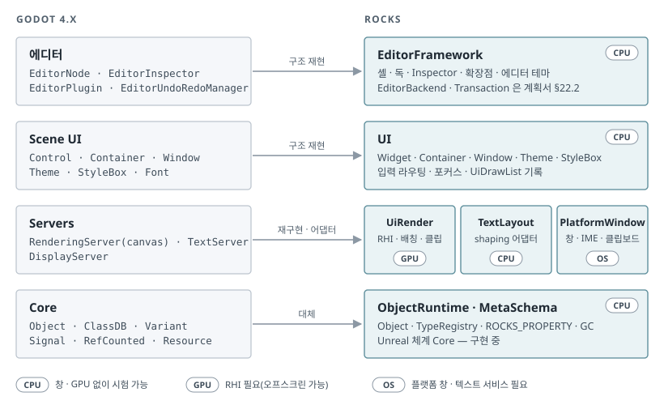
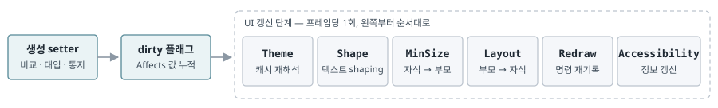
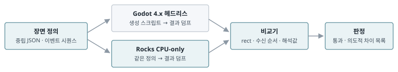

# UI 툴킷 — 게임 UI와 에디터의 단일 UI 체계

Godot 4.x 수준의 UI 런타임 · Unreal 체계 Core 위의 재구현

**설계 기준일 2026.11.11 · 초안 1.0 · 상태: 설계 제안 / 결정 UD1–UD8 대기 · 미구현**

Rocks의 게임 UI와 에디터(Rocks Studio)는 하나의 UI 툴킷을 사용한다. 목표 수준은 Godot 4.x의 UI 체계다. Godot의 코드를 이식하지 않고 층 구성과 동작 계약(레이아웃·테마·입력·그리기·텍스트·에디터 확장점)을 명세화하여 Rocks Core 위에 재구현하며, Godot의 실행 결과를 기준값으로 비교 시험한다. Core는 Unreal 체계(Object·리플렉션·GC·Transaction)를 따른다. 이전 계획의 웹 에디터(WebView2·WKWebView·TypeScript/React)는 검토 후 채택하지 않았으며, 그 결정을 [전체 구현 계획](EngineImplementationPlan.ko.md) 개정 1.4와 [Core·Object·Input 상세 구현 계획](CoreObjectInputDetailedPlan.ko.md) 1.2에 반영하였다.

이 문서의 구조·API·지정자 이름은 설계 제안이며 구현·측정 결과가 아니다. Godot 동작 서술은 4.x 공개 문서와 `4.5-stable` 소스 기준이며 §8의 오라클 비교 전까지 미검증이다.

| 항목 | 내용 |
|---|---|
| 기준 문서 | 전체 계획 개정 1.4 · 상세안 1.2 · [Clang 생성 Reflection](../Implementation/ReflectionMetadata.ko.md)(구현 상태) |
| Godot 기준 | 4.x 공개 문서와 소스. §6의 코드 근거는 `4.5-stable` |
| Rocks 상태 | Core·Object 구현 중. UI·렌더러·창 코드 없음 |
| 라이선스 | Rocks·Godot 모두 MIT. 차용 코드는 Godot 저작권 고지를 유지한다(UD5) |
| 식별자 | 단계 UT0–UT5, Core 선행 계약 CU1–CU8, 오라클 시험 GO1–GO6, 위험 UR1–UR6, 결정 UD1–UD8 |

## 요약

1. **형태:** Godot 코드를 이식하지 않는다. 구조와 동작 계약을 Rocks Core 위에 재구현하고 Godot를 기준값(오라클)으로 비교 시험한다. 알고리즘 단위의 코드 차용은 허용한다(UD5).
2. **범위:** 게임 UI와 에디터가 하나의 UI 런타임을 공유한다. 에디터의 셸·3D viewport·전문 편집기(머티리얼·컷씬·UI Designer·Script Editor)를 모두 같은 widget으로 구성한다.
3. **경계:** widget은 `rocks::Object`를 상속하는 한 층 구조(Godot Control 방식)를 기준안으로 한다(UD1). 리플렉션·GC·직렬화·Transaction은 Rocks Core를 사용하며 Godot의 Variant·참조 계수·문자열 기반 signal은 도입하지 않는다.
4. **속성 정의:** Godot의 문자열 바인딩·hint 문자열·setter 안의 효과 함수 호출·이름 비교 기반 표시 조건은 따르지 않는다. 필드 선언의 지정자에서 접근자·스키마·테마 연결을 생성하고, 변경 효과는 UI 갱신 단계에서 일괄 처리한다(§6).
5. **현 단계:** Core 작업 중 UI와 에디터가 의존하는 리플렉션 확장 8항목(CU1–CU8)의 계약을 확정한다(§7). UI 코어는 창·GPU 없이 시험할 수 있으므로 Foundation Gate 직후 RHI와 병행 착수한다(§9).

## 1. 형태 결정

| 안 | 가져오는 대상 | Unreal 체계 Core와의 정합 | 에디터·게임 동일성 | 판단 |
|---|---|---|---|---|
| A · 코드 이식 | Godot `scene/gui`·`servers` 소스를 옮기고 타입만 치환 | 낮음. Variant·RefCounted·수동 해제·Godot 컨테이너가 Rocks Object·GC·자체 컨테이너 규약과 충돌하여 Object 모델 2개가 공존한다. 라이선스는 제외 사유가 아니다 | 같음 | 채택하지 않음 |
| B · 구조 재구현 + 오라클 | 층 구성·동작 계약·확장점을 명세화하고 Rocks 관례로 구현. Godot 결과와 비교 시험 | 높음 | 같음 | **기준안** |
| C · Unreal 2층 + Godot 레이아웃 | 비객체 widget(Slate 방식)과 Object 래퍼(UMG 방식)를 분리하고 레이아웃 규칙만 Godot | 높음 | 부분. 에디터는 비객체 층, 게임 UI는 래퍼 층으로 작성 경로가 2개이며, Inspector로 에디터 widget까지 편집하는 Godot 방식이 성립하지 않는다 | UD1에서 판정 |
| D · 웹 에디터 + Godot식 게임 UI | 개정 1.3의 §21·§22 | 해당 없음 | 다름. 툴킷 2개, IME 경로 2개, Designer 미리보기를 별도 네이티브 화면으로 구성 | 검토 후 채택하지 않음 |

B를 기준안으로 하는 근거는 세 가지다.

- Godot 수준을 결정하는 요소는 코드가 아니라 계약이다. 레이아웃 해석 순서, 테마 탐색 순서, 입력 전파 순서, 지연 갱신 시점은 Core 관례와 독립적으로 재현할 수 있다.
- 같은 장면을 Godot에서 실행하여 결과를 비교할 수 있으므로 Godot 수준의 달성 여부를 수치로 판정한다(§8).
- widget이 `rocks::Object`이면 Inspector·직렬화·Transaction·자체 언어 바인딩이 리플렉션 하나에서 도출된다. 에디터 화면도 같은 경로로 편집·저장된다.

## 2. Godot 수준의 정의

아래 10개 항목을 Godot 수준의 정의로 사용한다. 오른쪽 열이 Rocks에서 재현할 계약이다.

| 구성 요소 | Godot 4.x의 형태 | Rocks에서 재현할 계약 |
|---|---|---|
| 단일 툴킷 | 에디터 전체가 게임과 같은 Control로 구성되고, 에디터 플러그인도 같은 widget으로 작성한다. | Rocks Studio의 모든 화면을 게임 UI와 같은 widget으로 구성한다. 에디터 전용 widget은 모듈만 분리하고 Shipping에서 링크하지 않는다. |
| 레이아웃 | 4변의 anchor(0–1)와 offset(px), grow 방향. Container가 자식 배치를 소유하며 size flags(`FILL`·`EXPAND`·`SHRINK_*`)와 stretch ratio로 분배한다. 최소 크기는 부모로 전파되고 정렬은 지연 실행된다. | 같은 해석 규칙과 같은 갱신 시점. 레이아웃 무효화는 프레임당 1회 일괄 처리한다. |
| 테마 | 항목 6종(Color·Constant·Font·FontSize·Icon·StyleBox). widget override → 조상 테마(type variation → 클래스 계층) → 프로젝트 테마 → 기본 테마 순으로 탐색한다. | 같은 탐색 순서. 해석 결과를 캐시하고 테마 변경 시 하위 트리에 통지한다. |
| StyleBox | Flat(모서리 반경·테두리·그림자·AA)·Texture(9분할)·Line·Empty. content margin이 최소 크기에 포함된다. | 같은 4종과 같은 최소 크기 규칙. |
| 입력 | `_input` → `_gui_input`(mouse_filter `STOP`·`PASS`·`IGNORE`로 부모 전파) → `_shortcut_input` → `_unhandled_input`. focus_mode·이웃 지정·기하 탐색, 드래그 앤 드롭 callback 3종, 툴팁, 팝업 스택. | InputRouter의 UI 단계에 같은 순서를 구현한다. 상세안 §22.1의 전달 자격 순서(text/IME·modal UI → 일반 UI → viewport → gameplay) 안에 배치된다. |
| 그리기 | widget이 `_draw`에서 그리기 명령을 기록하고 `queue_redraw` 때만 다시 기록한다. 렌더 서버가 canvas item을 RID로 보유하고 배칭·클리핑을 수행한다. | widget Object와 UiDrawList를 분리한다(전체 계획 §21). 명령 목록을 덤프할 수 있어야 CPU 시험이 성립한다. |
| 텍스트 | TextServer가 shaping·BiDi·줄바꿈·grapheme·폰트 fallback·MSDF·OpenType feature·가변 폰트를 담당하고, TextLine·TextParagraph가 shaping 결과를 캐시한다. | TextLayout adapter. library 타입은 공개 API에 노출하지 않는다(전체 계획 §21). |
| 창 | Window가 Viewport이며 하위 창을 내장 또는 OS 창으로 선택한다. Popup·PopupMenu, SubViewport로 3D 화면을 UI 안에 배치한다. | 같은 구조. 에디터 3D viewport도 SubViewport widget이며, 개정 1.3 §22.1의 child window 겹침·focus 문제가 구조적으로 발생하지 않는다. |
| 에디터 확장 | 속성 목록(type·hint·usage)으로 Inspector를 자동 생성하고 InspectorPlugin으로 교체한다. EditorPlugin 확장점(독·메인 화면·viewport 입력 전달). 드래그 Undo 병합. 에디터 테마를 설정값 몇 개에서 코드로 생성하고 SVG 아이콘을 에디터 배율로 래스터화한다. | 리플렉션 기반 Inspector, 모듈 단위 확장점, Transaction 병합, 에디터 테마 생성식. |
| 접근성 | 4.5부터 AccessKit 기반 스크린 리더를 지원한다. | PlatformWindow의 접근성 adapter. widget마다 역할·이름·상태를 노출한다. |

## 3. 계층 구조

그림 1. 위 두 층(에디터·UI)은 Godot의 구조를 재현하고, 서버 층은 Rocks 모듈과 외부 library adapter로 재구현하며, Core 층은 현재 구현 중인 Unreal 체계 Core로 대체한다. UI 층까지 CPU만으로 시험할 수 있다는 점이 §9의 착수 순서를 결정한다.

모듈 의존 방향은 전체 계획 §3.1의 규칙을 따른다. UI는 RHI·World·PlatformWindow에 의존하지 않는다. OS 창·clipboard·cursor는 Host가 주입한 계약으로 사용하며 CPU 시험에서는 가짜 Host를 주입한다. 입력은 PlatformWindow → InputCore → InputIntegration(UiInputRouter) 경로로 전달된다.

| 모듈 | 직접 의존 | 책임·금지 |
|---|---|---|
| UI | ObjectRuntime·MetaSchema·Task·TextLayout | widget 트리·레이아웃·테마·StyleBox·입력 라우팅·focus·UiDrawList 기록. RHI·World·PlatformWindow 직접 의존 금지 |
| TextLayout | Core·shaping/폰트 library adapter | shaping·줄바꿈·BiDi·grapheme·폰트 fallback·shaping 결과 캐시. library 타입 비공개 |
| UiRender | UI의 UiDrawList 계약·RHI·Task | 배칭·클립·glyph atlas·MSDF. widget Object 순회 금지 |
| PlatformWindow | Core·PlatformBase·window SDK | 창·DPI·IME(TSF·NSTextInputClient)·clipboard·cursor·OS drag/drop·접근성 adapter(상세안 §2.1) |
| EditorFramework | UI·EditorBackend | 셸·독·Inspector·확장점·단축키·에디터 테마. Shipping 링크 금지 |
| WorldIntegration | World·UI 계약 | 월드 공간 widget·HUD 소유 연결. UiDrawList의 RHI 명령 변환은 UiRender가 담당 |

## 4. 개념 대응

처리 열의 「유지」는 구조와 의미를 그대로 재현, 「변형」은 개념은 가져오되 Rocks 관례로 형태 변경, 「대체」는 Rocks의 기존 체계로 대체함을 뜻한다. 근거 열의 절 번호는 접두어가 없으면 전체 계획, 「상세안」은 상세 구현 계획의 절이다.

| Godot | Rocks 대응 | 처리 | 근거 |
|---|---|---|---|
| `Object` · `ClassDB` | `rocks::Object` · `TypeRegistry`(lease 보호) | 대체 | §5 · [RuntimeClassMetadata](RuntimeClassMetadata.ko.md) |
| `PropertyInfo`(type·hint·usage) | `ROCKS_PROPERTY` 지정자 + 편집 메타데이터 어휘(CU1) | 변형 | ReflectionMetadata |
| `Variant` | 없음. 속성 경로(CU4) + Archive 직렬화 값 | 대체 | §7 · Serialization |
| `ClassDB::bind_method` | `ROCKS_FUNCTION`(CU2) | 변형 | 신설 |
| signal · `connect` | 리플렉션된 이벤트(CU3). 약한 바인딩, 연결은 에셋에 저장 | 변형 | 신설 |
| `Control`(CanvasItem → Node → Object) | `Widget` : `rocks::Object`, 한 층 | 유지 | §21.2 widget instance |
| anchor · offset · size flags · `Container` | 같은 의미. 속성은 자식 widget에 위치(UD2) | 유지 | §21.2 |
| `Theme` · type variation · override | Theme 에셋 · type variation · widget override | 유지 | §21.2 |
| StyleBox · Font · Texture(Resource, 내장/외부) | 에셋 참조 또는 소유 subobject | 변형 | §5.3 서브오브젝트 |
| `PackedScene`(UI 장면) | WidgetAsset. 중첩·override는 프리팹 규약 | 변형 | §21.1 · §20.3 |
| `NodePath` · `%`고유 이름 | stable ID + named slot. controller는 생성된 typed 참조 | 대체 | §21.2 |
| RenderingServer canvas item(RID) | UiDrawList 핸들 · UiRender 배칭 | 유지 | §21 |
| TextServer · TextLine · TextParagraph | TextLayout adapter · shaping 결과 캐시 | 유지 | §21 · 상세안 §19.2 |
| DisplayServer | PlatformWindow(TSF·NSTextInputClient·clipboard·cursor·다중 창) | 유지 | §3.1 · 상세안 §19.2 |
| InputEvent · `_input` / `_gui_input` / `_unhandled_input` | InputCore 이벤트 → InputRouter UI 단계 → gameplay | 변형 | 상세안 §17.1 · §22.1 |
| `Window` · `Popup` · `SubViewport` | 같은 구조. 에디터 3D viewport도 SubViewport widget | 유지 | §22.1 |
| `UndoRedo` · `EditorUndoRedoManager` | Transaction(stable ID·FieldId·old/new) | 대체 | §22.2 |
| `EditorInspector` · `EditorProperty` · `EditorInspectorPlugin` | Inspector · 타입·지정자별 PropertyEditor 등록 · 사용자 정의 | 유지 | 신설 |
| `EditorPlugin` | EditorExtension(모듈 단위, ModuleLease) | 변형 | 상세안 §4.2 내부 확장 |
| GDScript | 자체 언어 WidgetController | 대체 | §21.2 · §23 |
| Tween · AnimationPlayer(UI) | UI 애니메이션(UI 시계 분리) | 변형 | §21.3 |

## 5. 도입 제외 항목

Godot의 UI를 Godot답게 하는 요소와 Godot 엔진 전체의 관례를 구분한다. 아래는 후자이므로 도입하지 않는다.

| Godot | 제외 이유 | Rocks의 해당 체계 |
|---|---|---|
| Variant | 모든 값을 하나의 동적 형식에 담는다. 리플렉션된 필드와 접근 경로가 이중화된다. | 속성 경로(CU4)와 타입 정보로 접근. 저장·Undo는 Archive 직렬화 값 |
| RefCounted · Resource 참조 계수, `queue_free` | GC와 수명 규약 2개가 공존한다. | GC + 명시 파괴(전체 계획 §5.2). 공유 데이터는 에셋 참조 |
| 문자열 기반 signal · `call` · NodePath | 이름 변경 시 오류 없이 연결이 해제된다. | stable ID · FieldId · 생성된 typed accessor |
| 전역 ClassDB · singleton 서버 | 전체 계획 §1의 「전역 singleton에 의존하지 않으며」 원칙, PIE 다중 World와 충돌 | TypeRegistry · lease, 세션 범위 서비스 |
| GDScript | 게임 로직 언어는 자체 언어로 확정(전체 계획 §23) | WidgetController(전체 계획 §21.2) |
| 게임을 별도 프로세스로 실행 | Rocks는 프로세스 내 PIE 세션 격리(전체 계획 §22.6) | 기존 PIE 계약 유지. 실행 화면은 SubViewport widget |
| SceneTree를 게임 월드로 사용 | 게임 월드는 World · Entity · Component(전체 계획 §10 · §20) | widget 트리는 UI에 한정 |

## 6. 속성 정의 방식

Godot의 UI 동작은 재현 대상이지만 속성 정의 방식은 재현 대상이 아니다. 원칙은 하나다. 속성은 필드 선언 한 곳에서 정의하고, 접근자·스키마·Inspector 표시·자체 언어 노출·테마 연결은 메타 컴파일러가 생성하며, 지정자 오류는 빌드 단계에서 검출한다.

### 6.1 Godot 방식의 문제

아래 근거는 Godot `4.5-stable`의 `scene/gui` 소스에서 확인하였다.

| 문제 | Godot 4.5-stable 근거 | Rocks 처리 |
|---|---|---|
| 선언 분산 | 필드·setter·getter의 선언과 정의, `bind_method` 2줄, `ADD_PROPERTY` 1줄이 setter 이름 문자열로 연결된다. `control.cpp`에 `ClassDB::bind_method` 호출 160줄, `ADD_PROPERTY` 계열 53줄 | 필드 + `ROCKS_PROPERTY` 한 곳. 접근자·스키마·자체 언어 노출은 생성 |
| hint 문자열 | `"0,1,0.001,or_less,or_greater"`, `"-4096,4096,1,or_less,or_greater,suffix:px"`를 실행 중에 해석 | `Range = [0, 1]` · `Step` · `Unit = Px` 형식의 지정자를 빌드 시 검증 |
| setter 안의 효과 호출 | `Button::set_text`가 `_shape`·`queue_accessibility_update`·`queue_redraw`·`update_minimum_size`를 직접 호출. `button.cpp`에 `queue_redraw()` 18회, `update_minimum_size()` 15회 | `Affects` 플래그 선언. 처리는 UI 갱신 단계가 담당 |
| 조건부 표시 | `Control::_validate_property`(`control.cpp` 459–623행)가 이름 문자열 비교·`begins_with("anchor_")` 접두 비교·사용 비트 XOR(`^=`)·`is_editor_hint` 분기로 구성 | `EditIf` 식(빌드 시 검증)과 배치 역할(`Role`) 선언 |
| 테마 항목 이중 선언 | `button.h`의 `ThemeCache` 멤버와 `button.cpp`의 `BIND_THEME_ITEM` 줄이 같은 항목을 각각 선언 | `ROCKS_THEME` 필드 한 곳 |
| 테마 override 문자열 분기 | `Control::_set`이 `"theme_override_icons/"` 등 접두 6종으로 분기하고, `_get_property_list`가 속성 이름을 문자열 연결로 조립 | 테마 항목 ID를 키로 하는 타입 있는 override 저장. Inspector 그룹 자동 생성 |
| 인덱스 속성·접두 그룹 | `ADD_PROPERTYI(…, "anchor_left", …, SIDE_LEFT)`를 변마다 1줄, `ADD_SUBGROUP_INDENT("Anchor Points", "anchor_", 1)`이 이름 접두로 그룹 지정 | `Sides<float>` 구조체 필드. 그룹은 구조체·Category, 개별 변은 속성 경로(CU4)로 지정 |
| enum·의사 속성 | `BIND_ENUM_CONSTANT`를 값마다 1줄(`control.cpp` 66줄), size flags 값을 hint 문자열 `"Fill:1,Expand:2,…"`에 다시 기재. `layout_mode`는 내부 사용 속성으로 별도 저장 | `ROCKS_ENUM`에서 자동 등록. 배치 방식은 부모 종류에서 결정 |

같은 속성의 두 정의는 다음과 같다. Godot 쪽은 원문에서 발췌하였고 탭은 공백 4칸으로 변환하였다.

~~~cpp
// Godot 4.5-stable scene/gui/button.h:59 — 테마 항목 캐시(첫 번째 선언)
struct ThemeCache {
    Ref<StyleBox> normal;
    Ref<StyleBox> normal_mirrored;
    …

// button.cpp:625 — setter마다 효과 함수를 직접 호출
void Button::set_text(const String &p_text) {
    const String translated_text = _get_translated_text(p_text);
    if (text == p_text && xl_text == translated_text) {
        return;
    }
    text = p_text;
    xl_text = translated_text;
    _shape();

    queue_accessibility_update();
    queue_redraw();
    update_minimum_size();
}

// button.cpp:807–808 — 이름 문자열로 setter·getter 연결
ClassDB::bind_method(D_METHOD("set_text", "text"), &Button::set_text);
ClassDB::bind_method(D_METHOD("get_text"), &Button::get_text);
ADD_PROPERTY(PropertyInfo(Variant::STRING, "text", PROPERTY_HINT_MULTILINE_TEXT), "set_text", "get_text");

// button.cpp:854 — 같은 테마 항목의 두 번째 선언
BIND_THEME_ITEM(Theme::DATA_TYPE_STYLEBOX, Button, normal);
~~~

### 6.2 선언과 생성

Rocks 제안이며 지정자 이름과 문법은 확정 전이다.

~~~cpp
ROCKS_CLASS()
class Button : public BaseButton {
    ROCKS_GENERATED_BODY()

private:
    ROCKS_PROPERTY(Category = "Text", Multiline,
                   Affects = Shape | MinSize | Redraw | Accessibility)
    Text text;

    ROCKS_PROPERTY(Category = "Icon", Affects = MinSize | Redraw)
    AssetRef<Texture2D> icon;

    ROCKS_PROPERTY(Category = "Icon", EditIf = "icon != null", Affects = Redraw)
    bool expandIcon = false;

    // 테마 항목: 캐시 해석·override 속성·저장 키를 생성한다.
    ROCKS_THEME(Affects = MinSize | Redraw)
    StyleBoxRef normal;

    ROCKS_THEME(Range = [0, 64], Unit = Px, Affects = MinSize | Redraw)
    int32 hSeparation = 4;

protected:
    // Shape 효과가 표시된 widget에 대해 UI 갱신 단계에서 한 번 호출된다.
    void UpdateShaping() override;
};

// 사용: 생성된 접근자. 같은 프레임의 shaping·최소 크기 계산은 1회다.
button->SetText(startText);
button->SetIcon(startIcon);
~~~

위 선언에서 메타 컴파일러가 생성하는 항목은 다음과 같다.

- **접근자:** `SetText`·`GetText`. setter는 동등 비교 → 변경 전 통지 → 대입 → 효과 플래그 표시 → `OnChanged` 지정 함수 호출 → 변경 후 통지 순서로 고정된다. 사용자 정의 처리가 필요한 속성만 `OnChanged = OnTextChanged`를 지정한다. 생성 방식은 UD7에서 확정한다.
- **스키마:** 형식·Category·Multiline·Affects·EditIf(판정식과 의존 필드 목록). 자체 언어 노출과 Inspector 편집기 선택이 이 스키마에서 도출된다.
- **테마 연결:** 필드 ID를 테마 항목 ID로 사용한다. 캐시 해석 함수, override 저장 슬롯, Inspector의 「테마 override」 그룹이 함께 생성되며 테마 항목 필드는 저장 대상에서 자동 제외된다.
- **빌드 오류:** EditIf가 존재하지 않는 필드를 참조하거나, 문자열 필드에 Range를 지정하거나, Affects 값이 어휘에 없으면 메타 컴파일러가 원본 위치와 함께 거부한다(현행 `RMC2000` 계열).

### 6.3 변경 효과의 처리 순서

Godot의 setter는 효과 함수를 직접 호출한다. `queue_redraw`는 지연 처리되지만 `Button::_shape`는 즉시 실행되므로, 한 프레임에 `text`·`autowrap_mode`·`text_overrun_behavior`를 변경하면 shaping이 3회 실행된다. Rocks의 setter는 플래그만 표시하고, UI 갱신 단계가 정해진 순서로 1회 처리한다.

그림 2. 최소 크기는 자식에서 부모 방향으로, 배치는 부모에서 자식 방향으로 계산한다. 같은 widget에 같은 플래그가 여러 번 표시되어도 처리는 1회다. 이 순서는 제안이며 GO1·GO6 비교로 확정한다.

| 효과 플래그 | 처리 | Godot의 수동 호출 |
|---|---|---|
| `Theme` | 테마 항목 캐시 재해석 | `NOTIFICATION_THEME_CHANGED` 처리 |
| `Shape` | 텍스트 shaping 재실행(widget의 `UpdateShaping`) | `_shape()` |
| `MinSize` | 최소 크기 재계산, 변경 시 부모로 전파 | `update_minimum_size()` |
| `Layout` · `ParentLayout` | 자신 또는 부모 container의 배치 재계산 | `queue_sort()` |
| `Redraw` | 그리기 명령 재기록 | `queue_redraw()` |
| `Accessibility` | 접근성 정보 갱신 | `queue_accessibility_update()` |
| (EditIf 의존 필드 변경) | Inspector 표시 재평가. 자동 | `notify_property_list_changed()` |

### 6.4 배치 속성

Godot은 부모가 container인지에 따라 anchor·offset·size flags의 표시 여부를 `Control::_validate_property`(`control.cpp` 518–605행)에서 속성 이름 접두 비교와 사용 비트 XOR로 판정하고, 허용 size flags의 hint 문자열을 호출마다 조립한다. Rocks는 배치 속성을 하나의 구조체로 묶고 필드마다 역할(`Role`)을 선언한다. container는 자식에 적용할 역할과 허용 플래그만 클래스 지정자로 선언하며, 표시 판정은 Inspector의 공통 규칙 한 곳에서 수행한다.

~~~cpp
ROCKS_STRUCT()
struct LayoutParams {
    ROCKS_PROPERTY(Role = Anchors, Range = [0, 1], Step = 0.001, AllowOutside,
                   Affects = ParentLayout)
    Sides<float> anchors;

    ROCKS_PROPERTY(Role = Anchors, Unit = Px, Affects = ParentLayout)
    Sides<float> offsets;

    ROCKS_PROPERTY(Role = SizeFlags, Affects = ParentLayout)
    SizeFlags horizontal = SizeFlags::Fill;

    ROCKS_PROPERTY(Role = SizeFlags, Affects = ParentLayout)
    SizeFlags vertical = SizeFlags::Fill;

    ROCKS_PROPERTY(Role = SizeFlags, Range = [0, 100], Affects = ParentLayout)
    float stretchRatio = 1.0f;
};

// container는 자식에 적용할 역할과 허용 플래그만 선언한다.
ROCKS_CLASS(ChildLayout = SizeFlags,
            ChildSizeFlags = Fill | Expand | ShrinkBegin | ShrinkCenter | ShrinkEnd)
class BoxContainer : public Container {
    …
};
~~~

부모가 container가 아니면 Position·Anchors 중 선택한 방식만 저장한다. Godot이 `layout_mode`를 내부 사용 속성(`PROPERTY_USAGE_INTERNAL`)과 `stored_layout_mode`로 별도 보관하는 부분에 해당한다. container별 추가 속성(예: Grid의 셀 지정)은 CU6 동적 속성으로 처리한다(UD2).

### 6.5 지정자 판정 규칙

- `Range`·`Step`·`Unit`·`AllowOutside`는 편집 UI 정보이고, `Clamp`는 생성 setter가 강제한다. Unreal의 `UIMin`·`ClampMin` 구분과 같다.
- 편집 전용 정보는 Shipping 스키마에서 제외된다. 런타임 코드에 `is_editor_hint` 같은 분기를 포함하지 않는다.
- 후보 목록이 실행 중에 정해지는 속성(테마 type variation 목록 등)은 `Options = Provider(…)`로 에디터 모듈 함수에 연결한다. Godot이 `_validate_property`에서 hint 문자열을 매번 조립하는 코드(`control.cpp` 461–505행)에 해당한다.
- enum은 `ROCKS_ENUM` 선언에서 열거자와 표시 이름이 등록되고, 플래그 enum은 비트 편집기로 표시된다. `BIND_ENUM_CONSTANT`와 `"Fill:1,Expand:2"` 형식의 문자열은 필요하지 않다.

## 7. Core 선행 계약

현재 리플렉션은 `ROCKS_CLASS`와 `ROCKS_PROPERTY`(`Transient`·`ReadOnly`·`Category`·`DisplayName`)를 지원하며, 함수 리플렉션·이벤트·변경 통지는 없다. 필드 형식은 bool·정수·실수·Guid·String·ObjectRef로 한정되어 enum·구조체·배열 필드는 거부한다([Clang 생성 Reflection](../Implementation/ReflectionMetadata.ko.md), 2026-11-11 기준). UI와 에디터는 아래 8항목에 의존하므로 Foundation Gate 전에 계약을 확정한다. 구현 시점은 항목별로 조정할 수 있으나, 형식은 Object·Archive 계약과 함께 고정해야 이후 재작업이 발생하지 않는다.

| ID | 항목 | Godot · Unreal 대응 | Rocks 현재 | 계약 내용 · 사용처 |
|---|---|---|---|---|
| CU1 | 편집 메타데이터 어휘 | `PROPERTY_HINT_*`·usage / `UPROPERTY(meta=…)` | 지정자 4개. 미지원 지정자는 `RMC2000`으로 거부 | 범위(min·max·step)·단위·enum 표시·비트 플래그·여러 줄·에셋 기반 타입 제한·편집 조건·고급·숨김. 거부 정책을 유지하도록 어휘를 버전 있는 manifest로 등록하고 메타 컴파일러가 검증한다. 에디터 전용 값은 Shipping 스키마에서 제외한다. UI용으로 `Affects`·`EditIf`·`Clamp`·`Role`과 클래스 지정자 `ChildLayout`·`ChildSizeFlags`를 포함한다(§6). 사용처: Inspector·UI Designer·프로젝트 설정 |
| CU2 | 함수 리플렉션 | `ClassDB::bind_method` / `UFUNCTION` | 없음. `Function.h`는 일반 callable | `ROCKS_FUNCTION`. 인자·반환 타입 스키마와 호출 thunk 생성. 사용처: 이벤트 연결 대상·자체 언어 바인딩·Inspector 버튼·에디터 명령 |
| CU3 | 리플렉션된 이벤트 | signal / dynamic multicast delegate | 없음 | 약한 Object 바인딩, 대상 파괴 시 자동 해제(GC 안전), 연결을 WidgetAsset에 저장, 에디터에 이벤트 목록 노출 |
| CU4 | 속성 경로 | `NodePath:property` / `FPropertyPath`·PropertyHandle | Transaction 계약(전체 계획 §22.2)이 stable ID·FieldId를 사용 | (객체 stable ID, FieldId 체인, 배열 index·map key) 한 형식을 Transaction·Inspector·UI 애니메이션 트랙·바인딩에서 공용으로 사용 |
| CU5 | 변경 통지 | `set` + `property_list_changed` / `PreEditChange`·`PostEditChangeProperty` | 없음 | 변경 전·후 통지와 종류(드래그 중·확정) 구분. 생성 setter에 포함되므로 수기 호출이 없다(§6). 전체 계획 §22.1의 「drag는 preview 병합, release 시 하나의 undo」의 기반이며 바인딩도 사용 |
| CU6 | 동적 속성 | `_get_property_list`·`_set`·`_get` / IDetailCustomization(에디터 측) | 없음 | 형태가 데이터로 정해지는 속성(스크립트 정의 속성·머티리얼 파라미터)을 객체가 추가 노출한다. 테마 override·배치 속성은 §6의 선언형으로 처리하므로 대상이 아니다. 저장 형식·Transaction 경로는 정적 속성과 동일하게 처리 |
| CU7 | 텍스트 위치 변환 | String(UTF-32)·TextServer / FString(UTF-16)·ICU | String은 UTF-8. 변환 최소 기능은 Core 범위(상세안 §7.3) | UTF-8 byte ↔ UTF-16 ↔ code point 위치 변환은 Core, grapheme·줄바꿈 경계는 TextLayout. IME(상세안 §19.2)와 텍스트 편집 widget이 사용 |
| CU8 | 필드 형식 확장 | Variant 형식 전체 / `FEnumProperty`·`FStructProperty`·`FArrayProperty` 계열 | bool·정수·실수·Guid·String·ObjectRef만 지원. enum·구조체·배열·컨테이너는 거부 | enum(플래그 포함, `ROCKS_ENUM`)·값 구조체(`ROCKS_STRUCT`: Vector2·Color·Sides·Rect)·Text·에셋 참조·배열. enum·구조체도 `.rocksids.json`의 안정 ID 체계에 포함한다. 사용처: 정렬·size flags·색·anchor 등 대부분의 widget 속성 |

항목 사이의 선행 관계는 다음과 같다. CU1·CU4는 enum·구조체·배열을 대상으로 하므로 CU8 이후에 확정한다. CU3은 연결 대상이 리플렉션된 함수이므로 CU2 이후다. CU5는 생성 setter의 형태가 정해지는 UD7 이후다. CU6은 같은 저장·Transaction 경로를 쓰므로 CU4·CU5 이후다. CU7은 다른 항목과 독립이다.

자체 언어 Sparks(전체 계획 23절)도 CU2·CU3·CU5·CU8을 언어 L1의 선행 조건으로 사용한다. CU3은 별도 이벤트 매크로·타입 없이 Core `MulticastDelegate` 필드에 `ROCKS_PROPERTY(Params = ...)`를 붙여 선언하고 메타 컴파일러가 `FieldKind::Event`로 분류한다. CU5의 변경 통지는 Sparks의 필드 `Changed` 이벤트로 노출한다. 스크립트가 구현하는 interface의 리플렉션 표(CU9)는 [Sparks 언어 설계](SparksLanguage.ko.md) §10.3에서 정의한다.

## 8. Godot 오라클 검증

Godot 수준의 달성 여부를 수치로 판정하기 위해 같은 장면을 Godot와 Rocks에서 각각 실행하고 결과를 비교한다. 장면 정의는 중립 JSON 하나로 작성하고, Godot 쪽은 이를 읽어 노드를 생성하는 스크립트로, Rocks 쪽은 CPU-only 테스트로 실행한다.

그림 3. 기준 Godot 버전은 하나로 고정한다(UD6). 허용 오차는 첫 비교 결과를 확인한 뒤 항목별로 정한다. Rocks가 의도적으로 다르게 동작하는 항목은 사유와 함께 차이 목록에 등재한다.

| ID | 대상 | 기록 값 | 장면 구성 |
|---|---|---|---|
| GO1 | 레이아웃 | widget별 전역 rect | container 10종 × size flags 조합 × 부모 크기 변화, anchor·offset 프리셋 |
| GO2 | 입력 전파 | 수신 widget·처리 여부·순서 | mouse_filter 조합, 겹친 widget, 팝업·모달, 드래그 앤 드롭 |
| GO3 | focus 이동 | 방향 키·Tab 입력 후 focus widget | 격자·불규칙 배치, 이웃 지정·미지정, 비활성 widget 포함 |
| GO4 | 테마 해석 | 항목별 해석값과 출처 | type variation 체인, 조상 테마 중첩, widget override, 프로젝트 테마 |
| GO5 | 텍스트 | 줄바꿈 위치·glyph advance·BiDi 순서 | 같은 폰트 파일·크기, 한국어·영문·아랍어 혼합, fallback 폰트 |
| GO6 | 최소 크기 | widget·container 최소 크기 | StyleBox content margin, 텍스트·아이콘 포함 버튼, 중첩 container |

Rocks와 Godot가 모두 MIT이므로 실행·결과 비교·소스 차용에 라이선스 제약이 없다. MIT의 조건은 저작권·허가 고지 유지 하나이며, 차용 코드의 고지 방식은 UD5에서 정한다. 오라클 시험은 Godot 실행 파일이 있는 개발 장비와 CI에서만 실행하며, 일반 CPU-only 테스트는 저장된 기준값 파일과 비교하여 Godot 없이 실행한다.

## 9. 단계 계획

UI 코어(UT1)가 창·GPU 없이 시험 가능하다는 점을 활용하여, 에디터 일정의 임계 경로에 포함된 UI 툴킷을 RHI보다 먼저 착수한다. 일정 열은 전체 계획 §30.1의 M 단계 표기다.

| 단계 | 범위 | 선행 | 완료 판정 | 일정 |
|---|---|---|---|---|
| UT0 | Core 계약 CU1–CU8 | 현재 Core 작업 | 리플렉션 하네스에서 8항목의 사용 예제·음성 대조·직렬화 왕복 통과 | M1–M2 |
| UT1 | UI 코어: 생성 setter·변경 효과 처리 단계·widget 트리·anchor/offset·container 10종(Box·Grid·Margin·Center·Panel·Scroll·Split·Tab·Flow·AspectRatio)·최소 크기 전파·테마 해석·StyleBox·입력 라우팅·focus·UiDrawList | UT0 | 창·GPU 없이 GO1–GO4·GO6 통과 | Foundation Gate 직후 |
| UT2 | 출력: PlatformWindow(다중 창·DPI·IME·clipboard·cursor·OS drag/drop)·TextLayout·UiRender(배칭·클립·glyph atlas·MSDF)·SVG 아이콘 | UT1, RHI 기본 | GO5, 같은 장면의 offscreen 픽셀 비교, 한국어 IME 조합 | M3 |
| UT3 | 에디터용 widget: LineEdit·TextEdit·Tree(가상화)·ItemList·Popup·MenuBar·SpinBox·ColorPicker·FileDialog·SubViewport·독 | UT2 | 에디터 규모 widget 수에서 GC·레이아웃·그리기 예산 측정(UR3) | M3 |
| UT4 | 에디터 프레임워크: 셸·독 배치 저장·Inspector(CU1·CU6)·확장점·단축키·에디터 테마 생성·Transaction 연결. 전체 계획 §22.2의 M3 기능(Outliner·Inspector·Asset Browser·viewport·gizmo·log) | UT3 | M3 gate 「import→edit→save→cook→run」을 Windows·macOS에서 통과 | M3 |
| UT5 | 전문 도구·게임 UI 완성: UI Designer(같은 Inspector 재사용)·바인딩·UI 애니메이션·RichText·그래프 편집(머티리얼 §14.5)·타임라인(컷씬 §25.3)·코드 편집(§23.3)·접근성 | UT4 | 전체 계획 §21.5 필수 sample 5종·§14.9 MAT 시험 | M4–M6 |

## 10. 위험과 대응

| ID | 위험 | 대응 |
|---|---|---|
| UR1 | 에디터 일정의 임계 경로에 UI 툴킷이 포함된다. 웹 방식은 에디터 화면을 별도로 병행 개발할 수 있었다. | UT1을 CPU-only로 구성하여 RHI 이전에 착수한다. UT3 widget은 §22.2 M3 기능에 필요한 순서로만 구현한다. 전체 계획 §31 R08에 같은 내용을 등재하였다. |
| UR2 | 텍스트 편집·IME·접근성을 직접 구현한다. 웹 방식은 브라우저가 제공하였다. | 상세안 §19.2의 TSF·NSTextInputClient 계약을 그대로 사용하고 AccessKit adapter를 둔다. 코드 편집 widget은 UT5로 순연한다. |
| UR3 | widget을 GC 객체로 운용할 때의 비용. 에디터는 widget 수가 많다. | UT3 gate에서 widget 수 대비 GC mark 시간·메모리를 측정한다. 레이아웃 rect·그리기 명령은 처음부터 비객체 배열로 분리한다. |
| UR4 | 반올림·경계 조건 등 Godot와의 세부 동작 차이 | 오라클 비교로 검출하고 의도적 차이는 사유와 함께 목록에 등재한다. |
| UR5 | Godot 버전 변경에 따른 기준값 변동 | 오라클의 Godot 버전을 고정하고, 승격은 기준값 갱신과 같은 커밋에서 명시적으로 수행한다. |
| UR6 | 지정자 어휘 확장에 따른 메타 컴파일러 복잡도 증가, 생성 setter 경로의 디버깅 난도 | 어휘를 버전 있는 manifest로 고정하고 지정자마다 양성·음성 회귀 시험을 추가한다(현행 RMC 진단 체계). 생성 접근자는 clang-format이 적용된 생성 헤더에 존재하므로 디버거로 단계 실행할 수 있다. |

## 11. 결정 대기 항목

| ID | 사안 | 권장안 | 대안 | 근거 |
|---|---|---|---|---|
| UD1 | widget 층 구조 | 한 층: `Widget` = `rocks::Object` | 두 층: 비객체 widget + Object 래퍼 | 한 층이어야 에디터 widget까지 Inspector·직렬화·Transaction이 같은 경로. 비용은 UR3 측정으로 확인 |
| UD2 | 레이아웃 속성 위치 | 자식 widget의 속성(Godot) | Slot 객체(Unreal UMG) | Godot은 size flags·anchor가 자식에 있다. container별 추가 속성은 CU6 동적 속성으로 처리 |
| UD3 | 텍스트 adapter 구성 | HarfBuzz·FreeType·ICU(Godot과 같은 구성) | HarfBuzz·FreeType·SheenBidi·libunibreak | 같은 구성이면 GO5 비교에서 library 차이가 제거된다. ICU 데이터 크기는 배포 구성에서 축소. 후보 모두 MIT 배포와 호환(FreeType은 FTL 선택 시 문서에 출처 표기) |
| UD4 | 하위 창 방식 | 내장·OS 창 모두 지원 | OS 창만 | 게임은 내장(콘솔·전체 화면), 에디터는 OS 창(다중 모니터) |
| UD5 | Godot 코드 차용 방식 | 알고리즘 단위 차용 허용, 고지 유지 | 열람·동작 비교만 | 양쪽 MIT로 라이선스 충돌 없음. Godot 코드는 Variant·Godot 컨테이너에 의존하므로 파일 단위로 가져와도 재작성이 필요하다. 차용은 focus 기하 탐색·container 분배·StyleBox 그리기 같은 알고리즘으로 한정하고, 해당 파일 헤더 주석과 THIRD_PARTY 목록에 Godot 저작권 고지를 기재 |
| UD6 | 오라클 기준 버전 | 현행 4.x 안정판 하나로 고정 | — | UR5 대응 |
| UD7 | 접근자 생성 방식 | 생성 본문 주입: `ROCKS_GENERATED_BODY`를 Unreal `GENERATED_BODY`처럼 파일·줄 단위 매크로로 확장하여 `SetX`·`GetX`를 선언 | 수기 한 줄 setter + 생성 헬퍼(`SetProperty(&Button::text, value)`) | 주입 방식은 단순 속성의 수기 코드가 0줄이다. 현재 `ROCKS_GENERATED_BODY`는 고정 매크로이므로 생성 헤더 포함 순서 규약이 추가된다. 대안은 setter가 소스에 보이지만 속성마다 선언·정의가 필요하다 |
| UD8 | `EditIf` 형식 | 제한된 식(필드·enum·리터럴 비교, `&&`·`\|\|`·`!`)을 빌드 시 검증 | 판정 함수 참조만 허용 | 식이면 메타 컴파일러가 의존 필드를 추출하므로 Inspector 재평가가 자동이다. 복잡한 조건은 함수 참조와 `DependsOn`으로 보완 |

## 12. 기존 스펙의 개정 위치

웹 에디터를 전제로 한 절을 다음과 같이 개정하였다. 절 번호는 개정 후 기준이다.

| 문서 · 절 | 개정 전 | 개정 후 |
|---|---|---|
| 전체 계획 표지 · §1 · §1.1 · §2.4 | 「웹 에디터」, 「웹 UI/네이티브 뷰포트 방향 계승」, Rocks Studio(웹 에디터·native viewport) | 단일 UI 툴킷 에디터, 개정 1.4 방향 전환 기록, Rocks Studio(UI 툴킷 기반 네이티브 에디터), Core 단계에서 CU1–CU8 계약 확정 |
| 전체 계획 §2.5 · PL04 | WebView2/WKWebView shell, 「양OS 웹+native viewport」, JS↔host 메시지 | 양OS PlatformWindow adapter와 같은 UI 툴킷, SubViewport widget인 3D viewport |
| 전체 계획 §3.1 · §3.2 | EditorWeb 모듈, `Editor/Web`, `Editor/Web/Material` | UI·TextLayout·UiRender·EditorFramework 모듈, `Editor/Framework`. 계층 그림의 「웹 UI」 표기 대체 문장 추가 |
| 전체 계획 §14.6 | `Editor/Web/Material`(MaterialGraph.tsx 등) | EditorMaterial의 UI 툴킷 화면(`MaterialGraphView.cpp` 등) |
| 전체 계획 §21 · §21.2 · §21.3 · §21.4 · §21.5 | 「게임 UI는 웹 에디터 UI와 독립된 runtime UI」, slot 배치 속성, 웹 UI Designer·editor DOM 미리보기, tunnel/bubble 입력 | 게임 UI와 에디터가 같은 UI 런타임, 자식 widget 배치 속성(UD2), Designer canvas가 실제 런타임 화면, Godot 입력 전파 순서, UT1 착수 시점, GO1–GO6 비교 |
| 전체 계획 §22 · §22.1 · §22.2 | 웹 에디터와 네이티브 뷰포트, WebView2/WKWebView·TypeScript/React·JSON RPC | 네이티브 에디터와 뷰포트, 프로세스 내 화면 ↔ EditorBackend, RPC는 외부 자동화·원격 용도 |
| 전체 계획 §23.3 · §25.3 | 웹 Script Editor, 웹 제작 UI(컷씬) | 코드 편집 widget + language service, 타임라인 widget |
| 전체 계획 §29.2 · §30.1 · §30.2 · §31 · §32 | B12 · UMG, M3 「웹/UMG 기초」, 웹 timeline·Inspector mock 병행, R08(웹 UI·native viewport focus/DPI), R20 · UMG | B12에 GO1–GO6, M2에 CU1–CU8, M3에 UT1–UT4, R08을 툴킷 임계 경로 위험으로 교체, 요구 추적표에 이 문서 연결 |
| 전체 계획 §33.2 · §33.9 · §34 | — | Unreal 비교표 UI 행 보완, 개정 1.4 기록, Godot 참고 자료 S75–S77, S13 미인용 표시 |
| 상세안 머리말 · §9 · §19.2 · §22.1 · §22.2 · §24.3 · §26.1 · §26.2 · 작업·파일 목록 | 「native 또는 웹 text owner」, 웹 DOM text focus·webview focus token, `Editor/Web/InputProfileEditor.tsx` | 상세안 1.2 기록, UI 툴킷 focus 하나로 단일화, §9(런타임 클래스 참조와 메타데이터의 확장)에 CU1–CU8 연결, `Editor/InputProfile/ProfileEditorView.cpp` |

전체 계획 §1.2 CF01·§2.5 PL01·§7.2·§9.3·§14.8·§14.9 MT08·§22.5·§27.10·§28.1·§28.5·§29.4·§30.1 M0와 상세안 §2.1·§4.1의 웹 관련 조건은 의미 변화 없이 삭제하거나 UI·window·에디터 표현으로 바꾸었다. PDF 배포본(`Docs/Releases`의 1.3·1.1)은 개정 전 판이다.

## 13. 참고 자료

조회일은 2026.11.11이다.

| ID | 자료 | 적용 범위 |
|---|---|---|
| G1 | [Godot 4.5 · Size and anchors](https://docs.godotengine.org/en/4.5/tutorials/ui/size_and_anchors.html) | anchor·offset·grow |
| G2 | [Godot 4.5 · Using Containers](https://docs.godotengine.org/en/4.5/tutorials/ui/gui_containers.html) | container·size flags·stretch ratio |
| G3 | [Godot 4.5 · Introduction to GUI skinning](https://docs.godotengine.org/en/4.5/tutorials/ui/gui_skinning.html) | Theme 항목·탐색 |
| G4 | [Godot 4.5 · Theme type variations](https://docs.godotengine.org/en/4.5/tutorials/ui/gui_theme_type_variations.html) | type variation |
| G5 | [Godot 4.5 · Using InputEvent](https://docs.godotengine.org/en/4.5/tutorials/inputs/inputevent.html) | 입력 전파 순서 |
| G6 | [Godot 4.5 · Keyboard/Controller Navigation and Focus](https://docs.godotengine.org/en/4.5/tutorials/ui/gui_navigation.html) | focus 이동 |
| G7 | [Godot 4.5 · Control](https://docs.godotengine.org/en/4.5/classes/class_control.html) | Control 속성·mouse_filter·최소 크기 |
| G8 | [Godot 4.5 · TextServer](https://docs.godotengine.org/en/4.5/classes/class_textserver.html) | shaping·BiDi·줄바꿈 |
| G9 | [Godot 4.5 · EditorInspectorPlugin](https://docs.godotengine.org/en/4.5/classes/class_editorinspectorplugin.html) | Inspector 확장 |
| G10 | [Godot 소스 · 4.5-stable scene/gui](https://github.com/godotengine/godot/tree/4.5-stable/scene/gui) | §6 코드 근거 |
| G11 | [Godot 4.5 릴리스](https://godotengine.org/releases/4.5/) | 스크린 리더 지원 |
| G12 | [AccessKit](https://github.com/AccessKit/accesskit) | 접근성 adapter 후보 |
