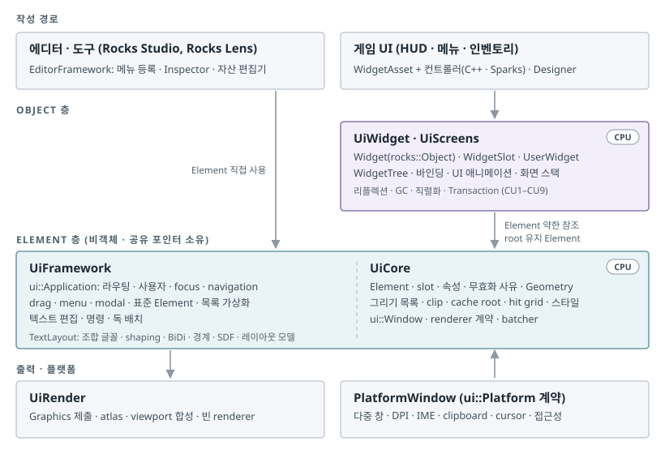

## 2. 계층 구조와 모듈

그림 1. 에디터는 Element 층을 직접 사용하고 게임 UI는 Widget 층을 사용한다. 두 경로가 같은 레이아웃·그리기·입력 처리를 공유한다. UiCore·UiFramework·UiWidget까지 CPU만으로 시험할 수 있다는 점이 9절의 착수 순서를 결정한다.

| Rocks 모듈 | UE 5.8 대응 | 위치 | 직접 의존 | 책임·금지 |
|---|---|---|---|---|
| UiCore | `Runtime/SlateCore` | `Engine/Source/Runtime/UiCore` | Core·Task·TextLayout(글꼴 계약) | Element·slot·자식 목록·속성·무효화·Geometry·그리기 목록·clip·cache root·hit grid·스타일·`ui::Window`·renderer 계약·batcher. Object·Graphics·PlatformWindow 의존 금지 |
| UiFramework | `Runtime/Slate` | `Engine/Source/Runtime/UiFramework` | UiCore·TextLayout·Input(이벤트 형식) | `ui::Application`(입력 라우팅·사용자·focus·navigation·drag/drop·tooltip·menu·modal), 표준 Element(패널·텍스트·편집·목록 가상화·스크롤·메뉴·`RetainedPanel`), 명령·단축키, 독 배치와 저장. Object·UiRender 의존 금지 |
| TextLayout | `SlateCore/Fonts` + `Slate/Framework/Text` + Core ICU | `Engine/Source/Runtime/TextLayout` | Core·Localization(없는 동안 culture 주입). FreeType·HarfBuzz·ICU·msdfgen은 ClientOnly `TextLayoutBackend`가 쓰고 backend 표로 연결한다([글꼴 설계](../Font/03-Modules.ko.md) 3장 — 서버 타깃 제외, BD25) | 글꼴·조합 글꼴·shaping·BiDi·줄/grapheme 경계·글리프 캐시·SDF·텍스트 레이아웃 모델. library 타입 비공개 |
| UiRender | `Runtime/SlateRHIRenderer` · `SlateNullRenderer` | `Engine/Source/Runtime/UiRender` | UiCore renderer 계약·Graphics(RHI)·Task | batch 데이터의 Render lane 제출·atlas texture·render target·viewport 합성·SVG 래스터 결과 업로드. 빈 renderer(headless) 포함. Element 순회 금지 |
| UiWidget | `Runtime/UMG` + `Runtime/FieldNotification` + MVVM 플러그인 | `Engine/Source/Runtime/UiWidget` | ObjectRuntime·MetaSchema·UiFramework | Widget·slot 객체·UserWidget·WidgetTree·WidgetAsset·Widget 풀·바인딩·UI 애니메이션·화면 layer 등록 interface. World·LocalPlayer 의존 금지 |
| UiScreens | CommonUI · CommonInput 플러그인 | `Engine/Source/Runtime/UiScreens` | UiWidget·Input(action) | 화면 스택·입력 라우터·입력 모드·뒤로 가기·focus 복원·입력 장치 종류 전환·플랫폼별 버튼 아이콘. UE에서 플러그인인 만큼 선택 모듈이며, 게임이 쓰지 않으면 링크하지 않는다 |
| PlatformWindow | `Runtime/ApplicationCore` | 기존 모듈 확장 | Core·PlatformBase·window SDK | 다중 창·DPI·IME·clipboard·cursor·OS drag/drop·접근성 provider(PW1–PW8) |
| EditorFramework | `Editor/UnrealEd` 일부 · `PropertyEditor` · `EditorStyle` · `Developer/ToolMenus` | `Engine/Source/Editor/Framework` | UiFramework·UiWidget·EditorBackend | 셸·자산 편집기 host·메뉴 등록·Inspector·Transaction 연결·에디터 스타일·EditorViewport·곡선/타임라인 Element. 그래프 편집 화면은 GraphView 모듈이다. Shipping 링크 금지 |
| GraphView | `Editor/GraphEditor` | `Engine/Source/Editor/GraphView` | UiFramework·EditorFramework·NodeGraph·NodeGraphTools·SpatialIndex(2D 격자) | 노드 그래프 편집 화면: 캔버스·노드·핀 시각·연결선·노드 메뉴·주석·diff 화면([노드 그래프](../NodeGraph/11-ModulesAndView.ko.md) 11절). 그래프 데이터·변경·undo·복사는 `NodeGraph`(Runtime)·`NodeGraphTools`(Developer) 소유이고, 도메인 schema·노드 서술은 각 도구 소유다. 도메인 모듈 의존 금지, Shipping 링크 금지 |
| WorldIntegration | `UWidgetComponent` · `UGameViewportSubsystem` · `SGameLayerManager` | 기존 계획 | World·UiWidget | game viewport의 화면 layer와 LocalPlayer별 layer, World 정리 연동, 월드 공간 Widget·가상 사용자 상호작용, 기본 입력 모드 |

모듈 의존 방향은 전체 계획 3.1절을 따른다. UiCore·UiFramework는 Object·Graphics·World·PlatformWindow에 직접 의존하지 않는다. OS 창·clipboard·cursor·IME는 `ui::Platform` 계약(UE `GenericApplication` 대응)으로 주입받으며 CPU 시험에서는 가짜 구현을 주입한다. UE에서는 독·명령·layout 저장이 런타임 `Slate` 모듈에 있고 Rocks도 같은 위치(UiFramework)에 둔다. 도구 프로그램(Rocks Lens 등)이 에디터 없이 독을 사용하기 때문이다. Shipping 게임은 독·명령 코드를 참조하지 않으므로 링크에서 제외된다.
