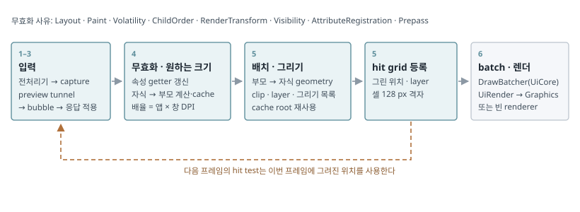

## 3. Element 층

### 3.1 객체 모델과 소유

| Rocks | UE 5.8 대응 | 계약 |
|---|---|---|
| `ui::Element` | `SWidget`(`SlateCore/Public/Widgets/SWidget.h:167`) | 원하는 크기 계산(layout 배율 인자)·자식 배치·그리기의 세 가상 함수와 자식 목록 조회. 공통 속성: tooltip·cursor·visibility·enabled·clip·pixel snapping·흐름 방향 선호·render transform·render opacity·접근성·tag |
| `ui::LeafElement` · `CompoundElement` · `PanelElement` | `SLeafWidget` · `SCompoundWidget` · `SPanel` | 자식 없음 · 자식 slot 1개 · 다수 slot. 패널은 자식을 같은 layer에서 그리고 최대 layer를 반환한다(`SlateCore/Private/Widgets/SPanel.cpp:18-43`) |
| `ui::NullElement` | `SNullWidget::NullWidget` | 빈 slot을 채우는 공유 Element. 부모를 가질 수 없다 |
| `ui::ElementSlot` · slot 기능 조합 | `FSlotBase`(`SlateCore/Public/SlotBase.h`) · `TSlotBase` · `Layout/BasicLayoutWidgetSlot.h`의 정렬·여백·크기 mixin | slot이 자식을 강하게 소유한다. 정렬·여백·크기 규칙은 조합 가능한 slot 기능으로 제공 |
| `ui::ElementChildren` 계열 | `FChildren` · `TPanelChildren` · `TSingleWidgetChildrenWithBasicLayoutSlot` 등 | 자식 없음·단일·다수·slot 없는 목록·약한 자식의 변형 |

- **소유:** 부모는 slot 안의 `SharedRef<Element>`로 자식을 강하게 소유하고, 자식은 부모를 `WeakPtr`로 가리킨다(UE `SlotBase.h:115`, `SWidget.h:2012`). 명시적 파괴 함수는 없으며 마지막 강한 참조가 해제될 때 파괴된다. slot 제거 시 부모 연결을 끊고 부모에 `ChildOrder` 무효화를 보낸다(`SWidget.cpp:761-788`).
- **파괴 시 정리:** 활성 timer 해제, 접근성 통지, cache root에서 제거, 캐시된 그리기 목록 제거(`SWidget.cpp:278-337`).
- **active timer:** Element가 등록하는 주기 콜백이며, 그리기 단계에서 Tick보다 먼저 실행된다(`SWidget.cpp:1497`). 입력이 없는 프레임에 UI 갱신을 계속할지 판정(UE의 sleep 판정)하는 근거가 된다.
- **할당 실패:** Core `SharedPtr::TryMake`는 실패 가능한 할당이다. 선언적 생성 중 실패는 트리 전체의 `Result`로 전파한다(UD9).

### 3.2 선언적 생성

UE는 `SNew`/`SAssignNew`, 인자 구조체 매크로(`SLATE_BEGIN_ARGS`·`SLATE_ATTRIBUTE`·`SLATE_ARGUMENT`·`SLATE_EVENT`·`SLATE_NAMED_SLOT`·`SLATE_SLOT_ARGUMENT`), slot 연산자 체인(`+ Slot() [ ... ]`)으로 트리를 선언하고, 속성의 무효화 사유는 클래스별 등록 함수에 따로 적는다(`SlateCore/Public/Widgets/DeclarativeSyntaxSupport.h:37-45, 63-460`, `SlateControlledConstruction.h:19-44`). 생성 순서는 공통 인자 적용 → 사용자 `Construct` → 속성 초기 갱신(선택, 기본 꺼짐) → volatility 계산 → 생성 완료 표시다(같은 파일 668, 981–991행).

Rocks는 같은 생성 순서와 표현력(값·바인딩 인자, slot이 배치 속성을 소유, 속성별 무효화 사유)을 유지하되 매크로·연산자 체인·등록 함수·코드 생성 없이 C++23 문법으로 선언한다(UD5 확정).

~~~cpp
class LabeledButton : public ui::CompoundElement {
public:
    using Super = ui::CompoundElement;   // RTTI 없는 형식 판정(CB2)에 쓴다.

    // 인자: 매크로 없는 일반 구조체. 필드 순서는 내용 → 모양 → 동작 → 이벤트로 고정한다.
    struct Args {
        ui::Bindable<Text> label;                   // 값 또는 바인딩
        const ui::ButtonStyle* style = nullptr;     // nullptr이면 활성 스타일의 기본값
        ui::ClickedDelegate onClicked;
    };

    // 실패하면 트리 전체의 생성 결과가 오류가 된다(UD9).
    Result<void> Construct(const Args& args) noexcept;

private:
    // 무효화 사유는 형식에 둔다. 등록 표·매크로·코드 생성이 필요 없다.
    ui::ElementAttribute<Text, ui::Invalidate::Layout> label_;
};

// 사용: 트리 모양이 그대로 보이고 연산자 오버로딩이 없다.
Result<SharedRef<ui::VerticalStack>> panel = ui::Build<ui::VerticalStack>({
    .slots = {
        { .size = ui::Auto, .padding = 4,
          .content = ui::Make<ui::TextLabel>({ .text = title }) },
        { .size = ui::Fill(1.0f),
          .content = ui::Make<ui::ListView<ItemRef>>({
              .items = &items,
              .onGenerateRow = ui::Bind(this, &InventoryPanel::MakeRow) }) },
    },
});
~~~

| 요소 | 규칙 | UE 5.8 대응 |
|---|---|---|
| 인자 구조체 `T::Args` | 일반 aggregate 구조체. 값·바인딩 인자는 `ui::Bindable<T>`, 이벤트는 Core `Delegate`, 스타일은 항목 포인터. 필드 순서는 내용 → 모양 → 동작 → 이벤트 | `SLATE_BEGIN_ARGS` 계열 매크로 |
| `ui::Make<T>(const typename T::Args&)` | 인자 형식을 추론하지 않는 매개변수라 중괄호 오류가 구조체 초기화 오류(예: `Args`에 없는 멤버)로 짧게 보고된다. 즉시 할당하여 「Element 또는 오류」를 담은 값을 돌려준다. 이 값은 참조 계수 복사이므로 중괄호 목록에 넣을 수 있다 | `SNew` · `SAssignNew` |
| `ui::Build<T>(...)` | 트리에서 첫 오류를 찾아 전체를 `Result` 하나로 반환하고, 실패 시 만든 부분 트리를 모두 해제한다(UD9) | — |
| slot 인자 | 패널마다 slot 인자 구조체(`.size`·`.padding`·`.align`·`.content` 등). 패널 인자의 `.slots` 목록 | `SLATE_SLOT_ARGUMENT` · `+ Slot()[...]` |
| `ui::ElementAttribute<T, 사유[, 변경 후 처리]>` | 사유는 형식 인자, 변경 후 처리는 선택적 멤버 함수 형식 인자. 바인딩된 getter만 바인딩 시점에 Element별 목록에 등록하고, 갱신 순서는 멤버 선언 순서(객체 안 위치)다 | `TSlateAttribute` + `SLATE_ADD_MEMBER_ATTRIBUTE_DEFINITION` |
| `using Super` | 부모 형식 선언. Element 형식 정보와 정적 형 변환에 쓴다 | `SLATE_DECLARE_WIDGET` |

남는 제약은 designated initializer의 필드 선언 순서 하나다. Rocks 빌드는 MSVC `/WX`와 clang `-Wpedantic -Werror`를 쓰므로 순서가 틀리면 컴파일 오류가 된다(`Programs/Rocks.Build/ActionGraph.cs:397, 438`). 필드 순서 규칙과 IDE 자동완성(선언 순서 표시)으로 부담을 줄인다. UI 계층에 매크로가 필요해지면 이름은 `ROCKS_UI_` 접두로 짓는다(UD12).

### 3.3 속성과 무효화

UE 5는 `TAttribute`(값 또는 매 호출 getter)와 Element 멤버 속성 `TSlateAttribute`(클래스별 등록, 무효화 사유 포함)를 구분한다. `TSlateAttribute`의 getter는 보이는 Element에 한해 원하는 크기 계산 단계에서 프레임당 한 번 호출되고, 비교 결과 값이 바뀐 경우에만 등록된 사유로 무효화된다(`SlateCore/Public/Types/SlateAttribute.h:23-161`, `Types/Attributes/SlateAttributeBase.inl:257-364`). 바인딩된 getter만 Element별 목록에 등록된다(`Types/SlateAttributeMetaData.h:102`). Rocks는 같은 두 형태를 둔다.

| Rocks | UE 5.8 대응 | 계약 |
|---|---|---|
| `ui::Bindable<T>` | `TAttribute<T>` | 값 또는 getter delegate. 인자 전달용이며 Element 멤버로 오래 보관하지 않는다 |
| `ui::ElementAttribute<T>` | `TSlateAttribute<T>` · `TSlateManagedAttribute` · `TSlateAttributeRef` | Element 멤버. `Set`은 getter를 해제하고 값이 다르면 무효화, `Assign(Bindable)`은 바인딩이면 등록·값이면 설정. 등록 순서대로 갱신하고 선행 관계를 지정할 수 있다 |
| 속성 등록 | `SLATE_DECLARE_WIDGET` · `FSlateAttributeDescriptor` · `SLATE_ADD_MEMBER_ATTRIBUTE_DEFINITION` | 사유·변경 후 처리를 멤버 형식에 둔다(3.2절). 별도 등록 함수가 없다 |

무효화 사유(UE `EInvalidateWidgetReason`, `SlateCore/Public/Widgets/InvalidateWidgetReason.h:13-69`)와 처리 규칙. 정규화는 `SWidget::Invalidate`(`SWidget.cpp:1306-1368`), 사전 처리와 부모 전파는 cache root(`SlateInvalidationRoot.cpp:1055-1066`, `FastUpdate/WidgetProxy.cpp:114-184`)를 따른다.

| Rocks `InvalidateReason` | 의미 | 처리 규칙 |
|---|---|---|
| `Layout` | 원하는 크기가 바뀜 | 다시 계산한 크기가 실제로 바뀐 경우에만 부모로 `Layout` 전파 |
| `Paint` | 다시 그리기만 | — |
| `Volatility` | volatility 재계산 | `Paint` 추가 |
| `ChildOrder` | 자식 추가·제거 | `Prepass`·`Layout` 추가 |
| `RenderTransform` | render transform 변경 | 원하는 크기 변화와 무관하게 부모 `Layout` |
| `Visibility` | 보이기 변경 | 사전 단계에서 가시성 상태를 갱신한 뒤 `RenderTransform`으로 처리 |
| `AttributeRegistration` | 속성 바인딩 등록·해제 | 사전 단계에서 처리 |
| `Prepass` | 하위 원하는 크기를 다시 계산 | `Layout` 추가 |

layout 배율이 아직 정해지지 않은 Element의 무효화는 `Prepass`·`Layout`으로 강제된다(`SWidget.cpp:1329`). 예를 들어 텍스트 Element의 `SetText`는 `Layout`으로 등록된 속성에 값을 대입하는 한 줄이며, 값이 같으면 아무 일도 일어나지 않는다(`Slate/Private/Widgets/Text/STextBlock.cpp:245-251, 47-48`).

**기본 경로:** UE 기본 설정(창 전체 cache 꺼짐)에서는 창마다 매 프레임 전체 원하는 크기 계산·그리기·hit grid 재구성을 수행한다(`SWindow.cpp:1118`, `SlateInvalidationRoot.cpp:391-399`, `SWidget.cpp:684`). 무효화 사유가 작업을 줄이는 곳은 cache root(3.6절) 안이다. Rocks도 같은 기본값에서 출발한다(UD11).

**UE와 다른 점:** Element 층은 UE와 같다. Widget 층의 폴링 바인딩(UE의 속성 delegate 바인딩)은 도입하지 않고 5.5절의 변경 통지 바인딩으로 대체한다. Element 층의 바인딩 getter는 에디터 코드 작성에 필요하므로 UE와 같이 유지한다.

### 3.4 프레임 처리 순서와 lane

그림 2. 입력은 지난 프레임에 그려진 hit grid를 기준으로 라우팅된다. 원하는 크기는 자식에서 부모 방향, 배치·그리기는 부모에서 자식 방향으로 진행한다.

**엔진 프레임 안의 위치:** UE 엔진 루프는 OS 메시지 수집·보관 → World tick → UI 입력 라우팅(`Tick(PlatformAndInput)`) → UI 그리기(`Tick(TimeAndWidgets)`) 순이다(`Runtime/Launch/Private/LaunchEngineLoop.cpp:5784, 5859, 5921, 5991`). 따라서 viewport를 거쳐 전달된 gameplay 입력은 다음 World tick에서 소비된다. Rocks는 전체 계획 8.2절의 프레임 순서에서 같은 위치를 정하고 이 1프레임 지연을 계약으로 명시한다.

**UI 단계 안의 순서:**

1. **플랫폼 입력:** OS 메시지를 모아 두었다가 UI 입력 단계에 전달한다(UE `FWindowsApplication::ProcessMessage`·`ProcessDeferredMessage`, `ApplicationCore/Private/Windows/WindowsApplication.cpp:2214, 3184`). Rocks는 Input 모듈의 bounded `InputQueue`를 창별 이벤트로 확장하여 사용한다(PW5).
2. **입력 라우팅:** 3.8절. 그 전후로 접근성 작업 처리, 사용자별 cursor·tooltip 갱신, 커서가 멈춰 있어도 hover를 갱신하는 합성 cursor move를 실행한다(`SlateApplication.cpp:1689-1744`).
3. **갱신 여부 판정:** active timer·입력·애니메이션이 없으면 그리기를 생략할 수 있다(UE `AllowSlateToSleep`, `SlateApplication.cpp:1746-1830`).
4. **무효화 처리와 원하는 크기:** 창별로 무효화를 처리한 뒤 `앱 배율 × 창 DPI`를 layout 배율로 원하는 크기 계산을 실행한다(`SlateApplication.cpp:1345-1362`). 각 Element는 속성 getter 갱신 → 자식 재귀(collapsed 자식은 dirty 표시만, 자식별 상대 layout 배율 적용) → 자기 원하는 크기 계산·캐시 순으로 처리한다(`SWidget.cpp:679-714, 1804-1894`).
5. **배치와 그리기:** 창 Element부터 그리기를 시작한다. 각 Element는 culling·clip 계산 → opacity 합성 → 상태 저장 → hit grid 등록 → clip push → pixel snapping·흐름 방향 적용 → active timer → Tick → 자기 그리기 → clip pop → 지연 그리기 처리 → cache 갱신 순으로 처리한다(`SWidget.cpp:1473-1781`). Tick이 필요한 Element만 Tick을 받으며 기본값은 Tick 없음으로 한다. **UE와 다른 점:** UE는 하위 호환을 위해 기본값이 Tick이다(`SWidget.cpp:245-246`).
6. **batch·제출:** 그리기 목록을 batch로 합쳐 draw buffer에 기록하고 renderer에 넘긴다(3.7절).

**지연 그리기:** overlay 메뉴·팝업처럼 부모의 clip·layer와 무관하게 최상위에 그려야 하는 Element는 그리기를 지연 목록에 넣고 창 그리기 끝에 그린다(UE `QueueDeferredPainting`, `SlateCore/Public/Rendering/DrawElements.h:349`).

**흐름 방향:** 오른쪽에서 왼쪽으로 쓰는 언어에서는 패널 배치가 좌우 반전된다. Element의 흐름 방향 선호와 현재 culture가 그리기 중 흐름 방향을 정하고, stack·canvas 배치 함수가 이를 받는다(`SWidget.cpp:1590`, `SlateCore/Public/Layout/LayoutUtils.h:798`).

**좌표와 배율:** Element는 DPI 독립 단위로 계산한다. `Geometry`는 로컬 크기, 누적 layout 변환(균일 배율 + 이동), 누적 render 변환(2×2 행렬 + 이동)을 가진다(`SlateCore/Public/Layout/Geometry.h:39`, `SlateLayoutTransform.h:19`). layout 변환은 배치·hit 계산에, render 변환은 표시에만 쓴다. 원하는 크기 계산은 layout 배율을 인자로 받으므로 텍스트는 최종 배율로 측정된다. 창 루트 변환은 `앱 배율 × 창 DPI`다(`SWindow.cpp:823-831`).

**lane:** Element·Widget 처리는 UE의 game thread와 같이 Game lane 하나에서 실행한다. 그리기 목록과 batch는 순환 draw buffer에 기록하여 Render owner lane에 넘기며, Render lane은 Element·Widget을 읽지 않는다(UE `FSlateRHIRenderer`는 game thread에서 batch한 뒤 render thread에 명령을 보낸다, `SlateRHIRenderer.cpp:1634, 1749`). buffer 반환은 GPU fence 완료 이벤트로 판정한다. OS 창 메시지는 PlatformWindow가 OS UI thread에서 받아 queue로 넘긴다(전체 계획 2.5절). Core `SharedPtr`는 항상 원자 참조 계수지만 Element 트리 자체는 Game lane 밖에서 접근하지 않는다.

### 3.5 레이아웃 Element

| Rocks | UE 5.8 대응 | 배치 규칙 요점 |
|---|---|---|
| `SizeBox` | `SBox` | 너비·높이 override, 최소·최대 원하는 크기, 종횡비 범위, 여백·정렬 |
| `Frame` | `SBorder` | 배경 brush·전경색·여백·내용 배율 |
| `HorizontalStack` · `VerticalStack` | `SHorizontalBox` · `SVerticalBox` | slot 크기 규칙 Auto·Fill(계수)·FillContent(증가·감소 계수)와 최소·최대, 축소 허용 여부, 흐름 방향. 여백과 Auto 자식을 먼저 뺀다. 남은 공간은 Fill 계수와 FillContent 증가 계수의 합을 분모로 Fill에 나누며, Fill은 최소·최대로 한 번만 제한하고 재분배하지 않는다. FillContent는 원하는 크기에서 증가 계수 비율로 늘이고, 축소는 `감소 계수 × 기준 크기` 비중으로 줄이며, 한도에 닿은 항목을 고정하며 최대 5회 반복한다(`LayoutUtils.h:798-1030`) |
| `Overlay` | `SOverlay` | z 순서 slot. 자식마다 layer를 올리며 증가 폭은 직전 자식이 사용한 layer 수에 따른다(`SOverlay.cpp:194-223`) |
| `Grid` · `UniformGrid` | `SGridPanel` · `SUniformGridPanel` | 행·열·span·layer, 행·열 채움 계수 / 균일 칸·칸 여백·최소 칸 크기 |
| `WrapStack` | `SWrapBox` | 선호 너비 또는 할당 크기, 줄 바꿈 강제, 빈 공간 채우기 |
| `ScrollView` | `SScrollBox` | 방향·overscroll·navigation 목적지 |
| `Splitter` | `SSplitter` | 내용 크기 또는 부모 비율, 크기 조정 모드 |
| `AnchorCanvas` | `SConstraintCanvas` | slot: offset(여백)·anchor(최소·최대)·정렬(기본 0.5, 0.5)·자동 크기·z 순서. anchor가 같은 축은 `anchor + offset.left − 정렬 × 크기` 위치와 offset 크기, 다른 축은 offset을 anchor 선으로부터의 여백으로 해석(`SConstraintCanvas.cpp:238-284`) |
| `FitBox` | `SScaleBox` | 늘이기 방식(없음·채움·맞춤·X/Y 맞춤·덮기 등)과 방향(양쪽·축소만·확대만) |
| `SafeArea` | `SSafeZone` | 플랫폼 안전 영역 여백, 변마다 적용 여부 지정 |
| `Switcher` | `SWidgetSwitcher` | 활성 index 하나만 배치 |
| `ScaleLayer` | `SDPIScaler` | 하위 상대 layout 배율(`SDPIScaler.cpp:79`). 변경 시 `Prepass` 무효화 |
| `ListView` · `TileView` · `TreeView` | `SListView` · `STileView` · `STreeView`(`STableViewBase`) | 보이는 항목만 행을 생성하고 쓰지 않는 행을 재사용한다(`STableViewBase.h:410`, `SListView.h:978-1072`). 트리는 자식 조회 delegate로 선형화한다 |

표준 컨트롤(텍스트·이미지·버튼·체크 상자·슬라이더·진행 표시·텍스트 입력·콤보·숫자 입력·색 선택·메뉴·tooltip)은 UiFramework에 같은 방식으로 둔다. 이름 목록은 UT3 착수 시 UE 5.8 `Runtime/Slate/Public/Widgets`의 목록과 1:1 대응표로 확정한다.

### 3.6 무효화 캐시

| Rocks | UE 5.8 대응 | 계약 |
|---|---|---|
| `CacheRoot` | `FSlateInvalidationRoot`(`SlateCore/Public/FastUpdate/SlateInvalidationRoot.h:76`) | 하위 트리를 평탄화한 proxy 배열과 사유별 처리 heap 3개(사전·원하는 크기·사후)를 유지한다. 느린 경로는 재귀 그리기로 cache를 다시 채우고, 빠른 경로는 갱신 목록의 Element만 다시 그리고 나머지는 캐시된 그리기 목록을 재사용한다(`SlateInvalidationRoot.cpp:358-439, 879-1280`) |
| `CachePanel` | `SInvalidationPanel` | 지역 cache root. 창 전체 cache가 켜지면 cache하지 않는다(`SInvalidationPanel.cpp:179`) |
| `RetainedPanel` | `SRetainerWidget`(UE는 UMG 모듈) | 하위 트리를 render target에 그리고 effect material로 합성, 단계 분할 갱신. render target은 UiCore `UiRenderer` 계약으로 요청하므로 UiFramework는 UiRender에 의존하지 않는다 |
| volatile | `IsVolatile`·`ForceVolatile` | volatile Element는 캐시하지 않고 매 프레임 다시 그린다 |
| 창 전체 cache | `Slate.EnableGlobalInvalidation`(기본 false, `SlateCoreClasses.cpp:52-55`) | UE와 같이 기본 꺼짐(UD11). 전환은 UV2·전체 계획 21.5절 예산 측정 후 판단 |

### 3.7 그리기 목록과 renderer 경계

- **그리기 목록(`PaintList`, UE `FSlateWindowElementList`):** 종류별 배열(box·text·shaped text·spline·line·gradient·viewport·border·custom·custom vertices·post process·rounded box·debug quad)로 기록한다(`Rendering/DrawElementCoreTypes.h:34-57, 155-172`). 명령 목록을 덤프할 수 있어 CPU 시험의 기준이 된다(UV6).
- **layer:** Element는 받은 layer 이상에 그리고 사용한 최대 layer를 반환한다.
- **clip:** clip 방식은 상속·경계 clip·교차 없는 경계 clip·항상·필요 시(원하는 크기가 할당보다 클 때)의 5종이다(`SlateCore/Public/Layout/Clipping.h:19-54`). clip 상태는 축 정렬이면 scissor, 회전이면 stencil 사각형이다.
- **batcher(`DrawBatcher`):** renderer와 독립이며 UiCore에 둔다(UE `FSlateElementBatcher`도 SlateCore, `ElementBatcher.h:245`). batch 결합 조건은 shader resource·draw flag·shader 종류·primitive·효과·parameter·instance·custom drawer·clip 상태이며 layer별로 묶는다(`SlateRenderBatch.h:145-161`).
- **renderer 계약(`UiRenderer`, UE `FSlateRenderer`):** draw buffer 획득·반환, 창 그리기, viewport 생성·크기 변경, brush resource 조회, 갱신 가능 texture, render target. UiRender가 Graphics로 구현하고, 빈 renderer는 headless 실행에 쓴다(`SlateNullRenderer.cpp:19-84`).
- **atlas:** 텍스처 atlas와 글리프 atlas(회색조·컬러·SDF)는 GPU fence 후 회수한다(전체 계획 21절).

### 3.8 입력 라우팅

UE `FSlateApplication`의 라우팅 정책 4종(직접·최하위·tunnel(루트 → 말단)·bubble(말단 → 루트))을 그대로 둔다(`SlateApplication.cpp:244-512`). 경로 위 각 Element가 반환한 `EventReply`는 다음 Element로 넘어가기 전에 즉시 적용된다.

**마우스 버튼 누름**(`SlateApplication.cpp:5292-5534`):

1. 입력 전처리기(우선순위 구간 순서)
2. pointer capture가 있으면 capture 경로의 최하위 Element에 preview → 본 이벤트
3. 없으면 커서 아래 창 → 팝업 바깥 클릭 통지 → hit grid의 bubble 경로에 preview를 tunnel, 본 이벤트를 bubble
4. 처리 중 focus 변경이 없으면 경로에서 focus를 받을 수 있는 가장 깊은 Element에 마우스 원인으로 focus

**키 누름**(`SlateApplication.cpp:4961-5076`): 전처리기 → Escape면 drag 취소 → 사용자 focus 경로에 preview tunnel → 본 이벤트 bubble → 처리되지 않으면 미처리 키 처리기. 문자 입력과 키 뗌은 bubble만 한다.

**`EventReply`**(UE `FReply`, `SlateCore/Public/Input/Reply.h`): 처리 여부와 함께 capture·focus 설정·해제, navigation 요청, 커서 고정·해제, 고정밀 마우스, 마우스 위치 설정, drag 감지·시작·종료, throttling 방지를 담는다. 적용 순서는 UE `ProcessReply`(`SlateApplication.cpp:3387-3726`)와 같다.

**hit grid**(UE `FHittestGrid`, `SlateCore/Private/Input/HittestGrid.cpp`): 창 영역을 128×128 px 셀로 나눈 격자이며(109, 275행) **그리기 중에** 채운다. 등록 키는 batch 우선순위와 layer이며, 경로는 셀의 최전면 Element에서 그리기 부모를 따라 창까지 올라간 뒤 뒤집는다. 비활성 Element에서 경로를 자르고, 3D 내 Element는 사용자 정의 hit 경로로 이어 붙인다(189–265, 859–930행). 즉 hit test는 지난 프레임의 그려진 위치와 layer를 따른다.

**보이기(`Visibility`, UE `EVisibility`):** 공개 값은 보임·접힘(공간 없음)·숨김(공간 유지)·전체 hit 불가(자신과 자식)·자신만 hit 불가의 5종이며, 내부는 보임·hit 가능 여부 비트의 조합이다(`SlateCore/Public/Layout/Visibility.h:13-107`).

**입력 전처리기(`InputPreprocessor`, UE `IInputProcessor`):** 키·아날로그·마우스·휠·동작 이벤트를 Element 라우팅과 capture보다 먼저 받는다. UE 5.5부터 등록 구간을 오버레이·엔진 전·엔진·에디터 전·에디터·게임 전·게임 순서로 나눈다(`Slate/Public/Framework/Application/SlateApplication.h:186-205`). IME 조합 중이거나 텍스트 편집 Element가 focus를 가지면 게임 구간 전처리기는 문자 입력을 소비하지 않는다.

**Rocks 입력 체계와의 연결:** 상세안 22.1절의 전달 자격 순서(text/IME·modal UI → 일반 UI → viewport → gameplay)는 위 순서로 실현된다. gameplay 입력은 game viewport Element(3.11절)가 bubble 경로에서 받아 World 입력으로 넘기며, 화면 입력 라우터(5.8절)와 기본 입력 모드가 viewport 전달 여부를 정한다.

### 3.9 사용자·focus·navigation

- **사용자(`ui::User`, UE `FSlateUser`, `Slate/Public/Framework/Application/SlateUser.h:40-359`):** 사용자 index, cursor, focus 경로(약한 경로와 지연 생성 강한 경로), focus 원인·표시 여부·version, pointer별 위치·capture·drag 감지·drag 내용·커서 고정, tooltip 상태, 사용자별 navigation 설정. cursor가 없는 사용자는 가상 사용자이며 월드 공간 Widget 상호작용에 쓴다(`SlateApplication.cpp:4509-4533`). 상세안의 LocalPlayer별 focus는 `ui::User`와 1:1이다.
- **focus 설정**(`SlateApplication.cpp:2984-3133`): 활성 modal 밖 창 거부 → 경로에서 focus 가능한 가장 깊은 Element 선택 → version 증가 → 변경 예고 통지(중간에 version이 바뀌면 중단) → focus 표시 여부 결정 → 경로 설정 → 잃음 통지(접근성 이벤트 포함) → 받음 통지. 원인은 마우스·navigation·직접·해제·다른 Element focus 상실·창 활성화다(`SlateCore/Public/Input/Events.h:24-43`).
- **navigation 발생:** bubble 경로에서 focus 가능한 Element의 기본 키·아날로그 처리가 navigation 키를 navigation 응답으로 바꾼다(`SWidget.cpp:415-448`). 이 Element가 키를 처리한 것으로 간주되므로 조상은 그 키를 받지 않는다.
- **navigation 해석:** 방향은 좌·우·상·하·다음·이전, 규칙은 경계 탈출·명시·순환·정지·사용자 정의·사용자 정의 경계다(`SlateCore/Public/Types/SlateEnums.h:98-136`, `Input/NavigationReply.h:14-33`). 다음·이전은 tab 순서, 상하좌우는 hit grid의 기하 탐색이다(`HittestGrid.cpp:319, 575`, `SlateApplication.cpp:6498-6597`). UE 5.8은 탐색 방식을 Element 메타데이터로 교체하는 확장점(`HittestGrid.cpp:1179`)과 실험적 탐색(681행)을 두며, Rocks도 탐색 방식을 교체 가능한 계약으로 둔다.
- **navigation 설정(`NavigationConfig`, UE `FNavigationConfig`):** tab·키·아날로그 navigation 사용 여부, 키 → 방향 규칙, 확인·뒤로 동작 키, 아날로그 임계값과 반복 속도. 사용자별로 교체할 수 있다(`NavigationConfig.h:60-163`).

### 3.10 drag/drop·tooltip·menu·modal

| 기능 | Rocks | UE 5.8 근거 | 계약 |
|---|---|---|---|
| drag 감지 | `EventReply::DetectDrag` | `SlateUser.cpp:1220-1237`, `SlateApplication.cpp:994-1002` | pointer별 감지 상태. 기본 거리는 1 mm 환산이며 최소값은 데스크톱 5 px, 그 외 10 px. 초과 시 drag 감지 이벤트 |
| drag/drop | `DragOperation` | `SlateCore/Public/Input/DragAndDrop.h:19-120` | drop·drag 중·cursor 질의, 장식 창 또는 창 없는 장식, 형식 ID |
| tooltip | `ui::User` tooltip 상태 | `SlateUser.cpp:52-61, 1315-1455` | 소환 지연 0.15초, 등장 0.1초(UE 기본값). 대화형 tooltip 지원 |
| menu | `MenuStack` | `MenuStack.h:72`, `PopupMethodReply.h:8-14` | 새 OS 창 또는 현재 창 overlay 중 방식을 bubble 질의로 결정(UD4), 바깥 클릭·focus 상실·창 활성화 시 닫기 |
| modal 창 | `ui::Application::AddModalWindow` | `SlateApplication.cpp:2124-2265` | modal stack, 대상 외 창 입력 차단, capture 해제 |

**UE와 다른 점:** UE의 modal 창은 중첩 tick 루프로 호출자를 막는다. 이 방식은 Rocks Task 체계와 프레임 순서를 깨므로 modal 창은 비동기 결과(완료 delegate)로 제공한다. 에디터의 닫기·저장 확인 흐름도 비동기 결과로 설계하며, 열린 Transaction 중 modal 결과를 기다리는 것을 금지한다.

**시간 동작:** tooltip 지연·더블 클릭·키 반복·아날로그 반복은 `ui::Application`에 주입한 시계로 진행한다. 시험은 시계를 명시적으로 전진시키며 실제 시간 대기에 의존하지 않는다.

### 3.11 창·DPI·viewport

- **창(`ui::Window`, UE `SWindow`, `SlateCore/Public/Widgets/SWindow.h`):** 창 종류(일반·메뉴·tooltip·알림·커서 장식), OS 테두리 사용 또는 자체 제목 표시줄, 최상위, 처음 표시 시 focus, 종횡비 유지. 창마다 native 창과 hit grid를 가진다. 가상 창(`VirtualWindow`, UE `SVirtualWindow`)은 render target에 그리는 창이며 OS capture 경로를 건너뛴다.
- **DPI:** 모니터별 DPI(Windows는 per-monitor aware, `GetDpiForMonitor` 유효 DPI, `WM_DPICHANGED`)와 앱 전체 배율을 곱한다(`ApplicationCore/Private/Windows/WindowsPlatformApplicationMisc.cpp:306-410`). 초기 창 크기·위치를 DPI로 조정한다.
- **viewport Element(`ViewportElement` + `ViewportSource`, UE `SViewport` + `ISlateViewport`):** 3D 화면을 Element 트리 안에 배치한다. 에디터와 Tryout은 별도 render target에 그린 뒤 viewport 그리기 요소로 합성하고, standalone game은 창 back buffer에 직접 그린다(UE `SViewport.cpp:165-169`, `SceneViewport.cpp:76`, `GameEngine.cpp:215-222`). UE 5.8의 그리기 범위 객체(`ISlateViewport::Paint`, 자식 그리기 후 소멸, `RenderingCommon.h:476-508`) 형태를 따른다. 입력은 viewport Element가 bubble 경로에서 받아 source에 전달한다.
- **에디터 배치:** 독 창은 OS 창, 게임의 팝업은 현재 창 overlay가 기본이다(UD4).

### 3.12 텍스트

글꼴 에셋(FontFace·Font)·임포트·쿠킹·로딩 방식과 아래 표의 글꼴 정보·조합 글꼴·글리프 cache·shaping·SDF 행의 상세(face·metric·조합 탐색·래스터·거리장·cache)는 [글꼴 설계](../Font/README.ko.md)가 정한다. 이 절의 레이아웃 모델·BiDi·Element·IME·지역화 행은 이 문서 소유다.

| 영역 | Rocks(TextLayout) | UE 5.8 대응 | 계약 |
|---|---|---|---|
| 글꼴 정보 | `FontInfo` | `FSlateFontInfo` | 글꼴·typeface 이름·크기·자간·기울임·fallback 수준·외곽선 |
| 조합 글꼴 | `CompositeFont` | `FCompositeSubFont`·`FCompositeFont`(`SlateCore/Public/Fonts/CompositeFont.h:402-469`) | 기본 typeface(이름 있는 face 목록)·fallback typeface·문자 범위와 culture를 가진 보조 typeface. 현재 culture 우선 탐색, culture 변경 시 cache 재구성 |
| 글리프 cache·shaping | `FontCache` · `TextShaper` | `FSlateFontCache`(`FontCache.h:756`) · `FSlateTextShaper` | BiDi run 분할 후 shaping. 방식은 자동(LTR은 kerning만, RTL은 전체 shaping)·kerning만·전체 shaping(`FontCache.h:51-72`). 회색조·컬러·SDF atlas |
| SDF 글꼴 | 래스터 모드 | `EFontRasterizationMode`(Bitmap·Msdf·Sdf·SdfApproximation) | msdfgen 계열 생성기를 Task로 실행 |
| BiDi·경계 | `TextBoundary` | ICU `ubidi`·`BreakIterator`(문자·단어·줄·camel case) | ICU adapter(UD3 확정). UE와 같이 문자(grapheme)·단어·줄·camel case 경계와 BiDi run을 제공 |
| 레이아웃 모델 | `TextLayoutModel` · run · 블록 · marshaller | `FTextLayout`(`Slate/Public/Framework/Text/TextLayout.h:211`)·`FSlateTextLayout`·`ISlateRun`·`ITextLayoutMarshaller` | 원본 줄(run 목록)과 표시 줄(줄바꿈된 블록), 정렬·흐름 방향. marshaller는 일반·서식·구문 강조 |
| Element | `TextLabel` · `RichTextLabel` · `TextInput` · `TextArea` | `STextBlock` · `SRichTextBlock` · `SEditableText` · `SMultiLineEditableText` | 숫자 전용 단순 모드, 서식 태그 parser와 decorator, 편집 커서는 grapheme 단위 이동(`SlateEditableTextLayout.cpp:3075-3084`) |
| IME | `TextInputContext` · `TextInputSystem` | `ITextInputMethodContext` · `ITextInputMethodSystem`(`ApplicationCore/Public/GenericPlatform/ITextInputMethodSystem.h`) | 편집 Element가 focus 시 context 등록·활성화, blur 시 비활성화. 위치 공간은 UTF-16 ACP이며 줄 끝은 `\n` 한 글자(한국어 IME 줄바꿈 뒤 입력 문제의 UE 수정, `SlateEditableTextLayout.cpp:21-28`). Windows는 TSF(`ITextStoreACP`)와 IMM, macOS는 `NSTextInputClient` |
| 표시 문자열 | Localization `Text` | `FText` | 표시 API는 `Text`, 레이아웃 내부는 문자열. 편집 결과는 `Text`로 확정 |
| 지역화 | `Text` 수집·culture 변경 | `FText` 수집·`FTextLocalizationManager` | WidgetAsset의 `Text` 속성은 안정 키로 수집 대상이 되고, culture 변경 시 텍스트 Element는 `Layout` 무효화와 조합 글꼴 cache 재구성을 받는다. Designer는 미리보기 culture를 바꿀 수 있다. 수집·키 규칙은 Localization 설계와 UE 대조 후 확정한다 |

### 3.13 접근성

UE는 `WITH_ACCESSIBILITY` 아래 플랫폼 중립 접근성 interface(`ApplicationCore/Public/GenericPlatform/Accessibility/GenericAccessibleInterfaces.h`: 동작·종류·이벤트·사용자·창·widget, 활성화·속성·텍스트·표 기능)와 UI 측 처리기(`FSlateAccessibleMessageHandler`, OS 스레드 질의를 UI 스레드로 전달)를 두고, Windows UIA·macOS·iOS provider를 직접 구현한다(`ApplicationCore/Public/Windows/Accessibility`, `Mac/Accessibility/MacAccessibilityElement.h`). Rocks는 같은 구조로 `PlatformWindow`에 Windows UIA·macOS NSAccessibility provider를 직접 구현하고 Element마다 접근성 동작·텍스트·요약을 노출한다(PW8).
