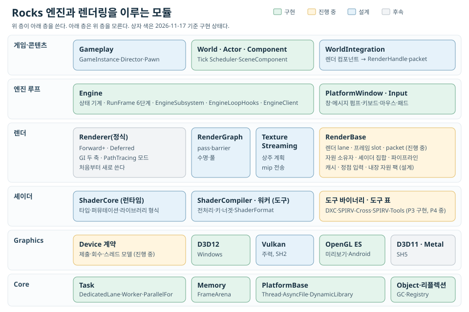
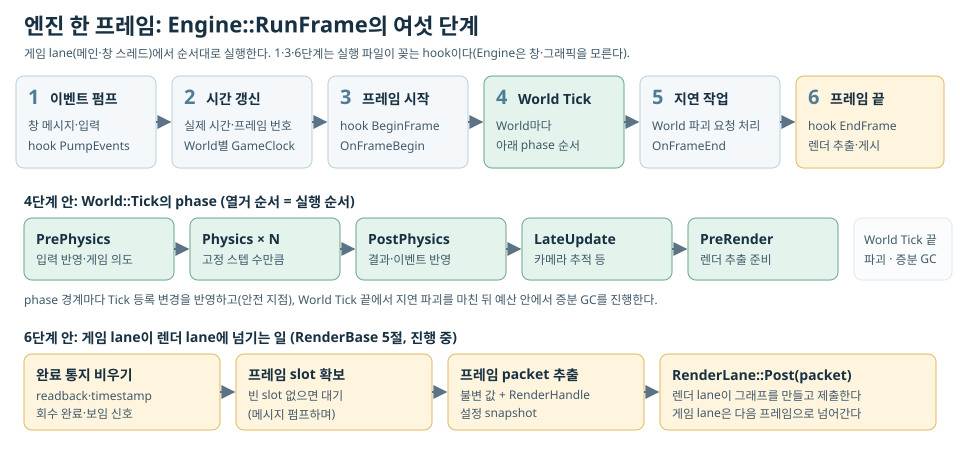
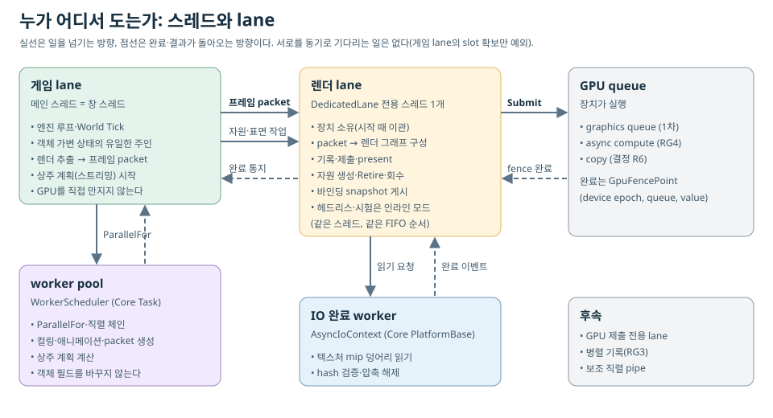
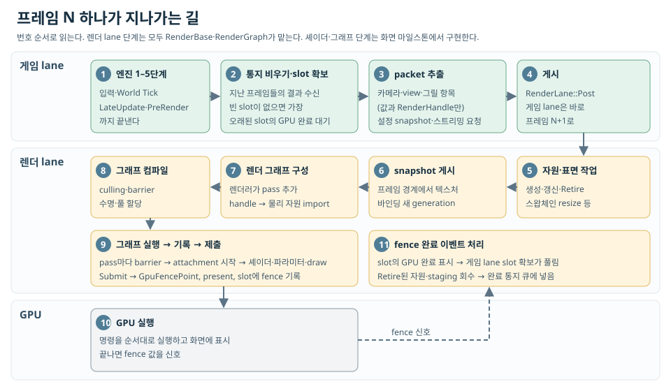
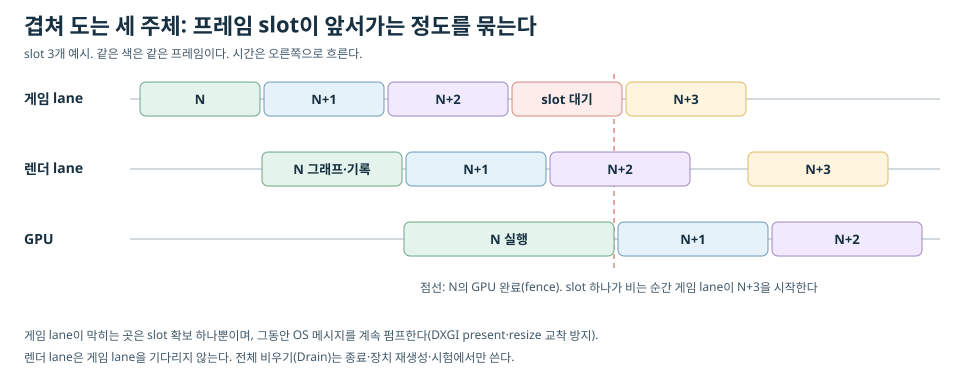
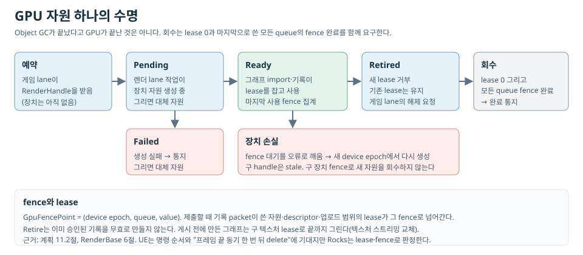
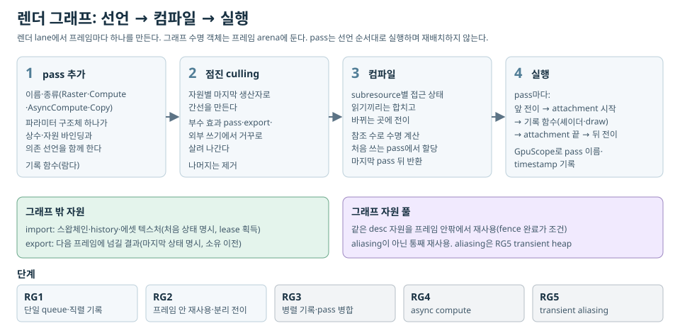
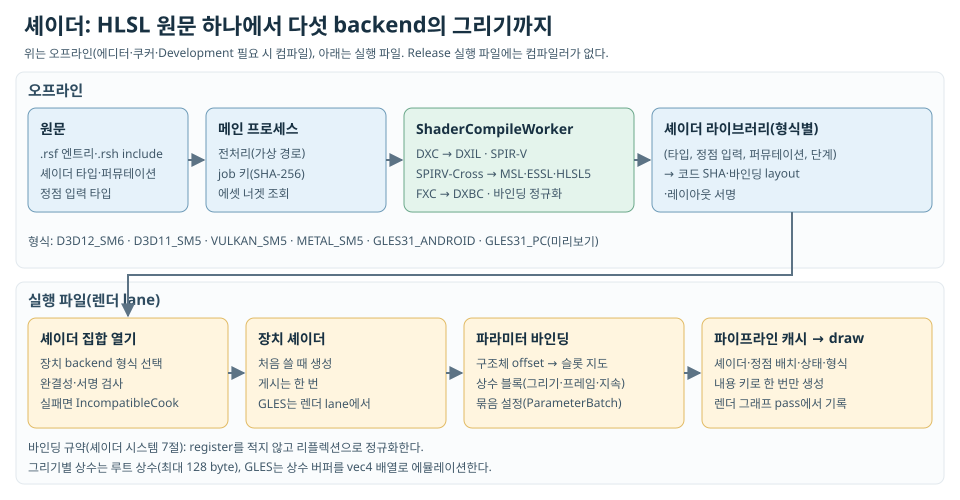
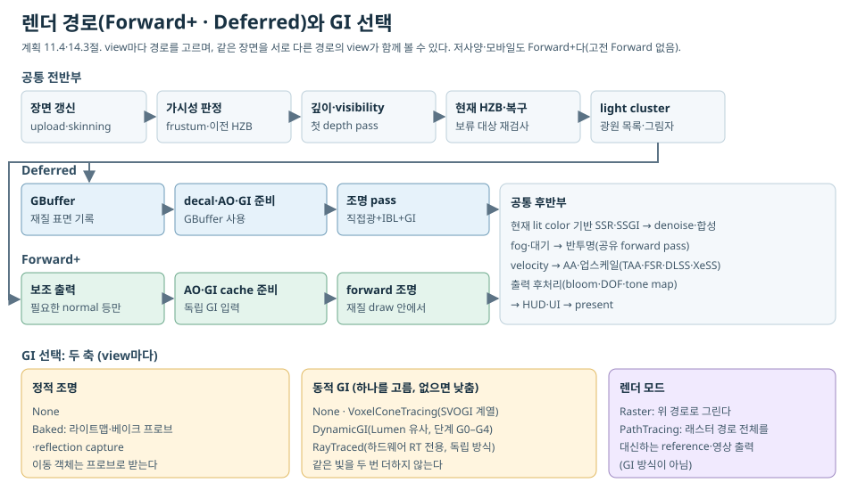
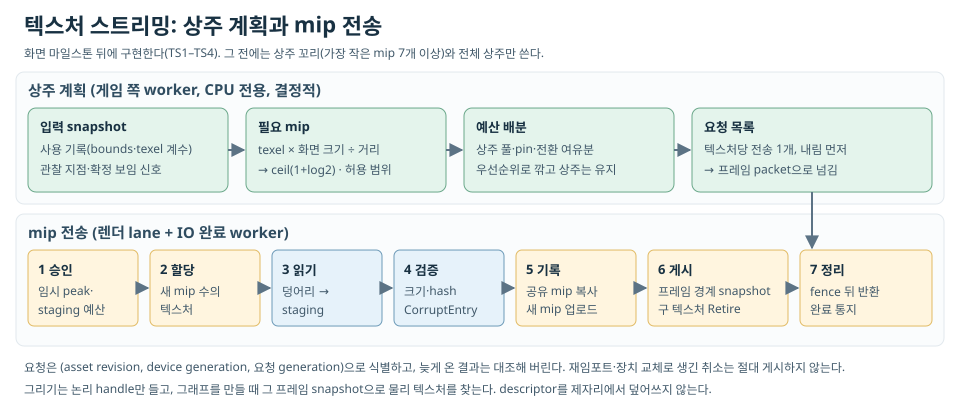

# Rocks 엔진 구동과 렌더링 안내

엔진이 한 프레임을 어떻게 돌리는지, 그 프레임이 어떤 스레드와 단계를 거쳐 화면에 그려지는지를 한곳에서 설명한다. 각 주제의 계약·근거·시험은 설계 문서에 있고, 이 문서는 그 문서들을 잇는 지도 역할을 한다.

- 기준일: 2026-11-17
- **상태 표기**: 상자 색과 본문 표기는 다음 셋이다. 지금 렌더링의 대부분은 설계 단계다.
  - **구현**: 코드와 시험이 있다.
  - **진행 중**: 구현 브랜치에서 작업 중이다.
  - **설계**: 스펙만 있다.

| 알고 싶은 것 | 읽을 절 |
|---|---|
| 엔진·렌더링의 전체 구성 | 1 |
| 엔진이 한 프레임을 도는 순서 | 2 |
| 어떤 스레드가 무엇을 하는지 | 3 |
| 프레임 하나가 화면에 나오기까지 | 4 → 5 |
| GPU 자원이 언제 만들어지고 해제되는지 | 6 |
| 렌더 그래프·셰이더가 어떻게 동작하는지 | 7 → 8 |
| Forward+·Deferred와 GI가 어디에 들어가는지 | 9 |
| 텍스처 스트리밍 | 10 |
| 시작·종료 순서, 지금 무엇이 되어 있는지 | 11 → 12 |

## 1. 전체 구성

여섯 층으로 나뉜다. 위 층이 아래 층을 쓰고, 아래 층은 위 층을 모른다.

| 층 | 모듈 | 하는 일 |
|---|---|---|
| 게임·콘텐츠 | Gameplay, World·Actor·Component, WorldIntegration | 게임 규칙과 장면 객체. WorldIntegration이 렌더 컴포넌트를 렌더 쪽 handle·프레임 packet으로 잇는다 |
| 엔진 루프 | Engine, PlatformWindow·Input | 엔진 상태 기계, 한 프레임 6단계, 창·입력 |
| 렌더 | Renderer(정식), RenderGraph, TextureStreaming, RenderBase | 렌더 경로, pass 그래프, 텍스처 mip 상주, 렌더 lane·자원 수명·셰이더 런타임 객체 |
| 셰이더 | ShaderCore, ShaderCompiler·워커, 도구 바이너리 | 런타임 셰이더 메타데이터, 오프라인 컴파일, DXC·SPIRV-Cross·SPIRV-Tools |
| Graphics | Device 계약, D3D12·Vulkan·OpenGL ES·D3D11·Metal backend | 장치·명령·제출·회수 계약과 API별 구현 |
| Core | Task, Memory, PlatformBase, Object·리플렉션 | 실행기·할당기·스레드·비동기 IO·동적 라이브러리·객체 |

- **Engine은 창과 그래픽을 모른다.** 이벤트 펌프와 렌더 제출은 실행 파일(Sandbox·게임)이 `EngineLoopHooks`로 꽂는다. 그래서 헤드리스 서버·시험은 같은 Engine을 hook 없이 돌린다.
- **렌더 쪽은 World·Object에 의존하지 않는다.** 게임 객체 대신 값과 handle만 받는다(3절).
- 그래픽 backend의 주력은 Vulkan이다. OpenGL ES는 구형 Android 기기와 Windows의 모바일 미리보기용이다. 데스크톱 OpenGL은 지원하지 않는다.
- 지금의 최소 렌더러(내장 메시 둘, 원문 셰이더 하나)는 Sandbox 샘플로 옮긴다. 정식 렌더러는 RenderBase·RenderGraph·쿠킹 셰이더 위에 처음부터 새로 쓴다.

근거 문서: [엔진 구현 계획](../Design/EngineImplementationPlan.ko.md) 3절, [엔진 런타임](../Design/EngineRuntime/03-Modules.ko.md) 3절, [렌더 기반](../Design/RenderBase/01-Decisions.ko.md) 1·3절.

## 2. 엔진 한 프레임

`Engine::RunFrame`은 게임 lane(메인 스레드이자 창 스레드)에서 여섯 단계를 순서대로 실행한다(구현).

1. **이벤트 펌프**: hook `PumpEvents`가 창 메시지를 처리하고 입력을 모은다. 종료가 필요하면 `RequestExit`를 부른다.
2. **시간 갱신**: 실제 시간과 프레임 번호를 갱신한다. World마다 자기 `GameClock`(pause·time scale·고정 스텝 계획)을 가진다.
3. **프레임 시작**: hook `BeginFrame`을 부르고, EngineSubsystem이 `OnFrameBegin`을 받는다.
4. **World Tick**: World마다 phase를 순서대로 돈다.
   - `PrePhysics`: 입력 반영·게임 의도
   - `Physics`: 이번 프레임의 고정 스텝 수만큼 반복
   - `PostPhysics`: 결과·이벤트 반영
   - `LateUpdate`: 카메라 추적처럼 렌더 직전에 확정할 것
   - `PreRender`: 렌더 추출 준비
   - phase 경계에서 Tick 등록 변경을 반영한다. World Tick 끝에서 지연된 파괴를 마치고, 예산 안에서 증분 GC를 진행한다.
5. **지연 작업**: 프레임 안에서 요청된 World 파괴를 처리하고, Subsystem이 `OnFrameEnd`를 받는다.
6. **프레임 끝**: hook `EndFrame`에서 렌더 추출과 게시가 일어난다.
   - **지금 코드**: 게임 스레드가 장치에 직접 그리고 present한다.
   - **바뀔 구조**(진행 중): 게임 lane은 렌더 lane에 프레임 packet만 넘기고 곧바로 다음 프레임으로 간다(4절).

근거 문서: [엔진 런타임](../Design/EngineRuntime/05-Time.ko.md) 5–8절, 계획 8.2–8.3절.

## 3. 스레드와 lane

일을 하는 주체는 다섯이다. 각 주체가 소유한 데이터는 그 주체만 바꾼다.

| 주체 | 실행 위치 | 소유하는 것 | 하지 않는 것 |
|---|---|---|---|
| 게임 lane | 메인 스레드(창 스레드) | 객체 가변 상태, World, 엔진 루프 | GPU를 직접 만지지 않는다. 디스크·GPU를 동기로 기다리지 않는다(slot 확보 예외) |
| worker pool | `WorkerScheduler` worker들(구현) | 나눠 받은 계산 범위 | 객체 필드를 바꾸지 않는다. 결과는 값으로 돌려준다 |
| 렌더 lane | 전용 스레드 1개, `DedicatedLane`(실행기는 구현, 렌더 lane은 진행 중) | 장치, 렌더 그래프, 자원 소유자, 바인딩 snapshot | 게임 객체 주소를 받지 않는다. 게임 lane을 기다리지 않는다 |
| IO 완료 worker | `AsyncIoContext`(구현) | 진행 중 파일 읽기 | 결과는 완료 이벤트로만 넘긴다 |
| GPU queue | 장치 | 제출된 명령 | 완료는 `GpuFencePoint`로 알린다 |

넘기는 방향과 돌아오는 방향:

- **게임 → 렌더**: lane 작업 네 종류만 오간다.
  - 프레임 packet
  - 자원 생성·갱신·`Retire`
  - 표면 작업(스왑체인 생성·resize·파괴, Android surface 소실)
  - lane 표지

  작업에 담을 수 있는 값 타입은 "lane 전달 가능"으로 등록한 것(`ROCKS_LANE_TRANSFERABLE`, `Meta/LaneTransfer.h`)뿐이며, 게임 객체 포인터는 담지 않는다.
- **렌더 → 게임**: 완료 통지 큐(`RenderNotices`)로 돌아온다. readback 결과, timestamp, 회수 완료, 보임 신호가 여기에 담기고, 게임 lane이 다음 프레임 시작에 비운다.
- **렌더 → GPU**: `Submit`이 `GpuFencePoint`(device epoch, queue, value)를 돌려준다. fence가 완료되면 렌더 lane이 이벤트로 받는다. 폴링하지 않는다.
- **게임 ↔ worker**: `ParallelFor`·직렬 작업 체인으로 넘기고 결과를 모은다.

**인라인 모드.** 헤드리스 실행과 시험은 렌더 lane 스레드를 만들지 않는다. 같은 스레드에서 같은 FIFO 순서로 작업을 실행한다. 두 모드는 같은 결과를 내야 하며, 그래야 GPU 없이도 렌더 흐름을 결정적으로 시험할 수 있다.

**장치 소유.**
- 장치는 게임 lane에서 만들고, 렌더 lane이 시작할 때 소유권을 넘긴다. 종료 때 돌려받는다.
- 제출·present·상태 변경은 소유 스레드만 한다.
- 기록 객체는 기록하는 스레드마다 하나씩 둔다.
- 자원 생성이 스레드 안전한지는 backend가 공개한다. D3D12·Vulkan·Metal은 어느 스레드에서도 만들 수 있다. OpenGL ES는 context가 스레드에 묶이므로 렌더 lane에서만 만든다.

근거 문서: [렌더 기반](../Design/RenderBase/05-RenderLane.ko.md) 5절, 계획 8.1절.

## 4. 프레임 하나가 화면에 나오기까지

| 번호 | 주체 | 하는 일 |
|---|---|---|
| 1 | 게임 lane | 엔진 1–5단계와 World Tick을 끝낸다 |
| 2 | 게임 lane | 완료 통지를 비우고 프레임 slot을 하나 확보한다. 빈 slot이 없으면 가장 오래된 slot의 GPU 완료를 기다린다 |
| 3 | 게임 lane | 프레임 packet을 추출한다: 카메라·view, 그릴 항목(값과 `RenderHandle`), 렌더 설정 snapshot, 텍스처 스트리밍 요청 |
| 4 | 게임 lane | `RenderLane::Post`로 게시하고 다음 프레임으로 넘어간다 |
| 5 | 렌더 lane | 앞서 들어온 자원·표면 작업을 FIFO 순서대로 처리한다 |
| 6 | 렌더 lane | 프레임 경계에서 텍스처 바인딩 snapshot을 새 generation으로 게시한다(스트리밍 교체) |
| 7 | 렌더 lane | 렌더러가 렌더 그래프에 pass를 추가한다. handle은 이 프레임 snapshot으로 물리 자원에 이어져 import된다 |
| 8 | 렌더 lane | 그래프를 컴파일한다: 미사용 pass 제거, 전이 계산, 자원 수명과 풀 할당 |
| 9 | 렌더 lane | pass마다 전이 → attachment 시작 → 셰이더·파라미터·draw로 기록한다. 제출하고 present하며, slot에 fence를 적는다 |
| 10 | GPU | 명령을 실행하고 화면에 표시한 뒤 fence를 신호한다 |
| 11 | 렌더 lane | fence 완료 이벤트를 받아 slot을 비우고, `Retire`된 자원·staging을 회수하고, 완료를 통지 큐에 넣는다 |

게임 lane이 추출하는 값이 "불변"이라는 점이 핵심이다. 렌더 lane이 그 packet을 처리하는 동안 게임 lane은 이미 다음 프레임의 World를 바꾸고 있다. 둘이 같은 메모리를 공유하지 않으므로 잠금이 필요 없다.

## 5. 프레임 파이프라이닝과 대기 규칙

- **겹쳐 도는 구조**: 게임 lane, 렌더 lane, GPU가 서로 다른 프레임을 동시에 처리한다. 프레임 slot 수(2–3, 설정)가 게임 lane이 앞서갈 수 있는 정도를 묶는다.
- **slot의 완료 표지 둘**: slot마다 "렌더 lane 처리 완료"와 "GPU 완료"를 따로 둔다. slot 재사용은 시간이 아니라 그 slot의 모든 queue fence 완료로 판정한다.
- **게임 lane의 유일한 대기**: 게임 lane이 막히는 곳은 slot 확보 하나뿐이다.
  - 그동안 OS 메시지를 계속 펌프한다. DXGI의 present·resize는 창 스레드로 동기 메시지를 보내므로, 펌프를 멈추면 교착이 난다.
  - 예외는 Android surface 소실 handshake 하나다. 앱 스레드가 렌더 lane의 surface 사용 중단을 기다려야 한다.
- **렌더 lane은 게임 lane을 기다리지 않는다.**
- **전체 비우기**: `RenderLane::Drain(이유)`은 종료·장치 재생성·시험에서만 쓴다. 일반 자원 해제에는 쓰지 않는다.
- **시간 초과**: hang 진단용으로만 쓴다. 결과를 가르는 데 쓰지 않으며, 시험은 시간이 아니라 이벤트 gate로 순서를 만든다.

## 6. GPU 자원의 수명

1. **예약**: 게임 lane이 텍스처·버퍼가 필요하면 `RenderHandle`을 곧바로 받는다. 이때 장치 자원은 아직 없다.
2. **Pending**: 렌더 lane 작업이 장치 자원을 만든다. 그사이에 그 handle로 그리면 형식·차원이 맞는 내장 대체 자원을 쓰고 진단 계수를 올린다. 생성에 실패하면 Failed 상태가 되고 통지된다.
3. **Ready**: 렌더 그래프 import와 기록이 그 자원의 lease를 잡고 쓴다. 제출할 때 lease는 그 fence로 넘어가고, 장치가 마지막 사용 fence를 집계한다.
4. **Retired**: 게임 lane이 해제를 요청하면 새 lease를 막는다. 이미 승인된 기록은 끝까지 그 자원으로 그린다.
5. **회수**: lease가 0이 되고, 마지막으로 쓴 모든 queue의 fence가 완료되면 해제한다. 회수가 끝나면 통지한다. 게임 쪽 CPU 데이터를 그때까지 붙잡아 둘 필요가 있으면, 이 통지를 받아 놓는다.

장치를 잃으면 기다리던 fence가 오류로 깨어난다. 자원은 새 device epoch에서 다시 만들고, 구 handle은 stale이 된다. 구 장치의 fence로 새 장치의 자원을 회수하지 않는다.

**내장 자원 팩.** 렌더 lane 시작 단계에서 한 번 만든다(11절). 들어 있는 것은 다음과 같다.
- white·black·transparent·flat-normal 텍스처, 차원별 대체 텍스처
- 0·1 버퍼, 기본 메시
- fallback 셰이더

생성에 실패하면 `BuiltinReady`를 게시하지 않고 시작이 실패한다.

근거 문서: [렌더 기반](../Design/RenderBase/06-ResourceLifetime.ko.md) 6·11절, 계획 9.6·11.2절.

## 7. 렌더 그래프

렌더러는 GPU 명령을 직접 기록하지 않고 pass를 선언한다(설계, RG1부터).

- **pass**는 이름, 종류(Raster·Compute·AsyncCompute·Copy), 파라미터 구조체, 기록 함수를 가진다. 파라미터 구조체 하나가 셰이더 상수, 자원 바인딩, "이 pass가 무엇을 읽고 쓰는가"라는 의존 선언을 함께 맡는다.
- **culling**: pass를 추가할 때마다 자원별 마지막 생산자로 간선을 만든다. 부수 효과가 있는 pass(present·readback), export, 그래프 밖 쓰기에서 거꾸로 살려 나가고 나머지는 버린다.
- **컴파일**: subresource마다 접근 상태를 모은다. 읽기끼리는 합치고, 상태가 바뀌는 곳에만 전이를 둔다. 참조 수로 자원 수명을 정하고, 처음 쓰는 pass에서 풀로부터 할당해 마지막 pass 뒤에 반환한다.
- **실행**: pass를 선언 순서대로 실행하며 재배치하지 않는다. 의존은 늘 앞쪽 pass만 가리키므로 순환이 생기지 않는다. pass마다 `GpuScope`가 이름과 timestamp를 남긴다.
- **그래프 밖 자원**: 스왑체인·history·에셋 텍스처는 import로 들인다(처음 상태 명시, lease 획득). 다음 프레임에 넘길 결과는 export로 내보낸다.
- **backend 차이**: 전이는 추상 접근 상태 하나로 계산하고, backend가 실제 barrier로 낮춘다. D3D12는 resource barrier나 enhanced barrier, Vulkan은 pipeline barrier다. OpenGL ES는 대부분 생략하고 UAV 쓰기 뒤에만 memory barrier를 둔다.
- **단계**:

  | 단계 | 내용 |
  |---|---|
  | RG1 | 단일 queue, 직렬 기록 |
  | RG2 | 프레임 안 재사용, 분리 전이 |
  | RG3 | 병렬 기록, tiled GPU pass 병합 |
  | RG4 | async compute |
  | RG5 | transient aliasing |

근거 문서: [렌더 기반](../Design/RenderBase/07-RenderGraph.ko.md) 7·8절, 계획 11.3절.

## 8. 셰이더: 원문에서 그리기까지

셰이더 원문은 HLSL 하나다. 엔트리는 `.rsf`, include는 `.rsh`다.

**오프라인**
- 메인 프로세스가 전처리하고 job 키(SHA-256)를 계산한다. 결과가 에셋 너겟에 있으면 그대로 쓴다.
- 없으면 별도 프로세스 ShaderCompileWorker가 형식별로 컴파일한다.
  - DXC: DXIL·SPIR-V
  - SPIRV-Cross: MSL·ESSL·HLSL 5.0
  - FXC: D3D11 DXBC
- 결과는 형식별 셰이더 라이브러리에 담는다. 항목의 키는 (셰이더 타입, 정점 입력 타입, 퍼뮤테이션, 단계)이고, 값은 코드·바인딩 layout·레이아웃 서명이다.
- Release 실행 파일에는 컴파일러가 없다.

**실행 파일(렌더 lane)**
- **셰이더 집합 열기**: 장치 backend에 맞는 형식의 라이브러리를 연다. 등록된 엔진 셰이더가 모두 있는지, 실행 파일과 레이아웃 서명이 같은지 검사하고, 아니면 `IncompatibleCook`으로 시작이 실패한다.
- **장치 셰이더**: 처음 쓸 때 만들고, 게시는 한 번만 한다.
- **파라미터 바인딩 지도**: 파라미터 구조체의 멤버 offset을 셰이더 슬롯으로 잇는다.
- **상수 블록**: 수명은 그리기 1회·프레임·지속의 세 가지다.
- **묶음 설정**: 상수 블록과 자원 바인딩을 한 번에 올린다.
- **파이프라인 캐시**: 셰이더·정점 배치·상태·형식을 내용 키로 묶어 한 번만 만든다.

**바인딩 규약**
- 셰이더 원문에는 register를 적지 않는다. 슬롯은 리플렉션으로 정규화한다.
- 그리기별 상수는 루트 상수(최대 128 byte)다.
- OpenGL ES는 상수 버퍼를 `vec4` 배열로 에뮬레이션하고, 바뀐 것만 올린다.

**정점 입력**
- 정점 입력 타입이 메시 정점을 셰이더에 공급하는 방식을 등록한다. UE vertex factory에 해당한다.
- 바탕인 정점 배치(진행 중)는 다음을 지원한다.
  - 원소 형식 20종
  - 속성 16개, stream 8개
  - 인스턴스 stream
  - 셰이더 입력 대조

근거 문서: [셰이더 시스템](../Design/ShaderSystem/README.ko.md), [렌더 기반](../Design/RenderBase/09-ShaderRuntime.ko.md) 9·10절.

## 9. 렌더 경로와 GI

정식 렌더러는 view마다 경로를 고른다(설계, 화면 마일스톤 다음).
- 경로는 **Forward+**와 **Deferred** 둘이다. 저사양·모바일도 Forward+다. light grid는 GLES에서 texture buffer로 읽는다.
- 같은 장면을 서로 다른 경로의 view가 함께 볼 수 있다.

**프레임 그래프 구성**
- **공통 전반부**: 장면 갱신·skinning → 가시성(frustum·이전 HZB) → 첫 깊이 → 현재 HZB와 보류 대상 재검사 → light cluster·그림자.
- **Deferred**: GBuffer → decal·AO·GI 준비 → 조명 pass.
- **Forward+**: 필요한 보조 출력만 → AO·GI cache 준비 → 재질 draw 안에서 forward 조명.
- **공통 후반부**: 현재 조명 결과 기반 SSR·SSGI → fog·대기 → 반투명(공유 forward pass) → velocity → AA·업스케일 → 출력 후처리 → HUD·UI → present.

**GI는 두 축으로 고른다.**
- **정적 조명**: None 또는 Baked(라이트맵·베이크 프로브·reflection capture).
- **동적 GI**: None·VoxelConeTracing(SVOGI 계열)·DynamicGI(Lumen 유사)·RayTraced 가운데 하나다. 장치에 능력이 없으면 정해진 순서로 낮춘다.
- 두 축을 함께 켤 수 있다. 같은 빛을 두 번 더하지 않는다.
- **PathTracing**은 GI 방식이 아니다. 래스터 경로 전체를 대신하는 별도 렌더 모드다(reference·영상 출력).

근거 문서: 계획 11.1·11.4·14.3·14.4·14.10절.

## 10. 텍스처 스트리밍

화면 마일스톤 다음에 구현한다(설계, TS1–TS4). 그 전까지는 텍스처의 가장 작은 mip들(상주 꼬리, 7개 이상)과 전체 상주만 쓴다.

- **상주 계획**(게임 쪽 worker, CPU 전용, 결정적)
  - 입력: 사용 기록(bounds·texel 계수)과 관찰 지점(위치·표본 해상도·boost).
  - 필요 mip = texel 계수 × 화면 크기 ÷ AABB까지 거리로 구하고, mip 수로 바꿔 허용 범위로 자른다.
  - 예산(상주 풀·pin 예약·전환 여유분·임시 peak·staging·업로드)에 맞춰 우선순위가 낮은 것부터 깎는다. 이미 상주한 mip은 예산이 허락하는 한 유지한다.
  - 결과는 요청 목록이다.
- **mip 전송**(렌더 lane + IO 완료 worker)
  - 순서: 승인 → 새 mip 수의 텍스처 할당 → mip 덩어리 읽기 → 크기·hash 검증 → 공유 mip 복사·새 mip 업로드 기록 → 다음 프레임 경계에서 바인딩 snapshot 게시와 구 텍스처 `Retire` → fence 뒤 정리·통지.
- **안전 규칙**
  - 요청은 (asset revision, device generation, 요청 generation)으로 식별하고, 늦게 온 결과는 대조해 버린다. 재임포트·장치 교체로 생긴 취소는 절대 게시하지 않는다.
  - 그리기는 논리 handle만 든다. descriptor를 제자리에서 덮어쓰지 않는다.

근거 문서: [텍스처 스트리밍](../Design/TextureStreaming.ko.md), [렌더 기반](../Design/RenderBase/06-ResourceLifetime.ko.md) 6.5절(쿠킹 텍스처 데이터 계약).

## 11. 시작과 종료

**시작**
1. 창과 장치를 만든다(게임 lane). 장치 능력을 조회한다.
2. 렌더 lane을 시작하고 장치 소유권을 넘긴다. 스왑체인을 만든다(표면 작업).
3. 엔진 셰이더 집합을 열고 검사한다.
4. 내장 자원 팩을 만들고 업로드한 뒤 fence를 기다린다. 끝나면 `BuiltinReady`를 게시한다.
5. 일반 에셋을 열고 프레임을 시작한다.

**종료**는 계획 3.2절 Shutdown 순서를 따른다. 실패한 단계도 뒤 단계를 건너뛰지 않고 오류로 보고한다.
1. 새 프레임 packet을 막는다.
2. 마지막 slot의 GPU 완료를 기다린다.
3. 최종 GC와 `Retire` drain을 closure가 닫힐 때까지 반복한다. 렌더 lane은 이 동안 살아 있다.
4. 엔진 셰이더 집합과 내장 자원을 `Retire`하고, 파이프라인 캐시를 비운다.
5. 스왑체인을 파괴한다.
6. 렌더 lane을 비운다(남은 작업 0을 확인).
7. 장치 소유권을 게임 lane으로 되돌리고 lane 스레드를 Join한다.
8. 장치 `WaitIdle` → 장치 소멸 → 창 파괴.

## 12. 지금 되어 있는 것과 다음

| 영역 | 상태 | 내용 |
|---|---|---|
| 엔진 루프·World·Tick·입력·창 | 구현 | 6단계 프레임, phase, 지연 파괴, 증분 GC, Win32 창·입력 |
| Core 실행기·할당기 | 구현 | `DedicatedLane`·`SerialTaskChain`·`ParallelFor`·`FrameArena`, `AsyncIoContext` 완료 게시 보류 |
| 동적 라이브러리·셰이더 도구 공급 | 구현 | `DynamicLibrary`, ThirdParty `binary`·`headers`, bootstrap, DXC·SPIRV-Cross·SPIRV-Tools Windows 빌드 게시 |
| 셰이더 도구 표·Release 배제 | 진행 중 | P4 |
| Graphics 제출·회수·스레드 모델, 렌더 lane, 정점 배치 | 진행 중 | GX7·GX10·GX11·CP6·RB1·GX3a. 최소 렌더러는 Sandbox 샘플로 이동 |
| 셰이더 컴파일·쿠킹·런타임 객체 | 설계 | 셰이더 시스템 SH0–SH4, RenderBase RB3·RB4. 화면 마일스톤 |
| 자원 수명·내장 자원 팩·정점 입력 타입·계측 | 설계 | RB2·RB5–RB7. 화면 마일스톤 |
| 렌더 그래프 | 설계 | RG1–RG2는 화면 마일스톤, RG3–RG5는 후속 |
| 텍스처 스트리밍 | 설계 | TS1–TS4. 화면 마일스톤 다음 |
| 정식 렌더러(Forward+·Deferred·GI) | 후속 | 계획 11·14절 |

전체 순서는 다음과 같다.
1. 리플렉션 B9
2. Curve
3. 에셋 A0-G(텍스처 형식·차원·샘플러)
4. 에셋 A1–A6
5. 화면 마일스톤: 셰이더 구현 + 렌더 기반을 제대로 세우는 단계. A5 텍스처 전부를 D3D12·Vulkan·GLES 미리보기로 대조한다.
6. 정식 렌더러·텍스처 스트리밍

에셋과 무관한 선행 작업은 미리 해 둔다. Core 실행기, 셰이더 도구 공급, Graphics 계약이 여기에 해당한다.

## 13. 더 읽을 문서

| 문서 | 다루는 것 |
|---|---|
| [엔진 런타임](../Design/EngineRuntime/README.ko.md) | 엔진 상태 기계·World·Tick·입력·Graphics 최소 경로 |
| [렌더 기반](../Design/RenderBase/README.ko.md) | 렌더 lane·자원 수명·렌더 그래프·셰이더 런타임·정점 입력·화면 마일스톤 범위 |
| [셰이더 시스템](../Design/ShaderSystem/README.ko.md) | 셰이더 언어·형식·바인딩 규약·도구·워커·키·라이브러리 |
| [텍스처 스트리밍](../Design/TextureStreaming.ko.md) | 상주 계획·mip 전송 |
| [픽셀 형식](../Design/PixelFormat/README.ko.md) | 형식 번호표·정보 표·형식 능력·backend 형식 대응·sRGB·깊이/스텐실 |
| [엔진 구현 계획](../Design/EngineImplementationPlan.ko.md) | 8절 실행 규약, 11절 렌더러·RHI·렌더 그래프, 14절 조명·GI |
| [에셋 시스템](../Design/AssetSystem/README.ko.md) | 에셋·쿠킹·텍스처 설정 |
