# Rocks 가비지 컬렉션 안내

객체를 **누가 살려 두는지**, 참조가 바뀌면 **GC가 어떻게 따라가는지**, 사용을 끝낸 객체가 **언제 실제로 해제되는지**를 설명한다. 현재 `ObjectRegistry`와 World·Engine 코드를 기준으로 작성했다. 수백만 객체의 비용은 코드 구조에 따른 분석과 계산 예이며, 처리 시간이나 최대 지원 규모를 입증한 벤치마크 결과는 아니다.

| 알고 싶은 것 | 읽을 절 |
|---|---|
| GC가 처음이라 전체 흐름부터 이해 | 1 → 2 → 3 → 4 |
| 객체를 생성하고 참조·접근을 안전하게 관리 | 2 → 5 → 6 |
| 장벽, 파괴 요청, 레벨 전환, 종료의 실제 동작 | 3 → 4 → 6 |
| 수백만 객체의 한도·메모리·정지 시간 | 7 → 8 → 9 |
| 회수가 늦거나 GC가 멈춘 것 같을 때 | 6 → 9 → 10 |

세부 구현 계약은 [점진·병렬 GC](IncrementalGarbageCollection.ko.md), 접근 및 수명 규약은 [객체 생명주기](ObjectLifecycle.ko.md)를 참고한다.

## 1. 전체 흐름과 기본 용어

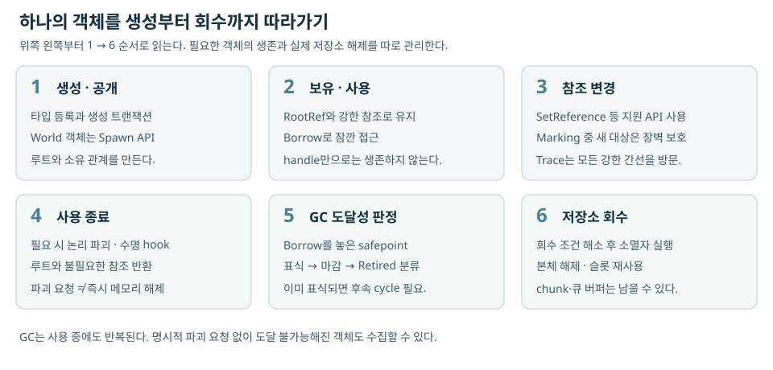

먼저 **보유와 접근**, **논리적 파괴**, **GC의 도달성 판정**, **저장소 회수**를 구분한다. 다음 그림은 이 중 보유 관계를 확대한 것이다.

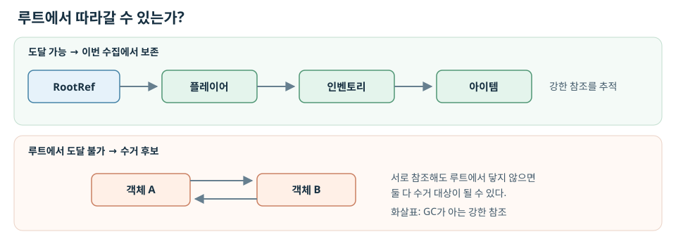

독립 Registry에서 외부 소유자가 플레이어의 `RootRef`를 유지하고, 플레이어가 인벤토리와 아이템을 참조한다면 세 객체에 도달할 수 있다. 아이템을 인벤토리에서 빼고 다른 루트나 강한 참조도 없다면 다음 수집에서 회수 대상이 된다. World가 관리하는 Actor는 6절의 Level 소유 규칙을 따른다.

| 용어 | 쉽게 말하면 |
|---|---|
| 루트 | GC가 탐색을 시작하는 외부 보유권 |
| 강한 참조 | 연결된 다른 객체를 살리는 참조 |
| 도달 가능 | 루트에서 강한 참조를 따라 객체에 갈 수 있는 상태 |
| cycle | 한 번의 수집을 시작해서 끝낼 때까지의 전체 과정 |
| slice | 점진 수집에서 나누어 실행하는 한 번의 작업 |
| `Trace` | 한 객체가 어떤 다른 객체를 강하게 참조하는지 GC에 알려 주는 방문 함수 |
| slot / chunk | 객체 하나의 상태를 기록하는 관리 칸 / 그 칸 64개를 묶은 저장소 |
| epoch | 이번 수집을 구분하는 번호. 객체의 표식 번호와 비교해 이미 발견했는지 판단한다. |
| gate | Registry의 공유 상태를 보호하는 잠금 |
| shade | 미발견 대상을 발견 상태로 표시하고 탐색할 작업에 넣는 동작 |
| safepoint | 소유 스레드에서 Borrow와 활성 생성 트랜잭션을 정리해 GC를 실행할 수 있는 지점 |

GC는 객체가 게임에서 쓸모있는지 알지 못한다. 사용이 끝났다면 보유하던 루트와 참조를 실제로 정리해야 한다.


### GC가 관리하는 범위

GC는 `ObjectRegistry`에 등록된 객체 중 **루트에서 강한 참조를 따라 도달할 수 없는 객체**를 찾아 회수한다. Registry가 알지 못하는 C++ 포인터나 추적되지 않는 필드는 객체를 살리지 않는다.

| 수단 | 역할 | GC에 미치는 영향 |
|---|---|---|
| `RootRef` | 외부에서 객체를 유지 | 탐색의 출발점 |
| `ObjectRef` 등 강한 참조 | 객체에서 다른 객체를 참조 | 타입의 `Trace`가 방문하면 대상 유지 |
| `ObjectHandle` | 객체의 식별자 | 단독으로 생존을 보장하지 않음 |
| `WeakRef` | 생존을 보장하지 않는 참조 | 접근 전에 pin 성공 여부 확인 |
| `Borrow` | 객체에 임시 접근하는 권한 | 보유 중에는 GC safepoint 진입이 막힘 |
| `BackendLease` / `EncodePin` | 백엔드·인코딩 작업의 보유 | 물리적 회수를 늦출 수 있지만 일반 접근용 루트는 아님 |

수집 대상은 Registry 객체다. 일반 C++ 할당 전체나 GPU 자원, 파일 핸들을 자동으로 추적하는 시스템은 아니다. 이러한 자원은 객체의 명시적 해제 및 소멸자 등 별도 소유권 규약이 필요하다. GC는 객체가 언제 회수될지 즉시 보장하지 않는다.

## 2. 소유 관계와 적용할 곳 정하기

| 상황 | 권장 방식과 이유 |
|---|---|
| 서로 참조하거나 수명이 동적으로 얽힌 Registry 객체 그래프 | 루트와 강한 참조를 명시하고 GC 사용. 순환 참조도 도달성으로 처리한다. |
| 프레임 중 객체가 많고 한 번의 전체 수집이 부담인 경우 | 안전한 프레임 경계에서 점진 수집을 진행하고 실제 pause와 메모리 잔류를 측정한다. |
| 로딩 화면·종료 등 긴 정지를 허용하는 시점, 또는 결과 대조 | 상황에 따라 `Collect` 사용. 전체 수집도 루트와 보유권 계약은 동일하게 지킨다. |
| 파일·락·GPU 자원처럼 정해진 시점에 반드시 반환해야 하는 자원 | 명시적 해제나 RAII를 사용한다. GC 및 지연 회수 시점에 의존하지 않는다. |
| hard real-time 경로 또는 긴 trace/소멸자를 허용할 수 없는 경로 | 현재 GC는 시간 상한을 보장하지 않으므로 별도 수명 관리와 스케줄링을 검토한다. |
| 짧게 쓰고 버리는 일반 값, 임시 버퍼, 프레임 scratch 데이터 | 값 타입, 스코프 수명 또는 적절한 allocator를 고려한다. Registry 객체화와 추적 비용이 필요하지 않을 수 있다. |

### 상황별 설계 지침

| 유즈케이스 | 보유와 정리 방법 | 주의할 점 |
|---|---|---|
| World가 플레이어 Actor와 Component를 소유 | World가 Level의 `RootRef`를 보유하고 Level → Actor → Component를 강한 참조로 유지한다. World 관리 객체의 수명은 Spawn·파괴 API로 관리한다. | 외부에서 Actor의 `RootRef`를 따로 장기 보유하면 정리가 지연된다. 게임 객체의 추가 강한 참조도 `Trace`해야 한다. |
| UI가 선택된 객체를 잠깐 관찰 | 대상의 수명을 소유하지 않는다면 `WeakRef`로 보관하고, 실제 사용 전에 pin 결과를 확인한다. 사용 중 필요한 접근 권한만 짧게 유지한다. | pin 실패는 정상적인 수명 종료일 수 있다. 오래된 handle이나 원시 포인터를 그대로 사용하지 않는다. |
| 비동기 작업이 나중에 객체를 사용 | 결과 적용 시점에 대상이 없어도 된다면 약한 참조를 확인한다. 반드시 유지해야 한다면 소유자가 작업 완료까지 `RootRef`를 보유하고 명시적 파괴·`Discard`와 작업 종료를 조율한다. 객체 접근은 올바른 소유 스레드와 문맥에서 수행한다. | `RootRef`는 명시적 파괴 후 일반 접근을 보장하지 않는다. 접근 결과를 검사한다. `BackendLease`도 일반 접근이나 논리적 생존을 보장하지 않는다. worker에 원시 포인터를 전달해 임의로 접근하지 않는다. |
| 레벨 전환으로 객체 그래프를 제거 | 게임의 참조와 루트를 정리하고 safepoint에서 수집한다. 폐기 시점에 제약이 있다면 명시적 수명 종료도 별도로 설계한다. | 소멸자 호출 시점은 즉각적이지 않다. GC 이후에도 backend 보유 등으로 저장소 회수가 지연될 수 있다. |
| 패키지와 소속 에셋 | 패키지 정책의 양방향 보존 규칙과 명시적 `Discard` 경로를 따른다. 패키지의 `RootRef`는 관리자가 수명 동안 보유한다. | 일반 Registry와 달리 패키지가 살아 있으면 소속 자식도 보존된다. Discard 없이 루트를 놓는 것은 정책 위반이다. |
| 캐시 또는 객체 풀 | 캐시가 객체를 계속 보유할지, 대상이 사라져도 되는지 정한다. Registry 밖의 소유 캐시는 유지할 항목의 `RootRef`를 보유하고, 관찰만 한다면 약한 참조를 고려한다. 반환·축출 시 참조를 정리한다. | Registry 객체 안의 강한 참조는 캐시 객체 자체가 루트에서 도달 가능하고 해당 참조를 `Trace`할 때 항목을 살린다. GC가 자동으로 캐시를 축출하지 않는다. |
| 파일·소켓·GPU 자원 | 사용 종료가 필요한 시점에 명시적으로 닫거나 별도의 RAII 소유자를 둔다. Registry 객체는 그 수명과 연결할 수 있다. | GC 실행, 소멸자 호출, backend 작업 종료가 같은 시점이라고 가정하지 않는다. |

**판단 순서:** 객체가 반드시 살아 있어야 하는 기간을 정한다 → 그 기간을 책임지는 소유자의 루트를 정한다 → 객체 사이의 강한 참조를 `Trace`와 변경 API에 반영한다 → 관찰만 하는 곳은 약한 참조를 고려한다 → 루트와 외부 자원을 언제 정리할지 정한다.

## 3. 삼색 마킹과 참조 변경 장벽

삼색은 탐색 상태를 설명하는 모델이다. 색깔 자체가 메모리에 저장되는 것은 아니다.

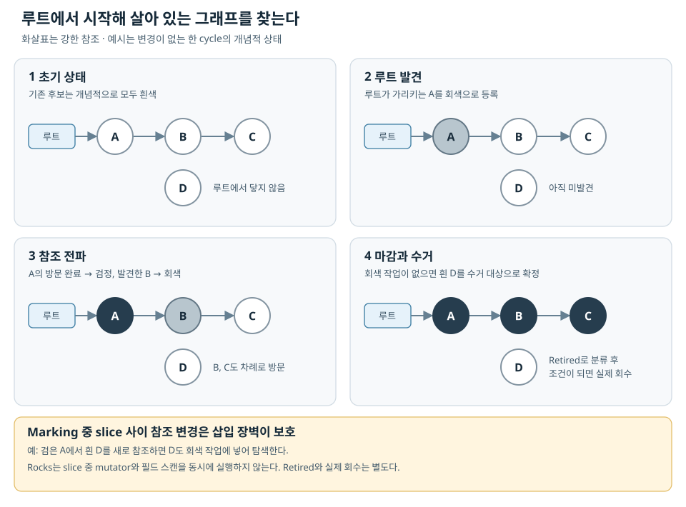

| 색 | 의미 | 이 cycle에서의 처리 |
|---|---|---|
| 흰색 | 아직 발견되지 않은 객체 | 마킹 마감까지 흰색이면 도달 불가능한 수거 후보 |
| 회색 | 발견되어 작업 목록에 들어갔거나 탐색 중인 객체 | 강한 참조를 방문해야 함 |
| 검은색 | 발견되었고 강한 참조 방문을 마친 객체 | 이번 cycle의 수거 대상에서 제외 |

1. 기존 후보를 개념적으로 흰색으로 두고, 루트가 가리키는 객체를 회색으로 만든다.
2. 회색 객체를 방문해 흰 자식을 회색으로 발견한다. 방문을 마친 객체는 검은색이 된다.
3. 회색 작업이 없어지면 남은 흰 객체를 수거 대상으로 확정한다. 그림에서는 D가 해당한다.

실제 구현은 세 색을 별도로 저장하지 않는다. 슬롯의 `mark`와 현재 `markEpoch_`로 발견 여부를 확인하고, `gcWork_`·`gcCursor_`와 진행 중인 trace로 남은 작업을 관리한다. epoch가 순환할 때 슬롯 표식을 초기화한다.

### 쓰기 장벽이란?

**쓰기 장벽(write barrier)**은 애플리케이션이 객체 참조를 변경할 때 GC가 함께 수행하는 추가 작업이다. 여기서 “장벽”은 참조 변경을 무조건 막는 벽이 아니라, **변경 사실을 수집기에 반영하는 규칙**이다. CPU 메모리 펜스나 스레드 동기화용 barrier와 같은 뜻으로 사용한 것은 아니다.

Rocks는 Marking 중 새 강한 참조의 **대상**을 표식하는 **삽입 장벽(insertion barrier)**을 사용한다. 이를 이해하려면 GC의 한 slice가 끝난 뒤 다음 slice가 시작되기 전에도 게임 코드가 객체 관계를 바꿀 수 있다는 점이 중요하다.

#### 장벽이 없다면: 살아 있는 객체를 놓치는 사례

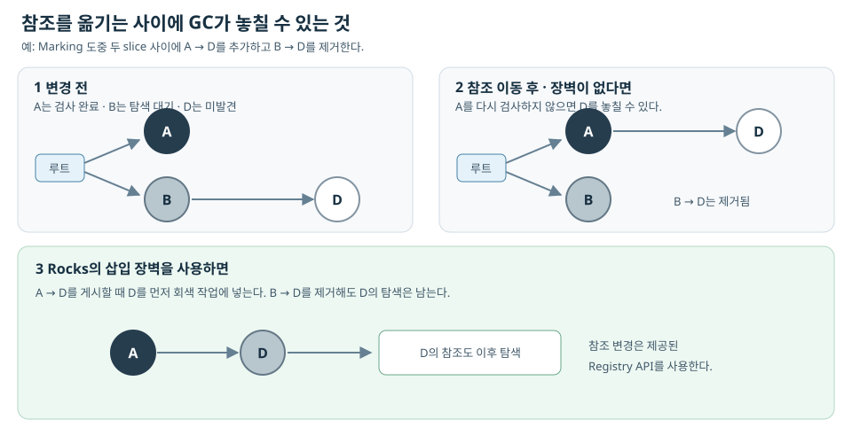

1. 루트에서 A와 B에 도달할 수 있다. GC는 A의 참조를 이미 검사했고 **A는 검은색**이다. B는 회색이고, B가 가리키는 D는 아직 흰색이다.
2. slice가 끝나고 게임 코드가 **A → D를 추가한 다음 B → D를 제거**한다. D는 여전히 루트 → A → D로 도달할 수 있다.
3. 장벽이 없다면 GC가 이후 B를 검사해도 D를 찾을 수 없고, 이미 검사한 A도 다시 보지 않는다. D가 흰색으로 남아 잘못 수거될 수 있다.
4. Rocks에서는 A → D를 `SetReference`로 추가할 때 D를 회색 작업에 넣는다. B → D를 제거해도 D가 이후 검사되어 이번 cycle에서 보존된다.

이 그림에서 변경은 **GC slice 사이**에 일어난다. Rocks의 표식 worker와 게임 코드가 같은 객체 필드를 동시에 읽고 쓰는 예가 아니다.

#### Rocks에서 참조를 쓸 때 무슨 일이 일어날까?

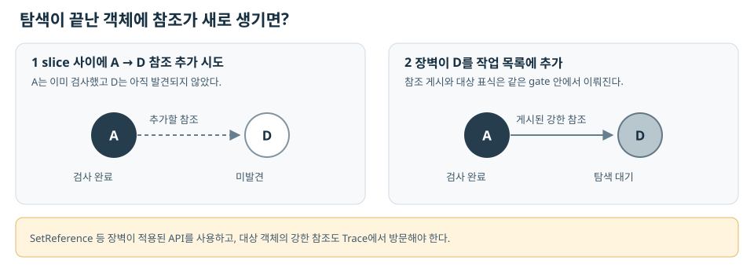

Marking 중 `SetReference`로 non-null 대상을 설정하는 경우를 단순화하면 다음 순서다.

| 순서 | 동작 | 목적 |
|---|---|---|
| 1 | Registry gate 아래에서 owner와 대상의 상태·타입 등 유효성 검사 | 유효하지 않은 객체나 허용되지 않은 연결 차단 |
| 2 | 대상이 현재 epoch에 표시되었는지 확인 | 이미 발견한 대상의 중복 작업 방지 |
| 3 | 아직 발견되지 않았다면 대상을 `gcWork_`에 넣고 현재 epoch로 표식 | 이후 대상의 `Trace`가 실행되도록 함 |
| 4 | 참조를 게시하고 성공을 반환 | 새 참조와 표식을 같은 gate 아래에서 일관되게 반영 |

구현은 **owner가 검은색인지 검사하지 않는다.** 유효한 owner가 가리킬 새 대상을 보수적으로 표식한다. 따라서 아직 루트에서 도달하지 못한 owner의 쓰기도 대상의 이번 cycle 생존으로 이어질 수 있다. 이미 표시된 대상은 중복으로 큐에 넣지 않는다. 실패하면 오류를 확인해야 하며, 단일 참조에서는 shade에 실패한 채 새 참조를 게시하지 않는다.

#### 어떤 작업에 적용될까?

| 작업 | 현재 동작 |
|---|---|
| 단일 강한 참조 설정 | `SetReference`가 non-null 새 대상을 shade한 뒤 게시한다. |
| 참조 배열 변경 | `AddReference`, `InsertReferenceAt`, `SetReferenceAt`이 non-null 대상을 처리한다. |
| 구조체 배열의 참조 필드 | `SetElementReference`가 해당 참조의 새 대상을 처리한다. |
| 참조 맵의 값 추가·교체 | `SetMapReference`가 non-null 대상을 처리한다. |
| 새 루트 또는 루트 복제 | Marking 중 `RootRef` 생성·pin·복제 경로가 대상을 shade한다. |
| 생성 트랜잭션 | 기존 Alive 대상은 참조 설정 시 shade한다. 같은 트랜잭션의 Reserved 대상은 Commit 시 공개되는 staged 객체 전체를 회색으로 넣어 Trace한다. |
| 참조 제거 또는 null 설정 | 새 대상이 없으므로 shade하지 않는다. 이미 발견된 객체의 표식을 되돌리지는 않는다. |

이 표의 shade는 **Marking 중**을 설명한다. 컨테이너의 live 편집에는 owner `Borrow`가 필요하고, 다음 GC slice 전에 반환해야 한다. 모든 변경 API의 `Result`를 확인한다. 사용자 정의 경로로 raw 메모리를 쓰거나 지원 API를 우회하면 장벽이 자동으로 실행된다고 가정할 수 없다.

#### 장벽과 Trace는 무엇이 다른가?

| | 쓰기 장벽 | `Trace` |
|---|---|---|
| 실행 계기 | Marking 중 참조를 새로 게시할 때 | GC가 발견한 객체를 방문할 때 |
| 역할 | 이번 cycle이 변경된 새 대상을 놓치지 않게 함 | 객체가 현재 보유한 모든 강한 참조를 수집기에 알림 |
| 빠지면 | 이미 검사한 객체에 추가된 대상을 놓칠 수 있음 | 기존 또는 이후 cycle의 강한 참조를 놓칠 수 있음 |

**둘 다 필요하다.** 쓰기 장벽을 거쳤더라도 타입의 `Trace`가 해당 필드를 방문하지 않으면 이후 cycle에서 그 참조를 놓칠 수 있다. 반대로 `Trace`가 올바르더라도 이미 검사한 객체의 새 참조는 장벽 없이 놓칠 수 있다.

#### 삭제, 생성, cutoff는 어떻게 다른가?

| 상황 | 동작과 주의점 |
|---|---|
| 참조 삭제 | Rocks에는 별도의 삭제 장벽이 없다. 이미 발견한 객체는 참조가 끊겨도 이번 cycle에 살아남을 수 있으며, 더 이상 도달할 수 없으면 다음 cycle의 후보가 된다. 이를 floating garbage라 한다. |
| Marking 중 새 객체 공개 | staged 객체 전체를 회색 작업에 넣어 자신의 참조와 Outer 등을 Trace한다. 이번 cycle에 보수적으로 남을 수 있다. |
| Marking 종료 | 빈 작업 목록 확인과 Sweeping cutoff 게시를 같은 gate 안에서 수행한다. 이 경계 이후에는 흰 객체에 대한 새 접근·연결·pin을 거부한다. |
| Sweeping 중 새 객체 공개 | 현재 epoch로 표시해 이번 cycle에서 보호한다. Commit은 기존 cutoff 흰 객체와의 연결이나 흰 Outer를 거부한다. 이는 Marking의 삽입 장벽과 별도의 보호다. |

장벽은 `RootRef`, `Borrow` 또는 명시적 파괴 규약을 대체하지 않는다. GC가 필요한 객체를 추적하려면 올바른 루트와 `Trace`, 지원되는 쓰기 경로가 함께 필요하다.

#### 성능과 진단

- 참조 변경에는 검증·gate 획득·epoch 검사 비용이 든다. 새 대상을 발견하면 큐 삽입과 이후 Trace도 발생한다.
- 이미 발견된 대상은 다시 큐에 넣지 않는다. 큐 용량은 미리 확보해 shade 중 gate 안에서 할당하지 않는다. 용량 불변식 위반 등으로 오류가 반환되면 호출자는 실패를 처리해야 한다.
- 쓰기 빈도가 높거나 이번 cycle에 불필요하게 보존되는 객체가 많다면 비용과 floating garbage가 증가할 수 있다. 지원 API를 우회해 비용을 줄이려 하지 말고 변경 횟수와 Trace 비용을 측정한다.
- `Core/Source/Runtime/ObjectRuntime/Tests/IncrementalGcTests.cpp`에는 이미 검사한 객체에 새 참조를 추가하고 다음 cycle에서 floating garbage를 회수하는 사례가 있다.

## 4. 수집 한 주기가 실행되는 방법

현재 구현은 **비이동 mark-and-sweep**이며 두 수집 경로가 있다.

- `Collect`: 소유 스레드에서 한 번에 수행하는 전체 수집이다. 예산으로 쪼개지 않으며 기준 결과를 비교하는 데도 사용한다.
- `BeginCollection` / `StepCollection`: 수집을 여러 slice로 나눈다. 각 slice가 반환한 사이에 애플리케이션이 실행되고 참조를 바꿀 수 있다. 선택적으로 안전하다고 선언된 타입의 trace를 worker에 분산한다.

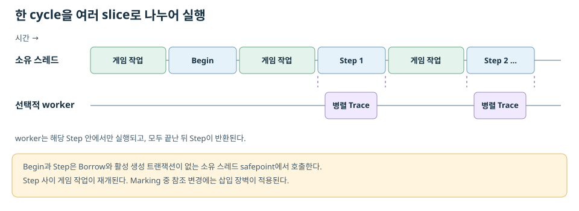

점진 수집은 게임 코드가 참조를 변경하는 작업(mutator)과 객체 필드 스캔이 동시에 진행되는 concurrent GC가 아니다. 소유 스레드는 각 slice에서 worker를 모두 기다린 후 반환한다. 병렬 표식은 GC 작업끼리의 병렬성이다. slice를 나누면 긴 정지를 분산하는 데 도움을 줄 수 있지만, 각 slice의 최대 시간을 보장하지는 않는다.

| 단계 | 실제 동작 | 애플리케이션에서 볼 수 있는 점 |
|---|---|---|
| Idle | 진행 중인 cycle 없음 | 새 cycle 또는 `Collect` 시작 가능 |
| Marking | 루트와 강한 간선을 추적하고 삽입 장벽으로 새 대상 보존 | slice 사이에 변경 가능. 새 객체는 trace할 수 있도록 작업에 넣음 |
| Sweeping | 마킹 큐가 빈 것을 확인하고 같은 잠금 안에서 도달성을 마감한 뒤 흰 슬롯을 `Retired`로 분류 | 아직 방문하지 않은 흰 슬롯도 cutoff로 새 접근·연결 등을 거부 |
| Reclaiming | 회수 가능한 `Retired` 객체의 소멸자와 저장소 해제를 실행 | 보유나 자식 때문에 지연된 슬롯은 남을 수 있음 |

### 수거 대상 확정과 실제 회수

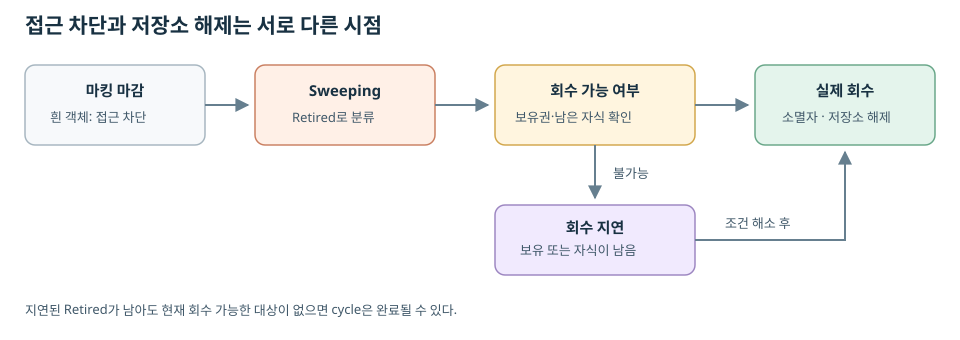

- **cutoff**는 Marking이 끝나고 흰 객체의 도달 불가능을 확정하는 시점이다. 아직 실제로 해제되지 않았어도 새 접근은 차단된다.
- **Retired**는 수거 대상으로 분류된 상태다. 보유나 남은 자식이 있으면 물리적 회수는 기다린다.
- **Reclaim**은 소멸자를 실행하고 저장소를 해제하는 단계다. 지연 대상이 남아도 즉시 회수할 대상이 없으면 cycle은 완료될 수 있다. 이후 `DrainRetired` 등으로 회수한다.
- 진행 중인 cycle의 `CancelCollection`은 Marking에서만 가능하다. cutoff 이후에는 이미 회수된 객체와의 관계를 되살리지 않도록 취소가 `Busy`다. Idle에서는 별도 작업 없이 성공한다.

객체의 `Outer`는 자식에서 부모로 향하는 강한 간선이다. 일반 Registry에서 부모가 자식을 자동으로 살리지는 않는다. 패키지 정책 Registry는 반대로 부모에서 소속 자식으로도 강한 간선을 방문한다. 따라서 동일한 계층이라도 정책에 따라 보존 범위가 다르다. 패키지의 명시적 `Discard`와 관련 계약은 [객체·그래프 보강](../Design/ObjectFoundations.ko.md)을 참고한다.

## 5. 실제 사용 순서와 자주 하는 실수

1. Registry의 소유 스레드에서 `ObjectAccessContext`를 준비한다. 필요한 타입을 등록하고, 외부 소유자는 유지해야 할 그래프의 `RootRef`를 보유한다.
2. 객체의 모든 강한 간선을 해당 타입의 `Trace`가 방문하도록 한다. 공개된 참조 변경은 `SetReference`와 Registry 컨테이너 API 등 장벽이 적용되는 경로를 사용한다. 로컬 원시 포인터는 추적 대상으로 간주하지 않는다.
3. 프레임 경계 등 safepoint에서 모든 `Borrow`와 활성 `ConstructionContext`를 정리한 다음 `BeginCollection(access)`를 호출한다. 실패하면 오류를 처리한다.
4. 이후 safepoint마다 `StepCollection(access, budget, scheduler)`를 호출하고 `Result`와 `GcProgress`를 확인한다. `IsComplete()`가 참이면 cycle이 완료된 것이다. `scheduler`는 선택 사항이다. slice 사이에는 정상 작업을 재개할 수 있다.
5. cycle 결과와 `Stats()`를 관찰한다. 수집 완료가 모든 `Retired` 저장소의 즉시 회수를 뜻하지 않으므로 지연 보유가 해소되는 경로도 관리한다. 종료 전에 root·borrow·lease 등을 반환하고 `Shutdown` 결과를 확인한다.

예를 들어 `parent`와 `child`가 `NewObject`로 생성된 `RootRef`이고 `Node::child`가 `ObjectRef<Node>`인 경우, 참조 연결과 일시적 접근은 다음과 같이 처리한다. 오류를 반환할 수 있는 함수 내부의 예다.

```cpp
{
    auto borrowed = registry.Resolve<Node>(access, parent.Handle());
    if (!borrowed) return borrowed.Error();
    auto node = borrowed.Value().Get();
    if (!node) return node.Error();
    auto linked = registry.SetReference(access, parent.Handle(), node.Value()->child,
                                        child.Handle());
    if (!linked) return linked.Error();
} // Borrow를 반환한 뒤 GC safepoint에 들어갈 수 있다.
child.Reset(); // 별도 child 루트는 놓되, parent가 살아 있고 Trace가 child를 방문하면 유지된다.
```

`parent` 자체도 필요한 동안 루트로 유지해야 한다. `Node::Trace`는 반드시 `visitor.Visit(child)`를 수행해야 한다. Registry 참조 컨테이너의 편집도 owner Borrow가 필요하며 다음 GC slice 전에 이 Borrow를 놓는다. `child.Reset()`이 객체를 즉시 파괴한다는 뜻은 아니다.

`BeginCollection`은 한 cycle당 한 번 호출한다. 이미 실행 중인 cycle에서 다시 시작하거나 safepoint 조건을 만족하지 못하면 실패한다. 호출 타이밍과 빈도는 호출자가 정해야 한다. 이 API 자체에 프레임별 자동 실행이나 메모리 임계치 기반 시작 설정은 없다. `StepCollection`에 너무 작은 예산을 주거나 자주 호출하지 않으면 cycle이 오래 유지되고 메모리가 늦게 회수될 수 있다. 오류 발생 시 성공했다고 가정하지 말고 오류 원인을 기록하고 호출 측 정책에 따라 재시도하거나 중단한다.

이 코드는 **독립 Registry를 직접 관리할 때의 예**다. World가 관리하는 Actor·Component·Level은 World의 파괴 API와 프레임 끝 자동 GC를 사용한다. 해당 World Registry에 별도의 GC 루프를 무심코 추가하지 말고 6절의 World 동작과 조율한다.

```cpp
// 소유 스레드의 safepoint에서 호출하는 예: access는 registry.OwnerAccess().
// 프레임 사이에 phase를 확인하므로 Begin은 새 cycle을 시작할 때만 호출한다.
if (shouldStartGc && registry.CollectionPhase() == rocks::GcPhase::Idle) {
    auto started = registry.BeginCollection(access);
    if (!started) {
        return started.Error();
    }
}
if (registry.CollectionPhase() != rocks::GcPhase::Idle) {
    rocks::GcBudget budget{64, 1'000'000}; // 최대 작업 64개, soft 1ms
    auto progress = registry.StepCollection(access, budget); // scheduler 생략: 순차 trace
    if (!progress) {
        return progress.Error();
    }
    // progress.Value().phase, processed, report를 호출 측 진단에 활용한다.
}
```

이 예의 `shouldStartGc`와 호출 빈도는 애플리케이션 정책이다. 한 프레임에 `Begin`과 `Step`을 모두 호출하면 두 비용이 같은 프레임에 발생한다. 전체 수집과 점진 수집은 동시에 시작하지 않는다. `Busy`는 예를 들어 Borrow나 생성 트랜잭션이 아직 열렸음을 뜻할 수 있다. 조건을 해소한 뒤 적절한 safepoint에서 다시 시도한다. `WrongThread`, `WrongContext`, `InvalidArgument` 등은 원인을 수정해야 한다.

### 자주 하는 실수

| 잘못된 가정 또는 실수 | 실제 결과 | 권장 방법 |
|---|---|---|
| “핸들을 저장했으니 객체는 살아 있다.” | handle만으로는 생존하지 않으며 나중에 stale이 될 수 있다. | 생존을 책임질 소유자는 `RootRef`를 유지하고, 관찰자는 실패를 처리한다. |
| “C++ 필드에 포인터가 있으면 GC가 알아서 찾는다.” | Registry가 추적하지 않는 참조는 도달성에 반영되지 않는다. | 강한 간선을 `Trace`에 포함하고 지원하는 참조 변경 API를 사용한다. |
| “필드를 직접 바꿔도 다음 Step이 찾아준다.” | 이미 방문한 객체의 새 대상이 누락될 수 있다. | Marking 중 삽입 장벽을 수행하는 `SetReference`나 Registry 컨테이너 API로 변경한다. |
| “객체를 쓰는 동안 Borrow를 계속 보관하고 매 프레임 Step을 호출한다.” | 살아 있는 Borrow가 safepoint를 막아 `Busy`가 반복될 수 있다. | 접근할 때만 Borrow를 획득하고 slice 전에 반환한다. 필요한 장기 소유는 `RootRef`로 표현한다. |
| “루트를 놓았으니 소멸자가 즉시 호출된다.” | 다른 경로, 아직 진행 중인 cycle, floating garbage 또는 회수 지연 때문에 객체가 남을 수 있다. | 모든 강한 경로를 확인하고 필요한 수집을 진행한다. 시점이 중요한 자원은 명시적으로 해제한다. |
| “부모가 살아 있으면 자식도 항상 산다.” | 일반 Registry의 Outer 관계는 자식 → 부모만 강한 간선이다. | 자식도 유지해야 하면 명시적인 강한 참조나 루트를 둔다. 패키지 정책의 규칙은 별도로 확인한다. |
| “GC가 끝났으니 Retired는 모두 해제됐다.” | backend 보유, pin, 남은 자식 등으로 물리적 회수가 지연될 수 있다. | `Stats()`와 보유권 반환을 확인하고 필요할 때 `DrainRetired`를 호출한다. |
| “1ms 예산이면 어느 프레임에서도 GC는 1ms를 넘지 않는다.” | Begin, 긴 Trace·소멸자, 대기, 미분류 후보 검사 등으로 초과할 수 있다. | API 호출의 실제 지연 분포와 피크 메모리를 함께 측정한다. |
| “병렬 옵션만 켜면 어떤 Trace든 안전하고 빨라진다.” | 안전하지 않은 callback은 경합을 만들 수 있고, 작은 작업은 오버헤드가 더 클 수 있다. | 안전성을 검증한 타입만 `parallelTraceSafe`로 선언하고 순차 실행과 비교 측정한다. |

## 6. 파괴 요청, 레벨 전환, 시스템 종료

### 명시적 파괴 요청부터 실제 회수까지

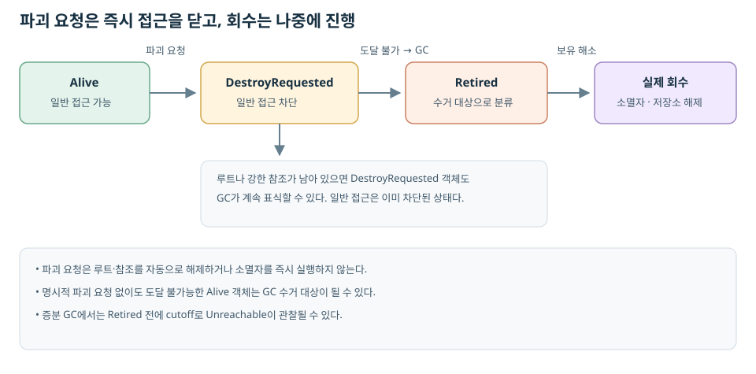

일반 Registry의 `RequestDestroy(access, handle)` 또는 객체의 `Destroy()`는 객체를 **논리적으로 종료**한다. 소멸자 실행이나 저장소 해제를 즉시 요청하는 API가 아니다.

| 순서 | 상태와 처리 | 호출자가 확인할 일 |
|---|---|---|
| 1. 파괴 요청 | `Alive` → `DestroyRequested`. 기존 루트·강한 참조는 자동으로 제거하지 않는다. | 더 이상 게임 로직에서 접근하지 않도록 소유자와 사용자를 조율한다. |
| 2. 논리 접근 차단 | 새 `Resolve`, `WeakRef::TryPin`, 기존 Borrow의 이후 `Get`은 실패한다. 기존 `RootRef`가 있어도 일반 접근이 허용되지는 않는다. | 기존 Borrow를 반환한다. 이미 얻은 포인터는 같은 Borrow 안에서 상태 조회와 멱등 `Destroy` 재호출에만 사용할 수 있다. |
| 3. 남은 경로 정리 | 루트나 살아 있는 객체의 강한 참조가 남으면 `DestroyRequested` 객체도 GC가 표식하고, 그 객체가 가리키는 강한 참조도 추적한다. | 더 이상 필요하지 않은 `RootRef`와 다른 객체의 참조를 지원 API로 정리한다. |
| 4. 도달 불가능 확정 | 도달 경로가 사라진 뒤 GC가 수집한다. 점진 GC에서는 마감 후 `Unreachable`이 먼저 관찰될 수 있고, sweep에서 `Retired`로 분류한다. | 이미 표시된 객체는 이번 cycle에 남을 수 있다. 필요하면 다음 cycle도 진행한다. |
| 5. 저장소 회수 | `Retired`의 보유 계수와 남은 자식 등 회수 조건이 해소되면 소멸자를 실행하고 저장소를 해제한다. | `BackendLease`·`EncodePin` 등 남은 보유를 반환한다. 회수된 handle은 `StaleHandle`이다. |

`RequestDestroy`는 유효한 handle에 다시 호출했을 때 이미 `DestroyRequested` 또는 `Retired`라면 성공한다. 그러나 실제 회수 후 오래된 handle은 `StaleHandle`이다. cutoff에 걸린 객체도 이전에 파괴 요청되었다면 재요청은 성공하지만, 파괴 요청 없이 cutoff된 Alive 객체에는 새 요청이 `Destroyed`다. 이미 보유한 `RootRef`의 복제는 `DestroyRequested` 상태에서도 보유권을 연장할 수 있으므로 무심코 복제하지 않는다.

```cpp
// 일반 ObjectRegistry의 예. handle은 기존에 보유한 객체 식별자다.
auto requested = registry.RequestDestroy(access, handle);
if (!requested) {
    return requested.Error();
}
// 이 요청은 다른 소유자의 RootRef/강한 참조를 자동으로 지우지 않는다.
// 각 소유자가 연결과 보유를 정리하고 이후 GC를 진행한다.
```

`Object::Destroy()`는 유효한 Borrow를 유지한 채 호출한다. 요청 이후 해당 Borrow의 일반 접근은 막히므로 빨리 반환하고, 반환한 뒤 이전에 얻은 원시 포인터를 사용하지 않는다. 오류 처리가 필요한 상태 조회는 `InspectLifecycle` 또는 `TryIsDestroyRequested`를 사용한다. `IsDestroyRequested()`는 조회 실패 시 중단하므로 미확인 handle의 범용 상태 검사로 사용하지 않는다.

| API / 방식 | 목적 | 즉시 저장소 해제? |
|---|---|---|
| `RequestDestroy` / `Object::Destroy` | 일반 Registry 객체의 논리 접근을 닫음 | 아니오 |
| `Discard` | 객체 부분 트리를 논리 파괴하고 이름 색인·부모 자식 고리에서 분리 | 아니오 |
| GC | 루트에서 도달할 수 없는 객체를 찾아 분류·회수 | 회수 조건과 실행 시점에 따름 |

`Discard`는 일반 Registry에서도 사용할 수 있다. 패키지 정책 Registry는 `RequestDestroy`/`Destroy`가 `Unsupported`이며 명시적 파괴에 `Discard`를 사용한다. World의 Actor·Component·Level은 Registry 파괴 API를 직접 호출하지 말고 아래 World API를 사용한다. 파괴 요청 없이도 도달 불가능한 Alive 객체는 GC 수거 대상이 될 수 있다.

### 레벨 정리와 시스템 종료

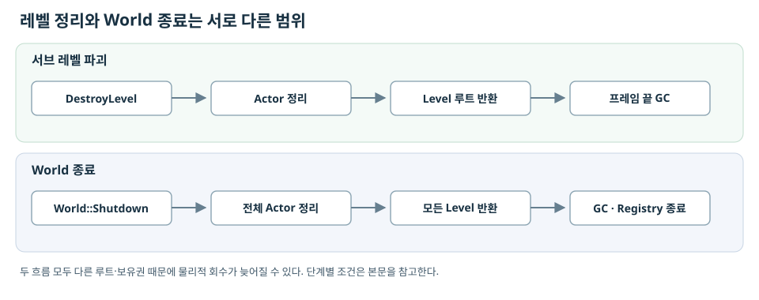

#### 서브 레벨을 정리할 때

현재 `World`는 자신의 Registry와 여러 Level을 가진다. World가 유지하는 소유 관계는 `Level` 루트 → Level의 Actor 참조 → Actor의 Component 참조다. **레벨 전환이라는 이름만으로 자동 정리되는 범용 동작을 가정하지 않는다.** 아래는 현재 구현의 서브 Level 파괴 흐름이며, 새 레벨을 언제 만들고 화면을 전환할지는 호출 측 정책이다.

1. 호출 측이 소유 스레드에서 `world.DestroyLevel(level)`을 요청한다. 영구 Level은 이 API로 파괴할 수 없다. 이미 대기 중인 Level의 재요청은 성공한다.
2. World는 Level을 파괴 대기로 표시하고 소속 Actor를 파괴 대기로 만든다. 파괴 대기 Level에는 새 Actor를 Spawn할 수 없다.
3. 프레임의 파괴 정리 단계에서 Actor·Component의 비활성화 및 파괴 hook과 등록 해제가 수행된다. World 관리 객체는 `DestroyActor`·`DestroyComponent`·`DestroyLevel`을 사용해야 해당 수명 정리가 수행된다.
4. 소속 Actor 정리가 끝나면 World는 Level의 Actor 참조를 비우고 Level에 파괴 요청을 한 뒤 자신의 Level `RootRef`를 반환한다. Actor가 이미 없고 Tick·hook 밖에서 요청한 경우 Level 정리는 바로 시작할 수 있다.
5. World가 GC 필요 상태를 기록한다. 이후 Tick의 끝에서 필요하면 새 cycle을 시작하고 `WorldDesc.gcBudget`으로 Step을 한 번 실행한다. 실제 객체 회수는 여러 프레임이 걸릴 수 있다.

**주의:** `DestroyLevel` 성공은 메모리 회수 완료가 아니다. 외부 `RootRef`나 다른 강한 경로, 외부 작업의 보유가 남으면 일부 저장소는 더 오래 남을 수 있다. World 외부에서는 Actor·Component·Level을 장기 `RootRef`로 붙잡기보다 handle을 보관하고 필요할 때 `World::With`로 접근하는 것이 World의 계약이다. Borrow는 Tick 전에 반환한다. 참조가 필요 없는 공유 에셋이나 영구 Level까지 이 서브 Level 정리만으로 제거된다고 가정하지 않는다.

**예: 던전에서 나오는 경우**

| 시점 | 던전 Level과 몬스터 | 영구 Level의 플레이어 |
|---|---|---|
| `DestroyLevel(dungeon)` 직후 | 던전과 소속 몬스터는 파괴 대기. 몬스터는 Tick 대상에서 빠진다. | 그대로 유지된다. |
| 다음 Tick 정리 후 | 몬스터 hook·참조·레코드가 정리되고 Level 루트가 반환된다. GC가 시작되거나 이어진다. | 계속 Tick할 수 있다. |
| 필요한 GC cycle을 진행한 후 | 이미 표식된 객체는 진행 중인 cycle을 지나 후속 cycle에서 회수될 수 있다. 다른 생존 경로와 회수 지연이 없어야 한다. | 영구 Level의 강한 소유 관계로 유지된다. |

이 예는 [`WorldTests.cpp`](../../Engine/Source/Runtime/World/Tests/WorldTests.cpp)의 `World_LevelsOwnActorsAndDestroyingLevelDestroysItsActors`에서도 확인할 수 있다. 새 Level 로드, 화면 전환, 외부 자원 정리는 호출 측이 별도로 조율한다.

#### 일반 Tick에서 World는 GC를 언제 실행하나?

| 조건 | 실제 동작 |
|---|---|
| 정리된 Actor·Component·Level이 없어 GC가 대기 중이 아님 | World의 프레임 끝 GC는 실행하지 않는다. |
| GC 대기 중이고 Registry가 Idle | `BeginCollection`을 시도하고 성공하면 같은 Tick에서 Step도 호출한다. |
| GC 대기 표시가 켜져 있고 cycle 진행 중 | 프레임 끝에서 `gcBudget_`으로 Step을 한 번 호출한다. 현재 World 경로는 scheduler를 넘기지 않아 순차 Trace다. 외부에서 cycle만 직접 시작했다고 자동으로 이어 주는 것은 아니다. |
| cycle 도중 추가 파괴 | 완료 뒤에도 필요 표시를 유지해 다음 cycle을 시작할 수 있다. |
| Begin 또는 Step 실패 | 현재 World 경로는 해당 오류를 호출자에게 반환하거나 로그하지 않고 다음 Tick에서 다시 시도한다. Borrow 등 원인이 지속되면 진행하지 못한다. |

이것은 **World의 파괴 처리와 연결된 자동 진행**이다. 독립 `ObjectRegistry` 자체가 시간이나 메모리 임계치로 자동 수집하는 기능은 아니다. World 관리 범위 밖에서 직접 만든 객체나 직접 조작한 Registry에 동일한 World 수명 처리가 적용된다고 가정하지 않는다.

#### World와 Engine을 종료할 때

| 순서 | 현재 구현 |
|---|---|
| 1. Engine 종료 시작 | `Engine::Shutdown`은 프레임 실행 중이면 `Busy`다. client의 `OnEngineShutdown`을 호출한 다음 World를 나중에 생성한 순서부터 종료한다. |
| 2. World 게임플레이 정리 | `World::Shutdown`은 Tick·hook 중이면 `Busy`다. `TearingDown`으로 전환하고 Tick을 닫고, 모든 Actor를 정리하며 시작 대기를 비운다. 그 뒤 World subsystem을 정리한다. |
| 3. Level 루트 반환 | Actor 정리 후 영구 Level을 포함한 모든 Level의 참조와 World 보유 루트를 정리한다. |
| 4. 진행 중인 World GC 처리 | Marking이면 취소하고, 그 외 남은 cycle은 큰 작업 예산으로 Step을 진행한다. 이후 전체 `Collect`를 실행해 회수한다. 이 종료 경로는 프레임용 1ms 예산을 보장하지 않는다. |
| 5. World Registry 종료 | `ObjectRegistry::Shutdown`은 신규 접근을 닫고 남은 cycle을 완료한 다음 전체 수집과 잔여 상태 검사를 수행한다. 보유권이나 객체가 남으면 성공하지 않는다. |
| 6. Engine 나머지 정리 | 모든 World가 성공적으로 종료된 뒤 Engine subsystem, Engine의 객체 Registry, 타입 등록과 TypeRegistry 등을 순서대로 정리한다. |

종료하기 전에 외부 비동기 작업을 중단·완료시키고, 각 소유자의 `RootRef`·`Borrow`·`BackendLease`·`EncodePin`을 반환한다. GC/소멸자가 사용할 시스템과 allocator는 정리가 끝날 때까지 유지한다. `Busy` 등 실패가 나면 원인을 해소하고 결과를 확인하며 재호출한다. World는 실패 시 `TearingDown`에 남을 수 있다. Registry는 닫은 뒤 실패하면 닫힌 상태로 남는다. World 소멸자가 종료를 완료하지 못하면 Fatal이므로 실패를 무시하고 World를 파괴하지 않는다.

World는 종료 시 남은 cycle에 대해 최대 64회 큰 예산의 Step을 시도하고 전체 수집을 최대 8회 시도한다. 이 횟수는 모든 외부 보유권이 자동 해제된다는 보장이 아니다. 실제로 각 단계가 실패하면 오류를 반환하므로 호출자는 잔여 상태와 보유자를 해결해야 한다.

**종료가 `Busy`인 경우의 확인 순서**

1. Tick이나 hook 안에서 호출했는지 확인하고, 그렇다면 그 호출이 끝난 뒤 다시 시도한다.
2. 외부 작업이 쥔 `Borrow`·`RootRef`·`BackendLease`·`EncodePin`과 열린 생성 트랜잭션을 확인하고 반환한다. World의 `Stats()`와 Registry의 `Stats()`를 진단에 활용한다.
3. 이미 종료 단계에 진입한 World는 게임 플레이를 재개하는 대상이 아니다. 오류를 해결한 뒤 같은 종료 경로를 재시도한다.
4. Engine에 속한 World라면 World와 Engine의 종료 결과를 모두 확인한다. World 정리 실패를 무시한 채 Engine의 타입·allocator를 먼저 해제하지 않는다.

단독 World 제거는 `Engine::DestroyWorld`로 요청할 수 있다. 프레임 밖에서는 즉시 종료를 시도하고, 프레임 안에서는 지연 처리한다. 실패 시 재시도 경로와 보유권 반환을 함께 고려한다.

## 7. 수백만 객체에서 달라지는 것

**현재 구현은 수백만 객체에 대해 성능을 보장하는 상태가 아니다.** 아래 항목은 코드에서 확인되는 제한과 비용이다. 기본 설정을 늘리는 것, 한 cycle을 제시간에 끝내는 것, 메모리를 확보하는 것은 서로 다른 문제다.

**300만 객체면 바로 문제가 되는가?** 기본 상한에서는 생성이 실패한다. 상한을 높인 뒤에는 하드웨어·그래프·생성률에 따라 동작할 수 있지만, 기본 예산의 긴 cycle과 예산 밖 작업은 구조적으로 남는다. 따라서 특정 개수에서 반드시 얼마 동안 멈춘다고 단정할 수는 없어도, 상한만 올려 대규모 운영이 준비됐다고 판단해서는 안 된다.

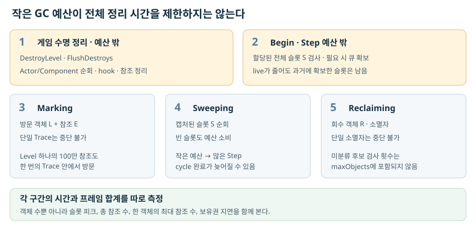

### 7.1 객체 수보다 먼저 확인할 한도

| 항목 | 현재 동작 | 수백만 객체에서의 의미 |
|---|---|---|
| 기본 `maxSlots` | Registry당 1,048,576 | 하나의 Registry에 동시에 200만·300만 객체를 유지하려면 생성 전에 상한을 높여야 한다. |
| 슬롯 점유 | Alive 외에도 Reserved·DestroyRequested·Retired 등이 슬롯을 사용한다. 세대 한도에 도달한 Exhausted 슬롯은 재사용하지 않는다. | 실제로 사용할 객체 수만큼 딱 맞춰 잡으면 생성 중 객체와 회수 지연에 필요한 여유가 없다. |
| 상한 도달 | 재사용할 빈 슬롯이 없고 새 chunk를 늘릴 한도도 없으면 생성이 `CapacityExceeded`로 실패한다. | `maxSlots`는 자동 GC를 시작하는 임계치가 아니다. 실패 전에 수집 진행과 객체 생성량을 관리해야 한다. |
| 할당 방식 | chunk는 64슬롯 단위로 필요할 때 생성한다. 객체 본체는 별도로 할당한다. | `maxSlots`를 크게 지정했다고 그만큼 미리 할당되는 것은 아니지만, 실제 생성 시 메모리가 부족하면 실패한다. |
| 옵션 수명 | `RegistryOptions`는 Registry 생성 시 고정한다. | 실행 중 상한을 바꾸는 공개 설정으로 해결할 수 없다. 생성 전 용량 계획이 필요하다. |

예를 들어 최대 300만 개를 예상한다면 `desc.objects.maxSlots = 4'000'000;`처럼 여유를 둔 값을 **실험 후보**로 지정할 수 있다. 이것은 400만 개를 원활하게 지원한다는 보장이 아니다. 실제로 필요한 여유는 생성 트랜잭션 크기, 회수 지연, live 객체 피크와 메모리 한도에 따라 정한다. Registry가 여러 개면 각각의 상한과 동시에 실행되는 GC 비용을 함께 합산한다.

### 7.2 비용을 결정하는 다섯 가지 수

| 기호 | 의미 | 영향을 받는 작업 |
|---|---|---|
| S | 지금까지 할당되어 남아 있는 슬롯 수 (`chunks × 64`) | Begin의 루트 검사, sweep. 현재 live 수보다 훨씬 클 수 있다. |
| L | 이번 cycle에서 실제 Trace하는 객체 수 | Marking 작업 수 |
| E | 그 객체들의 Trace 및 Registry 신원 간선 방문 수 | 참조 방문, handle 조회, gate 획득. 같은 대상을 여러 번 가리켜도 방문 비용은 남는다. |
| R | 이번 cycle에서 실제로 회수하는 객체 수 | 소멸자·allocator·슬롯 재사용 처리 |
| F | 한 객체가 가진 최대 참조 수 | 한 번의 Trace가 중단 없이 실행되는 최악 비용 |

단순한 정적 그래프에서는 **슬롯 검사 O(S), 표식 O(L + E), 회수 O(R) + 소멸자 비용**으로 생각할 수 있다. 후보 분류·할당·잠금·World hook 비용은 별도로 더해야 한다. Big-O는 처리 시간의 측정값이 아니라 규모에 따라 일이 얼마나 늘어나는지 나타낸다.

#### 작은 객체가 많을 때와 큰 참조 목록 하나가 있을 때

| 형태 | 생기는 문제 | 가능한 대응 |
|---|---|---|
| 작은 객체 수백만 개 | 객체별 슬롯·할당·타입 보유·참조 방문 비용이 누적된다. | 개별 정체성과 GC 수명이 필요 없는 데이터는 값 배열·덩어리 데이터로 둘 수 있는지 검토한다. |
| Level 하나가 Actor 100만 개를 직접 참조 | Level의 `Trace` 한 번이 배열 전체를 방문한다. `maxObjects=1`이어도 100만 간선을 한 번에 검사할 수 있다. | 지원되는 Level·수명 경계로 참조 묶음을 나눌 수 있는지 검토한다. 총 E는 여전히 남고, 한 객체의 거대한 Trace를 중단하는 기능은 현재 없다. |
| 서로 촘촘히 연결된 그래프 | 객체 수보다 E가 크게 늘고 공유 gate 비용도 커진다. | 불필요한 소유 관계를 줄이되 필요한 강한 간선은 반드시 Trace한다. |
| 긴 Marking 중 계속 신규 객체 공개 | 새 객체도 회색으로 들어가 남은 작업이 늘고, 그동안 dead 객체의 회수가 늦어진다. | 생성률과 표식 처리량을 함께 측정한다. 새 작업 유입을 따라잡지 못하면 cycle이 오래 끝나지 않을 수 있다. |

한 객체에 데이터를 모으는 것은 슬롯 수를 줄이는 방법일 수 있지만, 수백만 **GC 참조**까지 한 목록에 모으면 F가 커진다. 값 데이터 압축과 거대한 참조 목록의 집중을 같은 최적화로 취급하지 않는다.

### 7.3 기본 64개 예산이면 cycle은 얼마나 길어질까?

기존 객체가 모두 살아 있고, 슬롯 수와 live 수가 같으며 신규 생성·회수는 없다고 가정한다. 이때 Trace N회와 sweep N회로 작업은 약 **2N개**다. 아래는 **시간 제한이 한 번도 걸리지 않고 매 Step이 한도까지 작업할 때 필요한 최소 Step 수**다.

| 객체·슬롯 수 | 작업 수 | `maxObjects=64` 최소 Step 수 | 매 프레임 1 Step, 60 FPS로 환산 |
|---:|---:|---:|---:|
| 100만 | 200만 | 31,250 | 약 8분 41초 |
| 300만 | 600만 | 93,750 | 약 26분 3초 |
| 500만 | 1,000만 | 156,250 | 약 43분 24초 |

계산은 `ceil(작업 수 ÷ maxObjects)`다. 실제 처리 속도를 측정한 표가 아니며 시간 제한, 단계 전환, 추가 객체, `Busy`로 지연되면 더 오래 걸린다. 기본값은 대규모 장면의 목표 완료 시간을 충족한다는 뜻이 아니다.

**목표 완료 시간에서 필요한 처리량을 역산한다.** 예를 들어 정적인 300만 객체의 약 600만 작업을 60 FPS에서 10초 내 끝내려면 600프레임에 나누어 프레임당 평균 10,000작업 이상을 처리해야 한다. 단순히 `maxObjects=10'000`으로 설정해도 시간 예산이 먼저 소진되면 이 처리량은 나오지 않는다. 목표 시간 내 E 방문과 소멸자까지 처리할 CPU 여유가 있는지 실측해야 한다. 여유가 없으면 객체·참조 수, 데이터 표현, 수명 경계 또는 목표 회수 시간을 바꿔야 한다.

### 7.4 실제 메모리는 객체 본체보다 크다

메모리 계획에는 다음을 모두 넣는다. 아래의 `sizeof` 값은 대상 빌드의 ABI·정렬을 기준으로 측정한다.

| 구성 | 계산 기준 | 해제 시점·주의점 |
|---|---|---|
| 슬롯 관리 정보 | `S × sizeof(Slot)` | 상태·보유 계수·TypeLease·Outer·자식 고리 등을 포함한다. chunk는 Registry 소멸 때까지 유지된다. |
| 객체 본체와 데이터 | 각 타입의 크기, 배열·문자열·map 버퍼, allocator 비용의 합 | 객체 회수와 각 자원의 해제 규약에 따른다. |
| 증분 표식 작업 큐 | `Q × sizeof(ObjectHandle)` (`Q`는 큐 capacity) | Begin에서 슬롯 규모를 기준으로 예약한다. `Clear()`는 버퍼를 해제하지 않으므로 cycle 종료 후에도 남는다. |
| 전체 수집의 작업 큐 | 전체 수집 후보 수에 맞춘 별도 지역 큐 | `Collect` 동안 기존 증분 큐 버퍼와 동시에 존재할 수 있다. |
| 이름과 색인·chunk 표 | 이름 기록, 이름 hash table, 현재·이전 chunk 포인터 표 | 이름 기록은 회수 시 반환한다. chunk 표와 잔여 색인 버퍼 등은 Registry 소멸까지 남는다. |
| 상위 시스템 | World의 Actor/Level 기록·Tick 등록·파괴 대기 큐 등 | GC 슬롯 이외의 비용이다. 객체·컴포넌트 수를 함께 산정한다. |

일반적인 64비트 ABI에서 `ObjectHandle`은 16바이트다. **큐만** 정확히 아래 capacity를 가졌을 때의 데이터 용량은 다음과 같다(1 MiB = 1,048,576바이트).

| 큐 capacity Q | 큐 데이터 용량 |
|---:|---:|
| 100만 | 약 15.26 MiB |
| 300만 | 약 45.78 MiB |
| 500만 | 약 76.29 MiB |

실제 Q는 성장 여유 때문에 객체 수보다 클 수 있고, 재할당 중에는 이전·새 버퍼가 잠시 함께 존재할 수 있다. 슬롯 크기도 중요하다. 예를 들어 슬롯당 **추가 64바이트만** 있어도 300만 슬롯에서는 약 183.11 MiB가 된다. 이는 실제 Slot 크기라는 주장이 아니라 관리 정보의 민감도를 보여 주는 계산이다. 객체 본체 평균이 128바이트라면 300만 개의 본체만 약 366.21 MiB이며 슬롯·큐·컨테이너·이름·allocator 비용은 별도다.

#### 한 번 300만 개를 만들었다가 10만 개만 남으면?

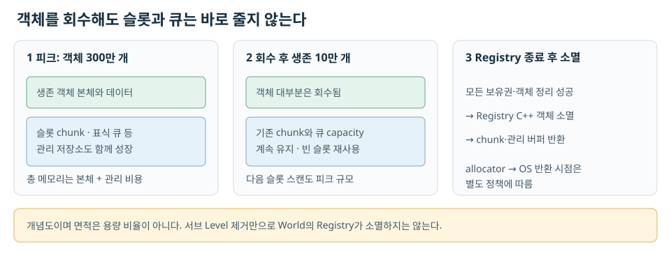

- 빈 슬롯은 재사용하므로 새 객체마다 처음부터 빈 칸을 찾지는 않는다.
- **기존 chunk는 줄이지 않는다.** 다음 Begin/sweep은 여전히 할당된 약 300만 슬롯 규모를 본다.
- 증분 작업 큐의 capacity도 `Clear()`로 줄지 않는다. 메모리가 그대로여도 전부 살아 있는 객체 누수라는 뜻은 아니다.
- Registry가 정상 종료되어 **소멸**해야 chunk와 보관 버퍼가 반환된다. `Shutdown()` 성공과 C++ 객체 소멸은 별개이며, allocator가 OS에 언제 반환하는지도 별개다.

서브 Level 하나를 제거하면 World 자체의 Registry는 계속 살아 있으므로 과거의 슬롯 규모가 남는다. 완전히 독립적인 World를 종료·파괴하면 그 World Registry의 관리 저장소도 반환할 수 있지만, 다른 Registry의 객체로 강한 참조를 그대로 연결할 수는 없다. 수명 경계를 나누는 설계는 소유 관계·공유 자원·전환 비용까지 함께 검토한다.

### 7.5 대량 레벨 제거와 종료의 정지는 GC만의 문제가 아니다

| 비용 구간 | 현재 예산 적용 | 대규모 장면에서 볼 것 |
|---|---|---|
| `DestroyLevel` 요청 | GC 예산 없음 | World 전체 Actor 기록 순회와 소속 Actor·Component의 Tick 해제 |
| `FlushDestroys` | GC 예산 없음 | 파괴 큐가 빌 때까지 hook·등록 해제·참조 정리. hook이 추가한 파괴도 같은 정리에 포함 |
| `BeginCollection` | Step 예산 밖 | 할당된 전체 슬롯의 루트 검사와 필요 시 큐 확보 |
| Marking Step | 작업 수·soft 시간 예산 | 거대한 단일 Trace는 중간에 멈추지 못함. non-null 간선 방문마다 gate 비용 |
| sweep·reclaim | 작업 일부에 예산 적용 | 빈 슬롯 검사, 긴 소멸자, 예산에 포함되지 않는 미분류 후보 검사 |
| World·Engine 종료 | 플레이용 Step 예산을 적용하지 않음 | 게임 정리, 전체 수집, 보유권 반환, 타입 종료까지 전체 시간을 따로 측정 |

`gcBudget`을 줄이는 것만으로 대량 `OnDestroy`나 Level 정리가 프레임 안에 들어오지는 않는다. 로딩 화면 등 허용 가능한 시점으로 작업을 옮기거나, 호출 측에서 종료 요청을 분산할 수 있는지 검토한다. World의 `FlushDestroys` 자체에 시간 예산을 주는 기능은 현재 없다.

또한 지연된 Retired만 남아 cycle이 완료되면 World의 `gcPending_`이 내려갈 수 있다. 그 후 backend hold·encode pin이 반환되어도 **그 반환만으로 World의 자동 GC가 다시 예약되지는 않는다.** 새로운 파괴 사건, 호출 측이 조율한 safepoint의 `DrainRetired`/수집 또는 종료 경로가 필요하다. `DrainRetired`에는 자체 Step 예산이 없으므로 한꺼번에 반환되는 보유권의 규모도 측정한다.

### 7.6 대규모 검증 시나리오

| 시험 | 확인 목적 |
|---|---|
| 10만 → 100만 → 목표 수백만으로 점진 증가 | 상한·OOM·메모리 피크·Begin 지연·cycle 완료 시간 확인 |
| 전부 생존 / 대부분 도달 불가 | Trace 중심 부하와 sweep·소멸자 중심 부하를 분리 |
| 넓은 Level 하나 / 나눈 Level / 긴 사슬 / 순환 그래프 | 총 E와 최대 F가 pause에 미치는 영향 확인 |
| Marking 중 지속 생성·참조 교체 | 큐 증가·쓰기 장벽·floating garbage·처리량 부족 확인 |
| 높은 피크 후 대부분 해제하고 같은 Registry 재사용 | live 감소 후에도 남는 S와 큐 capacity, 다음 cycle 비용 확인 |
| 대량 backend hold 후 일괄 반환 | 지연 회수 분류, 재진행 경로, `DrainRetired` 지연 확인 |
| 대량 Level 파괴와 전체 종료 | GC 외 hook/참조 정리와 최종 보유권 회수까지 검증 |

여기에는 **기능 검증**(필요한 객체 보존·도달 불가 객체 회수·오류 처리)과 **성능 검증**(pause P95/P99/최댓값·cycle wall time·메모리)을 모두 포함한다. 기존 회귀 테스트가 있다는 사실만으로 수백만 객체의 성능이 입증되지는 않는다.

## 8. 구현된 최적화와 남은 병목

**조회·재사용·중복 처리 비용은 줄였지만 전체 슬롯 스캔과 큰 단일 작업은 남아 있다.** 따라서 아래 최적화가 있다는 사실과 수백만 객체의 짧은 pause를 보장한다는 것은 별개다.

| 구분 | 현재 동작 | 효과와 한계 |
|---|---|---|
| handle 조회 | 슬롯 번호를 64로 나눈 chunk 표 색인으로 직접 접근한다. | O(1) 조회이며 슬롯을 선형 검색하지 않는다. 그래프를 따라 분산된 객체를 읽는 메모리 접근 비용은 남는다. |
| 빈 슬롯 재사용 | free list에서 꺼내며 세대를 올려 오래된 handle과 구분한다. | 생성마다 빈 슬롯 전체를 찾지 않는다. 객체 본체 할당은 별도이며 세대 한도의 슬롯은 재사용하지 않는다. |
| 표식 초기화 | 매 cycle마다 모든 객체에 색을 쓰는 대신 epoch를 변경한다. | 평상시 표식 초기화 쓰기를 줄인다. epoch 순환 시에는 전체 슬롯 표식을 초기화한다. |
| 중복 표식 | 현재 epoch에 이미 표시한 객체는 다시 큐에 넣지 않는다. | 같은 객체의 반복 Trace를 피하지만 각 강한 간선을 방문하는 비용은 남는다. |
| 표식 큐 | 사전에 용량을 확보하고 장벽의 shade 중에는 할당하지 않는다. | 장벽 안의 할당을 피하지만 Begin의 큐 확보 비용과 메모리는 필요하다. |
| Marking 중 큐 성장 | 새 객체 생성 시 용량 부족에 대비해 기하급수로 확장한다. | 매 chunk마다 큐 전체를 다시 복사하는 반복 비용을 줄인다. 확장 순간의 복사와 일시적 메모리 피크는 남는다. |
| 회수 대기 목록 | 회수할 수 없는 대상은 지연 목록으로 옮기고 조건이 풀릴 때 준비 목록으로 옮긴다. | 지연 대상을 매 slice마다 재검사하지 않지만 처음 미분류 후보를 처리할 때 비용이 모일 수 있다. |
| 지연 대상 깨우기 | 보유 반환·마지막 자식 분리 시 회수 가능해진 슬롯을 O(1)에 준비 목록으로 옮긴다. | 보유 반환마다 지연 목록을 전체 검색하지 않는다. 실제 회수 호출을 자동 예약하는 World 이벤트는 아니다. |
| 소멸자 실행 | 회수 대상을 분리한 뒤 Registry gate 밖에서 소멸자와 allocator 해제를 실행한다. | 사용자 코드 실행 중 gate를 점유하지 않는다. 소멸자 자체가 길면 호출 지연은 여전히 길다. |
| 선택적 병렬 Trace | 안전하다고 선언된 타입에 한해 worker를 사용한다. | 충분한 작업량에서는 이득이 가능하지만 작업 제출·대기·gate 경합을 측정해야 한다. |
| Registry 통계 | 상태 변경 때 누계를 갱신한다. | Release `ObjectRegistry::Stats()`는 전체 슬롯을 훑지 않는다. Debug 대조와 World의 통계는 별개다. |
| World의 일괄 참조 정리 | Actor 전체 파괴 때 Component 목록, Level 전체 파괴 때 Actor 목록을 끝에서 한 번 비운다. | 각 원소마다 반복 검색·삭제·뒤 원소 이동하는 비용을 줄인다. 전체 hook·순회·등록 해제는 여전히 필요하다. |

객체를 이동하지 않아 주소를 안정적으로 유지하지만, GC가 살아 있는 객체를 모아 배치하거나 빈 공간을 압축하지는 않는다. allocator 단편화·메모리 지역성·OS 반환은 별도로 평가한다. 세대별 GC, 병렬 sweep, 중단·재개 가능한 Trace도 현재 제공하는 옵션이 아니다.

다음은 **현재 제공되는 설정이 아니라 향후 구현을 검토할 수 있는 후보**다. 적용 전 대표 부하에서 병목을 확인하고, 기존 수명·장벽 불변식과 테스트를 유지해야 한다.

- Begin의 루트·슬롯 스캔이 병목이면: 루트 추적 자료구조 또는 시작 작업 분할을 검토한다. 루트 변경과 수집 시작 사이의 동기화가 더 복잡해진다.
- 빈 슬롯이 많은 sweep이 병목이면: 활성 슬롯 중심 순회나 요약 정보를 검토한다. 생성·retire·재사용과 동기화하는 유지 비용이 생긴다.
- 회수 후보 분류가 긴 pause의 원인이면: 미분류 후보 검사도 예산에 반영하도록 분할하는 방안을 검토한다. 완료 판정과 지연 목록 전이를 함께 검증해야 한다.
- Trace 하나가 너무 길면: 큰 객체의 참조 집합을 나누거나, 중단·재개 가능한 추적 설계를 검토한다. 현재 사용자 Trace는 중간에 중단되지 않는다.
- gate 경합이 크면: 병렬 작업 배치와 표식 동기화 방식을 검토한다. 병렬 처리는 정확성과 전체 비용을 함께 측정해야 한다.
- 대규모 World 정리가 병목이면: hook·등록 해제·참조 정리도 여러 프레임으로 분할하는 설계를 검토한다. 파괴 대기 중 접근과 hook 순서를 함께 정의해야 한다.
- 피크 슬롯이 장기간 부담이면: 수명 경계별 Registry/World 분리 또는 빈 chunk 회수 설계를 검토한다. handle 세대·자식 고리·진단·포인터 안정성에 영향을 주므로 단순한 버퍼 축소 변경이 아니다.

## 9. 설정과 튜닝 절차

| 설정 | 기본값 | 의미와 선택 시 고려 사항 |
|---|---|---|
| `GcBudget.maxObjects` | 64 | 한 Step에서 trace한 객체, sweep에서 검사한 슬롯, 실제 회수한 객체의 합. 0은 `InvalidArgument`. 이 단위들의 비용은 같지 않다. |
| `GcBudget.maxNanoseconds` | 1,000,000ns (1ms) | Step의 soft deadline. 0이면 시간 제한을 끄지만 `maxObjects` 제한은 유지한다. |
| `StepCollection`의 `scheduler` | `nullptr` | 지정하면 `parallelTraceSafe` 타입만 worker에서 trace. 미선언 타입은 소유 스레드에서 처리한다. |
| `RegistryOptions.maxSlots` | 1,048,576 | Registry 생성 시 슬롯 상한. 객체 수와 장기적인 슬롯 소진 가능성에 맞게 정한다. GC 빈도나 pause 설정은 아니다. |
| `RegistryOptions.maxGeneration` | `uint32` 최대값 | 슬롯 재사용 세대 상한. 도달한 슬롯은 재사용하지 않으며 낮은 값은 주로 고갈 시험에 사용한다. |

World를 직접 만들 때는 `WorldDesc.gcBudget`에 프레임 끝 Step 예산을 지정한다. Engine을 통해 World를 만들 때는 `WorldCreateDesc.gcBudget`으로 전달한다. 현재 World는 생성 시 이 값을 복사하며 런타임에 변경하는 공개 setter는 없다. 독립 Registry의 `StepCollection`은 호출마다 별도 `GcBudget`을 전달한다. World의 Begin과 종료 GC에는 이 Step 예산이 적용되지 않는다.

```cpp
// Engine이 Running인 상태에서 World 생성 시 예산을 지정하는 예.
rocks::WorldCreateDesc desc;
desc.name = "Main";
desc.gcBudget = {32, 500'000}; // Step당 최대 작업 32개, soft 0.5ms
auto world = engine.CreateWorld(desc);
if (!world) {
    return world.Error();
}
```

예산은 World를 만들기 전에 정한다. 특히 `maxObjects=0`은 잘못된 값이다. 현재 World 생성 시에는 이를 검증하지 않고 프레임 끝 Step 오류도 밖으로 전달하지 않으므로, GC가 반복 실패할 수 있다. World 경로의 수정·비교는 World 생성 설정을 바꾸어 동일 부하에서 다시 실행한다.

### 1ms 예산이 1ms 이내 완료를 뜻할까?

**아니다.** `maxNanoseconds`는 다음 작업을 시작할지 판단하는 soft deadline이며, 이미 시작한 작업을 중단하지 않는다.

| 예산을 넘길 수 있는 원인 | 이유 |
|---|---|
| `BeginCollection` | 큐 확보와 전체 슬롯 루트 스캔은 Step 예산 밖이다. |
| Trace·소멸자 | 한 번 시작한 콜백은 중간에 끊지 않는다. 간선 수나 소멸 비용도 제각각이다. |
| 잠금·worker | 잠금 획득과 제출된 worker 배치의 완료를 기다린다. |
| 회수 후보 분류 | 회수할 수 없는 미분류 `Retired` 후보들을 지연 목록으로 옮기는 횟수는 `maxObjects`에 포함되지 않는다. Step 종료 시 완료 검사도 예산 소진 뒤 실행된다. |
| `Collect` / `DrainRetired` | Step 예산 없이 실행한다. `DrainRetired`는 회수 가능한 대상을 처리한다. |

기본값 1ms나 `maxObjects=1`을 프레임 시간 상한으로 해석하지 않는다. 지연 목록에 이미 들어간 슬롯은 매번 다시 순회하지 않는다.

### 비용이 커지는 조건

| 작업 | 비용에 영향을 주는 요소 |
|---|---|
| Begin | 할당된 전체 슬롯 스캔과 슬롯 용량 기준의 표식 큐 예약. 큐 예약 실패 시 수집을 시작하지 않는다. |
| Marking | 도달 가능한 객체와 강한 간선의 수, 사용자 Trace 비용. |
| Sweeping | 캡처한 chunk의 슬롯 수. 빈 슬롯을 검사해도 작업 예산을 소비한다. |
| Reclaiming | 회수 후보 분류, 회수 가능한 객체 수, 소멸자와 allocator의 비용. |
| 병렬 표식 | 작업 제출·대기 비용과 공유 gate 경합. 작은 그래프에서는 오히려 느려질 수 있다. |

전체 수집은 후보 수에 맞춰 별도의 큐를 예약한다. 병렬 표식은 최대 64개 작업을 한 배치로 제출하고 반환 전에 모두 기다린다. `parallelTraceSafe=true`는 thread-safe 방문과 callback 계약을 실제로 만족하는 타입에만 선언한다. scheduler의 allocator는 worker의 capture 정리를 지원해야 하며, scheduler worker에서 Step을 호출하면 `WrongThread`다.

### 예산은 어떻게 정할까?

| 선택 | 기대 효과 | 대가 |
|---|---|---|
| 예산 증가 | cycle이 더 빨리 끝날 가능성 | 한 slice의 지연이 커질 수 있음 |
| 예산 감소 | 작업을 여러 slice로 분산 | cycle이 길어지고 메모리가 더 오래 남을 수 있음 |
| scheduler 사용 | 충분히 큰 안전한 trace 작업의 병렬 처리 가능 | 제출·대기·잠금 비용, thread-safe 계약 필요 |

대표적인 객체 수·참조 밀도·생성/삭제 부하를 재현해 다음을 측정하고 결정한다.

1. Begin과 각 Step 호출의 실제 경과 시간: 중앙값, P95, P99, 최댓값.
2. 한 cycle이 끝날 때까지의 프레임 수와 벽시계 시간.
3. 피크 메모리와 지연된 `Retired` 수.
4. 같은 부하에서 순차·병렬 표식의 전체 비용.

현재 pause percentile 벤치마크 결과와 hard real-time 보장은 없다.

### 상황별 예산: 첫 측정에 사용할 후보

아래 숫자는 **보장값이나 검증된 권장값이 아니라 비교 실험을 시작하기 위한 예시**다. 대상 기기와 그래프에 따라 적합한 값이 달라진다. 시간은 한 번의 `StepCollection`에 적용되며, Begin이나 같은 프레임의 다른 Step 비용을 포함하지 않는다.

| 상황 | 처음 비교할 `GcBudget{maxObjects, maxNanoseconds}` | 운영 방법과 판단 기준 |
|---|---|---|
| 60 FPS 플레이 중 지연을 우선 | `{16, 250'000}`, `{32, 500'000}`, 기본 `{64, 1'000'000}` | 프레임 경계에서 우선 한 번씩 호출해 P95/P99와 cycle 완료 시간·피크 메모리를 비교한다. 60 FPS의 전체 프레임 예산은 약 16.67ms이며 이 값은 GC만의 목표가 아니다. |
| 생성·삭제가 많아 회수가 밀리는 구간 | 기본 `{64, 1'000'000}`과 `{128, 2'000'000}` 비교 | 프레임 지연을 지킬 수 있는 범위에서 처리량을 늘린다. 완료까지 걸리는 시간과 피크 메모리가 개선되는지 확인한다. |
| 로딩 화면처럼 지연에 여유가 있는 구간 | `{256, 4'000'000}` 등 큰 예산을 시험하거나, 충분한 정지를 허용한다면 `Collect` 고려 | Step 예산을 늘려도 상한은 아니다. `Collect`는 예산 없이 전체 수집하므로 실제 로딩 시간과 최대 정지를 측정한다. 이미 진행 중인 cycle이 있으면 그 cycle을 완료한 뒤 `Collect`를 호출한다. |
| 메모리 여유가 작고 회수가 늦는 경우 | 현 예산과 더 큰 예산을 비교하고, 호출 측의 cycle 시작 빈도도 조정 | 보유 중인 루트나 지연된 `Retired`가 원인이면 예산 증가는 해결책이 아니다. 외부 자원·메모리 압박에 맞춘 시작 임계치는 애플리케이션이 정한다. |
| 그래프가 크고 Trace 비용이 높은 경우 | 동일한 예산으로 scheduler 미사용과 사용을 비교 | 작업 제출·대기와 gate 경합을 포함해 전체 프레임 비용을 비교한다. `parallelTraceSafe`로 선언된 타입만 worker에서 실행한다. |

이 중 scheduler와 Step 호출 빈도를 직접 조절하는 실험은 독립 Registry 호출 경로에 해당한다. 현재 World의 자동 경로는 프레임 끝에 최대 한 번, scheduler 없이 Step을 실행한다.

예를 들어 `{32, 500'000}`은 **Step 한 번에 최대 32개 작업, 시간 목표 0.5ms**다. 어느 조건이든 더 진행할 수 없는 시점에 Step을 반환하려고 하지만, 콜백·대기·후보 분류 등은 시간 목표를 넘어갈 수 있다. 32개는 객체 32개를 수거한다는 뜻이 아니다. Trace, 슬롯 검사, 실제 회수가 모두 같은 작업량 한도를 공유한다.

### 수집량을 대략 가늠하는 예

한 cycle에서 도달 객체 3,200개를 Trace하고, sweep에서 슬롯 6,400개를 검사하고, 객체 800개를 회수한다고 가정하자. 이때 작업 수의 합은 약 10,400개다. 시간 제한이 걸리지 않고 매 Step에서 정확히 64개 작업을 처리할 수 있다면 **최소 약 163 Step**이 필요하다 (`10,400 ÷ 64`를 올림).

이는 작업 수만으로 계산한 예시다. 실제로는 Begin 비용, 시간 제한, 단계 전환, 참조 변경·신규 객체, 회수 지연, 예산에 산입되지 않는 후보 분류 때문에 결과가 달라진다. 한 프레임에 Step을 한 번 호출한다면 단순 계산상 최소 약 163프레임이지만, 이것도 완료 시간 보장은 아니다. cycle이 이보다 지나치게 길다면 예산과 호출 빈도뿐 아니라 `Busy`로 진행을 놓친 횟수도 확인한다.

### 튜닝 절차

1. **기준 부하를 만든다.** 대표 기기의 게임 플레이, 대량 생성·레벨 전환, 참조가 많은 그래프, 긴 소멸자 등 실제로 문제가 되는 장면을 준비한다. Debug와 최종 배포 빌드의 측정값을 섞지 않는다.
2. **외부에서 시간을 잰다.** `BeginCollection`, 각 `StepCollection`, 필요 시 `Collect`·`DrainRetired`의 호출 전후 경과 시간을 각각 기록한다. 같은 프레임에서 호출한 GC 시간의 합도 프레임 예산과 비교한다. `GcReport.durationNanoseconds`만으로 최악의 호출 지연을 계산하지 않는다.
3. **진행과 메모리를 함께 기록한다.** 프레임별 phase·`processed`·오류/`Busy` 횟수, cycle 시작부터 완료까지의 시간과 프레임 수, 피크 메모리, live·retired·roots·borrows·backendHolds·encodePins를 본다. `Stats()`의 Debug 전체 대조 비용은 별도로 고려한다.
4. **한 번에 한 가지를 바꾼다.** 우선 기본 `{64, 1'000'000}`으로 기준을 얻는다. 독립 Registry는 `StepCollection` 호출마다 `GcBudget`을 전달하므로 예산·호출 빈도·scheduler 사용 여부를 각각 바꾸어 비교한다. World 자동 GC는 생성 시 `gcBudget`을 정하며 프레임 끝에서 scheduler 없이 최대 한 번 실행하므로 World 생성 설정을 바꾼 별도 실행을 비교한다.
5. **지연과 회수 속도를 함께 판정한다.** Begin/Step의 P95·P99·최댓값이 프레임 목표를 만족하는지, cycle이 충분히 빨리 끝나고 피크 메모리가 안정되는지 함께 확인한다. 평균만 보고 결정하지 않는다.
6. **원인에 맞게 수정한다.** 긴 Trace는 실제로 불필요한 참조와 callback 비용을 줄일 수 있는지 검토하되, 필요한 강한 간선은 반드시 Trace에 유지한다. 긴 소멸자는 명시적 자원 해제나 작업 분리가 가능한지 검토한다. 지나치게 많은 루트·불필요한 강한 참조·긴 보유권도 정리한다. 구현 변경 전후에는 동일 조건으로 다시 측정한다.

### 관측 결과에 따른 조정

| 관측 | 먼저 확인 | 조정 방향 |
|---|---|---|
| Step은 짧지만 cycle 완료가 너무 늦음 | 프레임당 호출 횟수, `processed`, `Busy`, 시간 제한 도달 여부 | 프레임에 여유가 있으면 예산이나 호출 빈도를 단계적으로 늘린다. 같은 프레임에서 여러 Step을 호출하면 지연은 합산된다. |
| 특정 Step만 길고 `processed`는 적음 | 가장 느린 Trace·소멸자, lock/worker 대기, 회수 후보 분류 | 해당 작업의 비용을 줄이거나 호출 시점을 옮긴다. 예산만 낮춰도 시작한 작업은 중단되지 않는다. |
| Begin이 길다 | 할당된 슬롯 수와 큐 예약 비용 | Step 예산 변경으로 Begin을 제한할 수 없다. 시작 시점을 조정하고 객체·슬롯 규모를 분석한다. |
| 병렬 표식이 순차보다 느림 | 대상 타입 비율, 그래프 크기, worker 제출·대기, gate 경합 | scheduler를 생략하거나 더 큰 실제 부하에서 다시 비교한다. 성능을 위해 안전하지 않은 타입을 병렬 선언하지 않는다. |
| 수집을 자주 해도 메모리가 줄지 않음 | 루트·강한 참조, 패키지 소속, `Retired`와 외부 보유, allocator 통계 | 실제 보유 원인을 정리한다. GC가 슬롯이나 allocator의 예약 메모리를 즉시 OS에 반환한다고 가정하지 않는다. |
| `Busy`가 반복됨 | 남은 Borrow, 열린 생성 트랜잭션, 재진입 | 사용 범위를 줄이고 safepoint를 확보한다. 예산을 키워도 safepoint 부재는 해결되지 않는다. |

애플리케이션에는 프레임당 총 GC 시간, cycle 시작 조건, 메모리 압박 시 정책, 실패 기록과 재시도 방식을 별도로 설계해야 한다. 이는 이 GC API의 자동 설정 기능이 아니다. 특히 메모리 경고만으로 기존 객체의 루트나 보유권을 강제로 해제해서는 안 된다.

## 10. 장애 진단과 검증 범위

| 증상 또는 위험 | 확인할 내용과 대응 |
|---|---|
| 필요한 객체가 사라짐 | 외부 소유자의 `RootRef`, 모든 강한 간선의 `Trace`, 삽입 장벽을 거치는 참조 변경 여부를 확인한다. raw 포인터나 handle만 보유해도 생존하지 않는다. |
| 객체가 예상보다 오래 남음 | 남아 있는 루트와 강한 경로, Outer/패키지 정책, floating garbage, cycle 진행 빈도를 확인한다. 이전 cycle에 발견된 객체는 다음 cycle까지 남을 수 있다. |
| `Retired`가 남거나 종료가 `Busy` | root·borrow·backend hold·encode pin 및 남은 자식 관계를 확인하고 보유권을 반환한다. 회수 지연은 객체에 대한 일반 접근 허용이 아니다. |
| Step 또는 Begin이 계속 `Busy` | 소유 스레드의 safepoint인지, Borrow와 생성 트랜잭션이 닫혔는지, callback에서 재진입하지 않았는지 확인한다. |
| cutoff 후 핸들 접근 실패 | Sweeping의 흰 객체는 아직 물리적으로 남아 있어도 이미 도달 불가능으로 확정됐다. 그 핸들을 통해 부활시키지 말고 올바른 루트를 미리 유지한다. |
| pause가 예산을 넘음 | Begin의 슬롯 스캔, 느린 Trace/소멸자, 잠금 및 worker 대기를 개별 측정한다. soft deadline을 hard limit으로 해석하지 않는다. |
| 병렬 실행에서 오류 또는 경합 | `parallelTraceSafe` 선언의 실제 안전성, callback 계약과 allocator, scheduler 호출 스레드를 검토한다. |
| 큐 할당 실패·유효하지 않은 Trace 간선 | 오류를 기록한다. 마킹 중 오류에서는 sweep하지 않고 cycle을 중단한다. 부분 표식을 성공 결과로 취급하지 않는다. |

### 무엇을 관찰할까?

| 값 | 읽는 방법 |
|---|---|
| `GcProgress.phase` / `processed` | Step 반환 시 단계 / 해당 Step에서 처리한 작업 수 |
| `GcReport.examined` | 점진 수집 Begin 당시 Alive 및 DestroyRequested 객체 수에 Marking 중 Commit으로 공개된 staged 객체 수를 더한 값 |
| `GcReport.marked` | 마감 당시 표식 작업 목록 크기 |
| `GcReport.retired` / `reclaimed` | 이번 cycle의 Retired 분류 수 / 실제 회수 수. 회수에는 이전에 Retired된 객체가 포함될 수 있음 |
| `durationNanoseconds` | Begin과 Step의 내부 측정 시간 합. slice 사이 게임 시간과 Step 마지막 완료 검사 등은 빠짐 |
| `LastGcReport()` | 마지막 성공 결과. 실패한 시도는 호출 오류를 별도로 기록해야 함 |
| `Stats()` | live·retired·roots·borrows·backendHolds·encodePins 등 현재 보유 및 상태 확인 |

보고서 수치를 단순히 빼서 현재 쓰레기나 누수 개수로 판단하지 않는다. 실제 pause는 API 호출 전후에 외부 타이머로 측정한다. Debug 빌드의 `Stats()`는 전체 슬롯을 대조하므로 매 프레임 호출 비용을 고려한다. 패키지 정책에서 Discard 없이 Alive 객체를 retire하면 `retiredWithoutDiscard`가 증가하고 기본 Debug 설정에서 중단한다.

`ObjectRegistry::Stats()`와 `World::Stats()`도 구분한다. 후자는 pending Actor 수 등을 계산하며 Actor 기록을 순회하므로 Release에서도 객체 수에 따른 비용이 든다. `CaptureDiagnostics`는 gate 안에서 전체 슬롯을 검사하고 진단 기록을 복사한다. 수백만 객체의 진단은 저빈도 샘플링과 호출 시간 측정을 병행하고, 매 프레임 전체 캡처로 측정 자체가 병목이 되지 않게 한다.

`Destroy` 요청은 일반 접근을 닫는 논리적 생명주기 전이이며, 즉시 메모리 해제와 같지 않다. 이미 얻은 포인터도 Borrow 반환 이후 사용하면 안 된다. 보유가 누락되거나 오래 지속되는 문제는 GC 조정만으로 해결되지 않는다. 자세한 상태별 계약은 [객체 생명주기와 실행 문맥](ObjectLifecycle.ko.md)을 따른다.

`Shutdown`은 신규 접근을 닫은 뒤 진행 중인 cycle을 완료하고 전체 수집을 시도하므로 오래 걸릴 수 있다. 닫은 뒤 보유권 때문에 `Busy`가 반환되어도 열린 상태로 되돌아가는 것이 아니다. 남은 보유권을 반환한 뒤 재시도하고, 성공 전에 Registry를 파괴하지 않는다.

현재 범위에는 자동 스택 루트 스캔, 다중 mutator와 동시 필드 스캔, 객체 이동·압축, 병렬 sweep, hard real-time 보장이 포함되지 않는다. 테스트 범위와 보다 세밀한 실패·회수 계약은 [구현 계약](IncrementalGarbageCollection.ko.md)의 검증 절을 참고한다.

### 구현과 테스트를 직접 확인할 위치

| 주제 | 근거 |
|---|---|
| 예산·슬롯 한도·보고서 | [ObjectRegistryOptions.h](../../Core/Source/Runtime/ObjectRuntime/Public/Object/ObjectRegistryOptions.h) |
| Slot·64개 chunk·관리 정보 | [ObjectRegistryInternal.h](../../Core/Source/Runtime/ObjectRuntime/Private/ObjectRegistryInternal.h) |
| 표식·장벽·sweep·회수 목록 | [ObjectRegistryGc.cpp](../../Core/Source/Runtime/ObjectRuntime/Private/ObjectRegistryGc.cpp) |
| 생성 상한·큐 성장·새 객체 공개 | [ObjectRegistryCreate.cpp](../../Core/Source/Runtime/ObjectRuntime/Private/ObjectRegistryCreate.cpp) |
| 파괴 요청·보유 반환·종료·통계 | [ObjectRegistry.cpp](../../Core/Source/Runtime/ObjectRuntime/Private/ObjectRegistry.cpp) |
| World 파괴·Level·프레임 GC·종료 | [World.cpp](../../Engine/Source/Runtime/World/Private/World.cpp) |
| 시스템 종료 순서 | [Engine.cpp](../../Engine/Source/Runtime/Engine/Private/Engine.cpp) |
| 점진 GC의 정확성 회귀 | [IncrementalGcTests.cpp](../../Core/Source/Runtime/ObjectRuntime/Tests/IncrementalGcTests.cpp) |
| 슬롯 조회·회수 목록의 탐색 횟수 검증 | [ObjectRegistryModelTests.cpp](../../Core/Source/Runtime/ObjectRuntime/Tests/ObjectRegistryModelTests.cpp) |

이 안내의 수백만 객체 계산은 코드에서 유도한 작업량·메모리 예시다. 이 문서 보강에서 대규모 실행 벤치마크를 수행하지 않았으며, 튜닝 후보값을 생산 환경 검증 결과로 해석하지 않는다.
